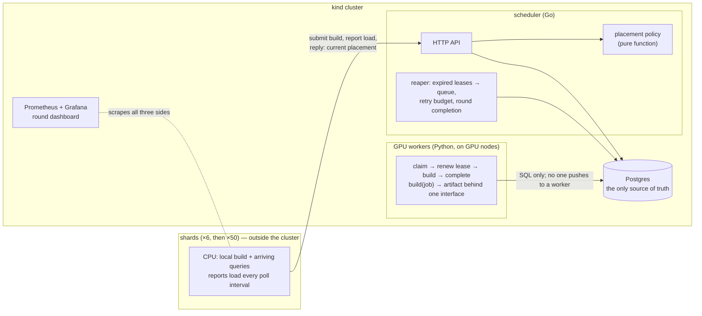

# HNSWonGPUs

A scheduler that places HNSW vector index builds from many database shards onto a small shared pool of GPU workers, or back onto each shard's own CPU, and measures which placement policy gets the whole cluster back to normal fastest.

**Status: Phases 1 and 2 are done; Phase 3 (placement policies and experiments) is in progress — the policies, the GPU finish estimator and the reconsider timer that executes preemption, reneging and speculation are built; next is the discrete-event simulator.** Phase 1 (done 2026-10-06) built the lease-based scheduler, the Postgres schema, the Python worker and the shard simulator, correct under failure at 6 and 50 shards. Phase 2 (done 2026-10-19) moved the control plane and GPU pool onto a kind Kubernetes cluster — two stand-in GPU nodes advertising countable fake GPU cards, probes, graceful shutdown, Prometheus and a Grafana round dashboard — with the shards running outside the cluster, as a database fleet would, and closed with failure injections watched live on the dashboard: a worker crashed mid-build, the scheduler pod deleted mid-round, both GPU nodes drained. The [roadmap](docs/roadmap.md) has all six phases.

## The problem

A sharded vector database receives one DDL: build an index on every shard. Each shard can build on its own CPU, which blocks the queries arriving at that shard until the build finishes, or hand the build to a shared GPU, which is faster but may already have a queue. Results are gathered from every shard, so the slowest shard sets the pace for the cluster.

Two pressures pull against each other:

- **Building locally blocks the shard.** The query backlog grows for as long as the CPU is busy.
- **Offloading to a saturated pool doesn't help.** If every GPU is busy, the build waits in a queue, and a local build might have finished sooner.

The metric is **round completion time**: from the DDL until every shard has built its index and drained the queries the build held up. The cluster's recovery time, reported as p50 and p99 over many seeded rounds.

The scheduler knows only what a real system could know: the build's size, the pool's state, and what each shard reports about its load. It never sees the future. A policy that does see the future exists only in the simulator, as an oracle to measure what not knowing costs.

## How it works



The properties the design is built around:

- **All shared state is in Postgres.** Every other process is stateless and can be killed at any time — and is, routinely, by the failure tests.
- **Workers pull.** A claim is one `UPDATE … FOR UPDATE SKIP LOCKED`. Nothing tracks which GPU is idle; an idle GPU announces itself by asking. The pool is capped by a countable per-node GPU-card resource, not by replica arithmetic.
- **Leases with a fencing token.** Every claim increments `attempt`. Every later write is guarded by `build_id` and `attempt`, so a worker that was paused past its lease and wakes up cannot overwrite the result of the worker that replaced it.
- **An idempotent reaper.** Expired leases go back to the queue; running it twice changes nothing; a build whose lease keeps expiring is parked as failed after a retry budget instead of poisoning the pool.
- **Graceful shutdown is designed, not assumed.** A deleted scheduler pod keeps answering while the cluster's routing catches up, but never stamps a round after SIGTERM, so a round's metrics can't die with the pod that recorded them; a deleted worker finishes or releases its build inside its grace period.
- **Placement can change in flight.** A local build whose shard's backlog is growing can be preempted to the GPU queue with rising priority; a queued GPU build can be moved back to local. Shards learn of changes in the reply to their own report, never by push.
- **Policies are pure functions** of the state they are given, so the live scheduler and the discrete-event simulator run the same code. The deployable ones — always-GPU, static threshold, reactive migration, reactive plus speculation — are built; a reconsider timer executes what they decide, and the clairvoyant oracle exists only in the simulator.

## How to understand this repo

Most of this code was written by an AI pair, and the documentation exists so a human can re-enter the codebase cold — months later, or mid-incident — without having watched it being written. Four layers, each answering a different question. Arrive with your question and pick the layer:

| Your question | Read | What it holds |
| --- | --- | --- |
| **Where** is this done? | [`docs/code-map.md`](docs/code-map.md) | One entry per action the system takes — decided where, written to Postgres where, reacted to where — ordered by a build's lifecycle, pointing at file + function. The re-entry point: start from "who cancels the losing copy?", not from a directory listing. |
| **Why** is it this way? | the decisions tables in [`docs/design/`](docs/design/) | Every design decision, append-only, with the alternatives considered and the argument that won. A reversal is a new row pointing at the old one, so the history of a rule is readable. |
| **What went wrong**, and what did it teach? | [`docs/bugs.md`](docs/bugs.md) | Significant bugs: symptom, cause, fix, what it would have looked like in production, and the lesson — including the ones where two correct rules composed into a deadlock. |
| **What is proven** to work? | [`docs/tests.md`](docs/tests.md), then [`test-logs/`](test-logs/) | Every test with its scenario in plain words, and the saved narrated logs — the logs read as the system telling its own story ("local build aborted at 28%: the speculative gpu copy finished first"), which is the fastest way to see behavior without running anything. |

The code map is kept current by working agreement (CLAUDE.md): any step that adds, moves or renames one of its pieces updates it. Its failure mode is silent staleness, so the standing audit is cheap and worth doing once a phase: pick one flow you care about, walk it against the map, and treat any mismatch as a bug.

## Repository

| Path | What |
| --- | --- |
| `scheduler/` | Go: HTTP API, placement policy, cost model, reaper, metrics, the store (every statement that touches the queue and leases), and the cross-check agent's black-box tests |
| `worker/` | Python: the GPU worker; `builder.py` is the one interface the fake, hnswlib and cuVS builders implement |
| `db/migrations/` | Postgres schema, applied in order on scheduler start |
| `shard/` | Go: the shard simulator — seeded workloads, local builds that block the CPU, query streams |
| `experiments/` | Seeded workload generator; the discrete-event simulator and results arrive in Phase 3 |
| `deploy/` | Docker Compose (Phase 1); kind cluster config, Kubernetes manifests and monitoring (Phase 2) |
| `scripts/` | One command per step: bring the cluster up, run rounds, inject failures, run every check |
| `docs/roadmap.md` | The plan: six phases, schema, policies, scenarios, failure tests |
| `docs/design/` | The design as built, one doc per phase: diagrams, flows, and an append-only table of every decision with the alternatives considered |
| `docs/code-map.md` | Where each important action lives: decided where, written where, reacted to where, by build lifecycle |
| `docs/bugs.md` | Significant bugs: symptom, cause, fix, what it would have looked like in production, lesson |
| `docs/tests.md` | Every test, with the scenario it checks in plain words |
| `test-logs/` | Narrated test output, saved per step |

## Testing

Tests narrate what they do and what Postgres holds at each step, so the logs read as a record of what happened. Two suites run against a throwaway Postgres container:

```
scripts/test-db.sh          # Go, then Python
scripts/test-db.sh --go     # or --py
```

The Kubernetes checks are scripted the same way (`scripts/k8s-check-*.sh`, `KGPU_KIND=1` for the Go suites) and leave their logs in `test-logs/phase2/`.

Every step is also tested by an **independent cross-check agent** that reads the design docs and writes black-box tests without reading the implementation. Its tests live in `scheduler/crosscheck/` and run with the rest. Eight of the ten entries in the bug log were found that way — including a concurrency race in the per-round cap, a 10-second shard stall hidden inside pod deletion, and a worker that crashed with its lease held — and its findings that weren't bugs became documented design decisions.

## Roadmap in one line each

1. **Scheduler with fake jobs** on Docker Compose; correct under `kill -9`, SIGSTOP, restart and duplicate submit, at 6 and 50 shards. *(done)*
2. **Kubernetes on kind** with stand-in GPU nodes and countable fake GPU cards, probes, graceful shutdown, Prometheus and Grafana; shards outside the cluster; failure injections proven on the dashboard. *(done)*
3. **Placement policies and experiments:** always-GPU, static threshold, reactive migration, speculation, and a clairvoyant oracle, compared across seeded scenarios in a discrete-event simulator. *(next)*
4. **Real CPU builds with hnswlib**, an object store for vectors and artifacts, and a measured cost model.
5. **Real GPUs with cuVS** on a small cloud node pool: cold start, spot preemption, measured GPU numbers.
6. **Kubernetes-native dispatch** with a custom resource, an operator and Kueue, compared against the hand-built scheduler.

## Toolchain

Go 1.27, Python 3.12 with uv, Postgres 17, Docker, kind, kubectl, Helm. See the Commands section of `CLAUDE.md` for the exact commands.
