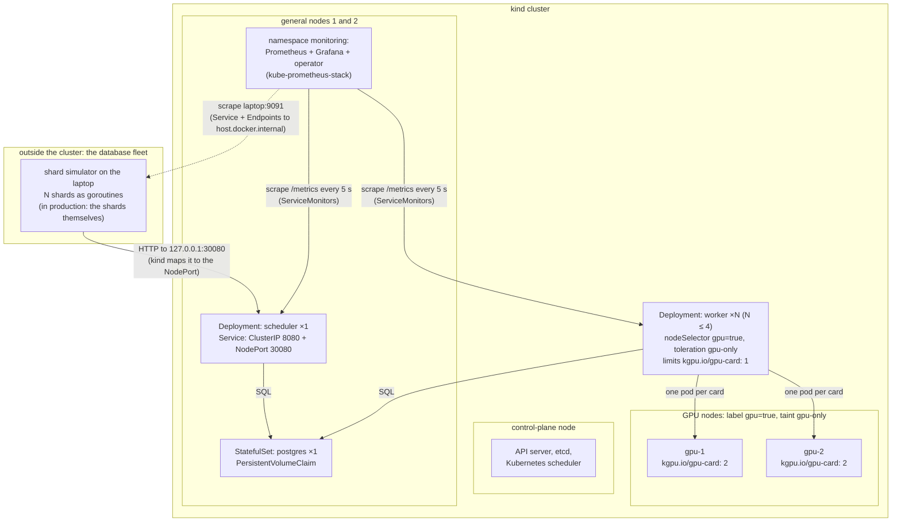
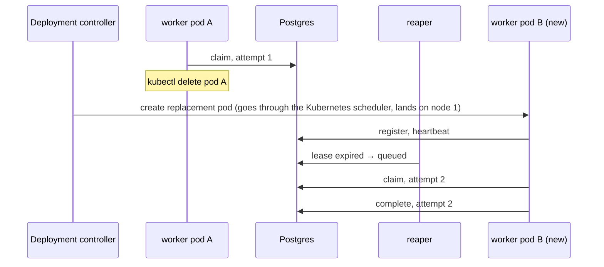
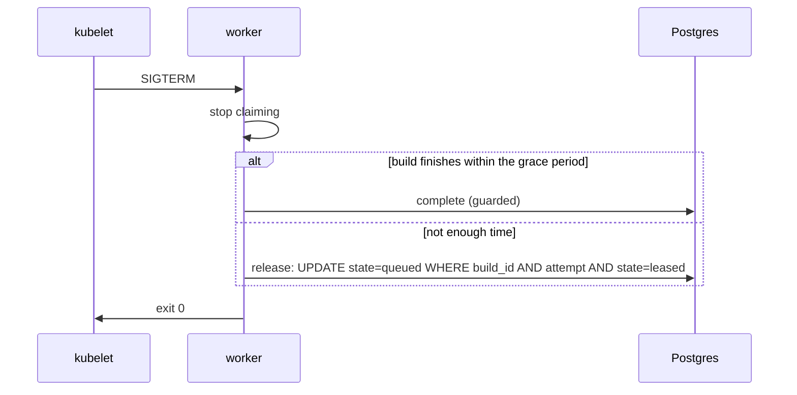

# Phase 2: Kubernetes on kind

## Status and scope

**Done (2026-10-19).** Started 2026-10-08. Steps 1 (the cluster), 2 (Postgres and the scheduler), 3 (workers), 3b (GPU cards as a resource, two GPU nodes), 4 (shards outside the cluster), 5 (metrics and dashboards) and 6 (failure injection on the dashboard), each with its cross-check. The done-when — the dashboard showing a worker pod deleted mid-round and the round still completing — is `test-logs/phase2/step6-failures-dashboard.log`, read through Grafana's datasource proxy (decision 36).

Run the Phase 1 system unchanged on a local kind cluster, with Prometheus and Grafana watching it. The scheduler code and the schema do not change. What changes is who keeps processes alive and where they run.

**Done when** the dashboard shows a worker pod deleted mid-round and the round still completing.

## System diagram

The cluster holds the control plane and the GPU pool: scheduler, Postgres, workers. The **shards are not in it.** In the real system they are the database machines, clients of the scheduler; here the shard simulator runs on the laptop and reaches the scheduler through one address, a NodePort mapped to `127.0.0.1:30080` (decisions 26, 27). One control-plane node and four worker nodes, all Docker containers on the laptop. Two nodes are labeled and tainted as the stand-in GPU pool, and each advertises two fake GPU cards as a countable resource (`kgpu.io/gpu-card`). A worker pod holds one card, so the card count caps the workers per node the same way the NVIDIA device plugin will in Phase 5; `replicas` chooses how many of the cards to use (decisions 22 to 24).

The taint keeps every pod *without the toleration* off the GPU nodes; the node selector keeps the workers *on* them. Precisely: the toleration grants access and the selector constrains, so any manifest that copies the toleration can land on the GPU node, and on an otherwise idle node the Kubernetes scheduler will even prefer it (the cross-check saw six toleration-only pods all placed there). "Only workers on the GPU node" is therefore a convention kept by not copying the toleration, not something Kubernetes enforces; an admission policy could enforce it later if it ever matters. This rehearses real GPU scheduling before any GPU exists. The card resource completes the rehearsal: a pod requests one card, the scheduler subtracts it from the node's count, and a worker beyond the card total stays Pending with "Insufficient kgpu.io/gpu-card", exactly the message a real cluster gives for `nvidia.com/gpu`. Phase 5 changes the resource name and nothing else. On the laptop the NodePort is reachable only as `127.0.0.1:30080` because Docker Desktop does not route the kind network to the host; on a Linux host every node's IP on 30080 would answer too. The design claim is only that the shards use one URL. Like the toleration, the cards are a convention as far as *who* may use them: any pod that requests `kgpu.io/gpu-card` gets one if free, and a pod that copies the toleration and selector without requesting a card lands on a full GPU node (the step 3b cross-check did both). The resource caps pods that request it; it does not reserve the cards for workers. An admission rule would, if it ever matters.

## Flows

### Worker pod deleted mid-build

Two independent recoveries run at once. Kubernetes restores the worker count; the lease path restores the build.

### Graceful shutdown on SIGTERM

Kubernetes sends SIGTERM, waits `terminationGracePeriodSeconds`, then SIGKILL. The worker uses that window instead of making the reaper wait for the lease to expire.

## Design decisions

| # | Decision | Alternatives | Why |
| --- | --- | --- | --- |
| 1 | Workers are a Deployment of long-running pullers | One Kubernetes Job per build | Keeps Phase 1's pull loop unchanged. Per-build Jobs is a different dispatch model; Phase 6 compares the two. |
| 2 | Scheduler runs with one replica, but is written so two are safe | Leader election | The reaper is an idempotent conditional `UPDATE`; two reapers change nothing extra. The API is stateless. Leader election is complexity with nothing to protect. |
| 3 | Postgres as a StatefulSet with a PVC | Managed database outside the cluster | Keeps the everyday environment self-contained on a laptop. A PVC survives pod restarts; the Postgres-restart failure test depends on it. |
| 4 | Shards as a StatefulSet with 10 simulated shards per pod, with CPU requests and limits | One pod per shard; or a Deployment | Stable pod names give stable shard IDs. Limits now mean local builds compete for real CPU in Phase 4 without changing manifests. |
| 5 | Stand-in GPU node via label + taint from the start | Add node constraints only in Phase 5 | The scheduling rehearsal is the point of Phase 2. The Phase 5 change is then one added resource request. |
| 6 | Readiness = can reach Postgres; liveness = process responds | No probes | Readiness keeps a worker that cannot claim from counting as live. Liveness catches a hung worker, which a lease also catches but slower. |
| 7 | Retries with backoff on every Postgres call | Crash and let Kubernetes restart | A Postgres restart would otherwise crash-loop every service. Retrying is cheaper and keeps leases alive across a short outage. |
| 8 | kube-prometheus-stack via Helm, ServiceMonitor per service | Hand-written Prometheus config | The chart is the standard way; the project is not about running Prometheus. |
| 9 | **Cluster shape in one kind config file:** one control-plane node, two general workers, one node labelled `kgpu.io/gpu=true` and tainted `kgpu.io/gpu=true:NoSchedule` at join time through a `kubeadmConfigPatches` block; labels in the config, the taint in the patch | Taint by `kubectl` after creation | Declarative and reproducible: `scripts/kind-up.sh` recreates the same cluster from the file, and the GPU node is never untainted for a moment after boot. The label and taint keys are the ones Phase 5's real GPU pool will carry. |
| 10 | **The step's proof is a scheduling check, not a deployment:** throwaway pods without the toleration must avoid the GPU node, a worker-shaped pod must land on it, and a selector-only pod must stay Pending with the taint cited | Trust the config | `scripts/kind-check-gpu-node.sh` is rerun whenever the cluster is recreated; the Pending case shows the taint doing the repelling, not luck. |
| 11 | **Readiness and liveness are different endpoints.** `/healthz` pings Postgres and is the readiness probe (decision 6: a scheduler that cannot reach the database takes no traffic); `/livez` answers unconditionally and is the liveness probe | One endpoint for both | If liveness depended on Postgres, a database outage would make the kubelet restart a perfectly healthy scheduler every ten seconds. Observed in the step 2 check: Postgres deleted, the scheduler logged reaper errors, stayed up with restart count 0, and recovered on the next tick. |
| 12 | **Manifests are plain YAML under `deploy/k8s/`, applied as one unit with kustomize; images are built locally, tagged `:dev`, loaded into kind with `kind load docker-image`, and pulled `IfNotPresent`** | Helm chart for our own services; a registry | Six files is not a chart. kind nodes cannot see the laptop's images, and `:latest` would make the kubelet try a registry. Phase 5's managed cluster needs a registry; the manifests change only in the image reference. |
| 13 | **Postgres is a one-replica StatefulSet behind a headless Service, with `PGDATA` in a subdirectory of the claimed volume** | A Deployment with a PVC; a managed database | A StatefulSet gives the pod a stable name and a claim that outlives it (the step 2 check deletes the pod and finds the rounds still there). The headless Service makes `postgres` resolve to the pod itself. `PGDATA` must be a subdirectory because the mount point is not empty. |
| 14 | **The scheduler needs no retry wrapper around its Postgres calls beyond reconnecting.** Shards retry their calls (decision 61 in Phase 1), the reaper runs every tick, and pgx's pool re-establishes broken connections | Retry with backoff inside every store call (the roadmap's wording) | During the Postgres outage every scheduler call failed for a few seconds, clients retried, the reaper's next tick succeeded, and nothing was lost; a per-call retry would only have hidden the outage from the logs. The roadmap item is satisfied by the pieces that already exist. |
| 15 | **Migrations report what they did:** the scheduler logs `migrations checked` with the files applied by this process, how many were already there, and how long the advisory lock took | Silent migrations | With two replicas starting together the logs could not show which one applied the schema or that the other waited on the lock; the cross-check had to read `pg_locks` to see it. (Cross-check gap.) |
| 16 | **The worker serves its probes from a thread of its own:** `/livez` always 200, `/healthz` 200 only if a heartbeat to Postgres succeeded within three heartbeat intervals | Reuse the main loop; probe via `exec` | A worker thirty minutes into a build must still answer liveness, and readiness must track Postgres, not the build. Verified mid-build in the step 3 check. |
| 17 | **`WORKER_ID` is the pod name, from the downward API** | The hostname (what Compose used) | On Kubernetes the hostname is the pod name anyway, but saying so explicitly gives a readable, unique id per replica, and a replaced pod gets a new one. |
| 18 | **The worker image carries its own init (tini at PID 1)** | Rely on the platform's init flag | Compose had `init: true`; Kubernetes has no such flag. Without an init, python is PID 1 and an in-container SIGKILL is dropped by the kernel: the first version of the step 3 crash test killed nothing. tini also forwards SIGTERM and reaps zombies. |
| 19 | **The crash test on Kubernetes is an in-container kill of the worker process, not a forced pod deletion.** `kubectl delete pod --grace-period=0 --force` still delivers SIGTERM before the kill, so the worker's release path runs and no lease expires; it is a graceful stop in disguise. The in-container kill exits the container with 137, the lease expires, the reaper requeues, and the kubelet restarts the container in place | Treat forced deletion as the crash | Measured: forced deletion gave attempt 2 in 8 s with zero lease expiries; the in-container kill gave attempt 2 in 17 s (10 s lease plus the 6.5 s build) with one expiry and restart count 1. The script keeps the forced deletion as a documented observation. |
| 20 | **The worker's liveness probe carries its own `terminationGracePeriodSeconds: 5`** | Inherit the pod's 30 s | A process the liveness probe has declared hung cannot act on SIGTERM; waiting the pod's full grace period before SIGKILL meant a frozen worker took 52 s to restart (cross-check). The lease path was unaffected (reaped at 10 s); this only shortens how long a dead container occupies the slot. |
| 21 | **`GET /workers` lists every registered worker with a `live` flag; `pool` counts only the live ones** | List only live workers | An operator wants to see who went quiet; the policy wants the live count. Both from one call. (Cross-check gap.) |
| 22 | **GPU cards are a countable node resource.** `scripts/kind-up.sh` advertises `kgpu.io/gpu-card: CARDS_PER_NODE` on every GPU node as a Kubernetes *extended resource* (a status patch, the same mechanism the NVIDIA device plugin uses for `nvidia.com/gpu`), and each worker pod requests one. Kubernetes itself then caps the workers per node at the card count and reports "Insufficient kgpu.io/gpu-card" beyond it | Pod anti-affinity to force one worker per node; nothing, leave the count to `replicas` | Anti-affinity encodes "one per machine", which is an assumption the owner rejected (decision 23). The resource encodes "one per card", which is physics: a card runs one build at a time (CLAUDE.md modeling assumption). Phase 5 renames the resource; the manifests are otherwise final. |
| 23 | **How many workers to run per card and per machine is an experiment parameter, not a design assumption.** The cluster is described as machines × cards; `replicas` picks how many cards are in use; the Phase 3 cost model gets a per-node shared transfer bandwidth term; Phase 5 measures workers per node at a fixed card count; more than one worker per card is the device plugin's time-slicing setting, also a number | Fix one worker per machine (the first instinct: "maximise one GPU's speed"); fix one worker per card | Workers on one box share its network link, PCIe bus, host CPU and RAM, and every build starts by streaming its vectors in. Whether a second card on a box adds a second card's throughput depends on the transfer-to-build ratio, which depends on the dimension (published figures: transfer is noise at 128 dims and binds at 1536). That is a measurement, so the system must not hard-code the answer. |
| 24 | **Cluster shape: two stand-in GPU nodes with two cards each** (`deploy/kind/cluster.yaml`, `CARDS_PER_NODE`), modelling two small GPU machines; refines decision 9 | Keep one GPU node (the step 3 shape, "one box with two cards") | Index builds have the *inference* shape (each build fits one card, cards never talk to each other, the bottleneck is the network into the card), and inference fleets are mostly one or two cards per server or small cloud VMs; the eight-card boxes are the training shape. Two nodes also make a drain halve the pool instead of emptying it, which is the `shrinking_pool` scenario Phase 3 cares about. |
| 25 | **Worker registration waits for the schema.** An `UndefinedTable` on the first heartbeat is "not yet", retried with backoff; readiness stays 503 meanwhile | Crash and let Kubernetes restart the pod (what happened) | Kubernetes has no startup ordering between Deployments; Compose's `depends_on: service_healthy` had been doing load-bearing work nobody wrote down. Bug 9. |
| 26 | **The shards run outside the cluster.** The shard simulator is a client on the laptop, as the database fleet would be; the cluster holds only the control plane and the GPU pool. Reverses the roadmap's "shards as a StatefulSet with CPU limits" | Shards as a StatefulSet in their own namespace, labelled as a stand-in fleet (keeps Kubernetes CPU limits for Phase 4 and in-cluster scraping) | The owner's correction (2026-10-18): the honest topology has the shards where the database is, reaching the scheduler over the network, and the Kubernetes work should cover what one would deploy. Phase 4's real CPU builds then run on the laptop's CPU, which is where the shard's CPU is; fifty shards will contend for it regardless, just without Kubernetes metering. If metering matters, a per-process cap on the simulator or a revisit then. |
| 27 | **The scheduler is reachable from outside through a NodePort** (`type: NodePort`, port 30080), which kind maps to the laptop with `extraPortMappings` on the control-plane node; the in-cluster `scheduler:8080` address is unchanged | `kubectl port-forward` only (what the checks used); an Ingress controller | A port-forward is a debugging tool that dies with its terminal; the shards need a stable address. An Ingress is the production answer for HTTP but adds a controller for no gain on kind. On a real cluster this becomes a LoadBalancer or Ingress and the shards' `SCHEDULER_URL` changes; nothing else does. |
| 28 | **Shard-side metrics come from the shard, scraped from outside the cluster; scheduler-side metrics come from the scheduler.** The simulator exposes `/metrics` on the laptop and Prometheus is given the Docker host address to pull from, as a fleet's monitoring would be pointed at the shards; `build_duration_seconds{placement=local}` and per-shard queue and wait numbers come from there. Round, queue, placement and lease metrics come from the scheduler's own state, which is the view the dashboard should show | A push gateway in the cluster (one more component, inverts the pull model for one process); deriving local build durations from the scheduler's submit and done timestamps (the scheduler's view at report cadence, not the shard's measurement) | Owner's choice (2026-10-18) after decision 26 moved the shards outside. Scraping the laptop is kind-specific in its address only; the shape is the production one. |
| 29 | **A deleted scheduler pod keeps serving for `SHUTDOWN_DELAY` (3 s) after SIGTERM, and the shard client bounds one connection attempt with a 2 s `DialTimeout`** separate from its 10 s request timeout | A `preStop: sleep` hook (same effect; the image has no shell); accept the stall | Bug 10: endpoint removal is eventually consistent across nodes, so a server must outlive its removal from the Service by the propagation time, or connections are black-holed until the client's timeout. Measured: a 10.5 s stall per deletion became zero retries. |
| 30 | **A shard client that cannot reach the scheduler waits without limit before its first round** (the simulator's `MIN_WORKERS` wait and the client's "scheduler not ready, retrying" loop have no deadline; `ROUND_TIMEOUT` applies only once a round has started) | A startup deadline that exits non-zero | A database shard does not give up on its control plane; it keeps reporting until the scheduler is back, and a loud log line every minute is the right signal. The cross-check raised it as a gap; it is intended, and now written down. |
| 31 | **Round metrics are observed where a round is stamped finished, in both places that do it:** the reaper's tick and `GET /rounds/{id}`, which stamps on read so a polling shard never sees a stale "open". `store.FinishCompleteRounds` returns the closed rounds with duration, straggler lag (last shard's finish minus the median's, computed in SQL) and every GPU build's queue wait; `metrics.ObserveFinishedRounds` records them | Observe only in the reaper (the first version; it missed every round a shard's poll had already closed, so `round_duration_seconds_count` stayed 0 while rounds completed); have the worker observe queue wait at claim | One function, called by both closers, observes each round exactly once. Queue wait therefore lands at round end, a few seconds late for a dashboard but on the same clock as the round. |
| 32 | **Scrape wiring:** a ServiceMonitor per in-cluster service (`scheduler`, and a new headless `worker` Service that exists only so the workers' probe port can be found); for the shards on the laptop a selector-less `shards` Service plus a hand-written `Endpoints` object carrying the laptop's address as the kind nodes resolve `host.docker.internal`, filled in by `scripts/k8s-monitoring-up.sh` | A PodMonitor for the workers; `additionalScrapeConfigs` with a static address for the shards; an `EndpointSlice` instead of `Endpoints` | PodMonitor works too; a Service keeps one pattern for everything. The static config would bypass the operator's model. The EndpointSlice was tried first and the operator did not discover it: ServiceMonitor targets come from `Endpoints`, so the older kind is the one that works, deprecation warning included. |
| 33 | **Dashboards are reached by `kubectl port-forward`** (`scripts/k8s-dashboards.sh`: Grafana on 3000, Prometheus on 9090), not a NodePort | NodePorts mapped in the kind config (another cluster rebuild) | The dashboards are for a person at this laptop; the shards needed a stable address because they are clients of the system. Different audiences, different doors. |
| 34 | **kube-prometheus-stack trimmed for a laptop:** no Alertmanager, no node-exporter, no bundled alert rules, no scrapes of the control-plane components; kube-state-metrics kept for pod restart counts; 5 s scrape interval, 2-day retention; the chart told to pick up every ServiceMonitor in the cluster, not only its own release's | The chart's defaults | The defaults are a production cluster's monitoring and most of it would show red on kind (no node-exporter mounts, unreachable control-plane ports). What is kept is what Phase 2's done-when needs: our metrics, pod restarts, a dashboard. |
| 35 | **Every metric series exists from the first scrape:** label combinations are pre-created at startup (`metrics.Init` in Go, module import in Python) | Let a series appear on its first increment | A dashboard reading a counter that does not exist yet shows a gap, not zero; the first version of the API test failed on exactly this. |
| 36 | **"The dashboard shows it" is proven through Grafana's datasource proxy:** the step 6 check reads every number via `/api/datasources/proxy/uid/<prometheus>`, Grafana forwarding the query to the same datasource the panels read, so the saved log records what the dashboard served | Query Prometheus directly (a parallel channel that could disagree with what Grafana sees); screenshot the panels (not assertable, not diffable) | One channel, assertable, and it exercises Grafana's auth and datasource wiring on every check |
| 37 | **Counter panels read windowed `increase()`, not raw sums:** the lease-expirations panel is `sum(increase(lease_expirations_total[2m])) by (outcome)`, retitled "(2m windows)" | Keep `sum(lease_expirations_total)` and retitle "(since this scheduler pod started)" | A counter lives in process memory, so a panel summing current series falls to zero when the pod is replaced: the step 6 cross-check recorded an expiry, deleted the scheduler pod, and the "(total)" panel showed 0 — an incident's evidence erased by the deploy that often follows it. `increase()` spans the replacement (each pod's series contributes its own growth) and detects in-series resets from container restarts. Same family as the step 5 cross-check's per-pod stat finding. The mean-round-duration stat still reads NaN on a fresh pod until its first round; accepted. |
| 38 | **A one-node drain can empty a two-replica pool; refines decision 24.** "A drain halves the pool" holds when every card is in use (the cross-check measured 4 → 2, held at 2). With fewer replicas than nodes, Kubernetes may co-schedule all workers on one node — decision 22 chose cards over anti-affinity, so nothing spreads them, and in three of three two-replica runs they sat together — and a one-node drain then empties the pool for the sub-second rescheduling takes (API `live_workers=0` for ~0.5 s; the 5 s scrape usually misses it). Builds are released and complete once throughout. Whether to add a soft spread (`topologySpreadConstraints` with `whenUnsatisfiable: ScheduleAnyway`) is the owner's call, in the open questions; the systemic answer to an empty pool is Phase 3's CPU fallback | Add the spread rule now; silently reword decision 24 | Changing scheduling behaviour without asking breaks the working agreement, and the `shrinking_pool` scenario would need re-measuring either way |
| 39 | **Workers get a soft spread across GPU nodes:** `topologySpreadConstraints` on the worker pod template (`maxSkew: 1`, `topologyKey: kubernetes.io/hostname`, `whenUnsatisfiable: ScheduleAnyway`), owner's decision (2026-10-19) resolving the question decision 38 raised. Verified live: a fresh replacement pod lands on the emptier node; with one node cordoned the replacement still schedules by packing (nothing goes Pending), so decision 22's packing experiments stay legal. **Caveat observed on the very first rollout:** the spread is evaluated only when a pod is scheduled — a rolling update can still pack, because the old pods hold the drained node's cards while terminating and Kubernetes never moves a running pod to fix skew. The guarantee is "fresh scheduling prefers balance", not "the pool is always balanced" | `podAntiAffinity` with `preferredDuringScheduling` (per-pod pairwise preference, no skew bound, the thing decision 22 rejected in hard form); `whenUnsatisfiable: DoNotSchedule` (a 1-node cluster or a cordon would strand a replica Pending) | Decision 24's "a drain halves the pool" now holds at 2 replicas on the usual path, while the soft rule changes nothing at 4 replicas (every card in use forces 2 per node anyway) and never blocks scheduling |

## Implementation notes

### Step 1: the cluster (done 2026-10-08)

| Path | What |
| --- | --- |
| `deploy/kind/cluster.yaml` | The cluster: control plane, two general workers, one GPU node with label and join-time taint (decision 9). |
| `scripts/kind-up.sh`, `scripts/kind-down.sh` | Create (idempotent) or delete the `kgpu` cluster. |
| `scripts/kind-check-gpu-node.sh` | The scheduling check (decision 10); saves `test-logs/phase2/step1-kind-cluster.log`. |

Toolchain added: kind 0.33, kubectl 1.37, Helm 4.3 (Homebrew).

Observed on the first run: six plain pause pods spread over the two general nodes, none on the GPU node; the worker-shaped pod landed on `kgpu-worker3`; the selector-only pod stayed Pending, the scheduler's event reading "2 node(s) didn't match Pod's node affinity/selector, 2 node(s) had untolerated taint(s)".

### Step 2: Postgres and the scheduler (done 2026-10-08)

| Path | What |
| --- | --- |
| `deploy/k8s/namespace.yaml`, `postgres.yaml`, `scheduler.yaml`, `kustomization.yaml` | The `kgpu` namespace; Postgres as a Secret, a headless Service and a StatefulSet with a 2 GiB volume claim and `pg_isready` probes; the scheduler as a ConfigMap, a Service and a Deployment with `/healthz` readiness and `/livez` liveness (decisions 11 to 13). |
| `scheduler/api` | `GET /livez`. |
| `scripts/k8s-build-load.sh`, `scripts/k8s-up.sh` | Build the three images, load them into kind; apply the manifests and wait for the rollouts. |
| `scripts/k8s-check-step2.sh` | The step's check; saves `test-logs/phase2/step2-postgres-scheduler.log`. |

### Cross-check of steps 1 and 2 (2026-10-08)

A fresh agent deployed its own copy of the stack into a `kgpu-xcheck` namespace, with the scheduler at two replicas, and tested through `kubectl` and the API. 9 tests, all passed. Beyond the implementer's scripts: two replicas started together on an empty database four times, applying exactly four migrations each time with no restarts; with the test holding advisory lock `0x4B475055` for 25 s, `pg_locks` showed both replicas waiting, no table was created, and neither became ready until the release; a Postgres outage held 45 s, past the liveness budget, during which `/healthz` returned 503 on 41 of 41 samples, `/livez` 200 on every one, the pod left the Service's endpoints at 8 s and the restart count stayed 0; the whole StatefulSet deleted and re-applied reattached the same claim with the rounds intact; a SIGKILL of the scheduler process from the node (the image has no shell) was restarted in place by the kubelet (exit 137, restart count 1, ready in 1.7 s); DNS for the headless and normal Services resolved as designed; a `nvidia.com/gpu` request stayed Pending as the Phase 5 difference.

| Finding | Resolution |
| --- | --- |
| A toleration alone lands a pod on the GPU node, and the scheduler prefers that node when it is idle; "only workers there" is a convention. | Stated in the system diagram text above. |
| Migrations are invisible in the logs. | Decision 15: `migrations checked` log line with the files applied, the count already present, and the lock wait. |
| NotReady arrives about 8 s after the database vanishes, from the unstated default `failureThreshold`. | Made explicit in the manifest with a comment. |
| Two replicas are untested under the reaper (needs workers). | Step 3. |
| Deleting the whole StatefulSet was not in the step 2 check. | The agent's test covers it; recorded here. |

Observed in the step 2 check: the scheduler pod connected, applied all four migrations and listened; the API answered through the Service via a port-forward; deleting the scheduler pod produced a replacement with a new name on which `GET /rounds/1` still returned the round (the data was never in the pod); deleting `postgres-0` brought it back on the same claim with the rounds intact, while the scheduler logged `reap failed` and `finish rounds failed` with a DNS error for the missing pod, kept restart count 0, and served a new round once Postgres was back.

Metric names are fixed in the roadmap (Phase 2, Metrics) and are a contract between phases; do not rename them.

## Notes from the published build-time figures (2026-10-06)

Real builds are minutes on a GPU and hours on a CPU (see the Phase 1 doc, "Cost model v0 against published numbers"). Three consequences for this phase:

- **Probes must not depend on the build thread.** A worker in a 30-minute GPU build must still answer its liveness and readiness probes; the probe endpoint runs on its own thread, like the heartbeat does today, and a probe failure must mean the process is stuck, not that it is busy.
- **`terminationGracePeriodSeconds` stays short and release is the norm.** A build that takes minutes cannot finish inside any sane grace period, so on SIGTERM the worker releases (decision 37's budget stays a few seconds); the grace period only needs to cover the release write. Draining a GPU node therefore costs the in-flight builds' progress, which is the number Phase 5 measures under spot preemption.
- **Shard CPU limits must leave room for a local build's threads.** Hours-long local builds at 2 threads are the modeled case; a limit below that silently changes the cost model. Set requests and limits so the local build gets its modeled threads.

### Step 3: the workers (done 2026-10-08)

| Path | What |
| --- | --- |
| `worker/kgpu_worker/health.py` | The probe server thread (decision 16); `HEALTH_ADDR`, default `:8081`. |
| `worker/Dockerfile` | tini as PID 1 (decision 18). |
| `deploy/k8s/worker.yaml` | ConfigMap with test-friendly values (10 s lease, 10x fake builds), a Deployment of two replicas with the GPU node selector and toleration, `WORKER_ID` from the pod name, probes on 8081, a 30 s termination grace period. |
| `scripts/k8s-check-step3.sh` | The step's check; saves `test-logs/phase2/step3-workers.log`. |

Observed: both workers on `kgpu-worker3`, registered under their pod names; a 2M-vector build done at attempt 1 with both probes answering 200 mid-build; a graceful deletion mid-build released the build within a second and the replacement landed on the GPU node, the build finishing at attempt 2 once; an in-container kill expired the lease and the build finished at attempt 2 once, 17 s later, with the container restarted in place; a forced deletion ran the release path (decision 19).

### Cross-check of step 3, the workers (2026-10-08)

A fresh agent deployed its own stack into `kgpu-xcheck` and ran 9 subtests, all passed, saved as `test-logs/phase2/step3-crosscheck-kind-workers.log`. Beyond the implementer's check: three replicas leased three builds at once and a scale-down released the long one and deregistered within a second; with two scheduler replicas, two leaseholders SIGKILLed at the same moment produced exactly one reap line per build across both schedulers and one completion each; a 40 s Postgres outage mid-build gave readiness 503 from about 8 s with liveness 200 on 38 of 38 samples, no restarts, the attempt lost to the lease deadline and recovered once Postgres returned (Phase 1 decision 48 on Kubernetes); a SIGSTOP'd worker was caught by liveness while the reaper recovered its lease at 10 s; SIGTERM with 3 s left finished the build and with 7 s left released it; draining the GPU node evicted both workers through the release path, left five builds queued with replacements Pending on the taint, and uncordoning drained the queue with every build completed once.

The agent disclosed that one exploratory `kubectl apply` landed on the `kgpu` namespace with an unmodified render because macOS `sed` silently ignored a `\s` pattern; the objects were unchanged except an annotation, no pod restarted, and the rewrite was redone with perl and verified.

| Finding | Resolution |
| --- | --- |
| A hung worker took 52 s to restart: liveness fired at 30 s, then SIGTERM to a stopped process waited the pod's 30 s grace. | Decision 20: a 5 s grace on the liveness probe. |
| `/workers` listed a frozen worker while the pool counted one. | Decision 21: a `live` flag per worker. |
| Two reapers were never seen contending: the same replica logged every reap and an idle tick logs nothing. | Per-replica `lease_expirations_total` in step 5 makes it visible. |
| The readiness threshold is "within three heartbeat intervals" measured from the last *successful* heartbeat; the probe period adds up to one interval, so the first 503 lands 2 to 3 intervals after the last success. | Stated here. |
| A Postgres outage longer than the lease always costs the in-flight attempt (decision 48 working as designed). | Noted beside the roadmap's "Restart Postgres" item. |
| The drain checklist item is answered for workers; the dashboard view is pending. | Roadmap ticked with the note. |

### Step 3b: GPU cards as a resource, two GPU nodes (done 2026-10-17)

Prompted by the owner's question whether the design assumed one GPU machine with two workers on it, and the follow-up that the worker count should be measured, not assumed (decisions 22 to 24).

| Path | What |
| --- | --- |
| `deploy/kind/cluster.yaml` | A second GPU node, same label and join-time taint. |
| `scripts/kind-up.sh` | Advertises `kgpu.io/gpu-card: CARDS_PER_NODE` (default 2) on every GPU node by patching the node's status, waits for the kubelet to copy capacity into allocatable, prints the card table. Idempotent. |
| `deploy/k8s/worker.yaml` | `limits: kgpu.io/gpu-card: "1"` per worker (an extended resource must have request = limit, so only the limit is set). |
| `scripts/k8s-check-gpu-cards.sh` | The step's check; saves `test-logs/phase2/step3b-gpu-cards.log`. |
| `scripts/kind-check-gpu-node.sh`, `scripts/k8s-check-step3.sh` | Now accept a set of GPU nodes. Rerun on the rebuilt cluster together with the step 2 check; all pass. |
| `worker/kgpu_worker/worker.py` | Registration waits for the schema (decision 25, bug 9), found on the first deploy to the rebuilt cluster. |

Observed: both GPU nodes advertise 2 cards, no other node advertises any; two workers run one per node, each holding one card, the node's allocated count matching its worker count; scaled to 4, every card is used, two workers per node, and the pool shows 4; scaled to 5, the fifth pod stays Pending with "2 Insufficient kgpu.io/gpu-card, 1 node(s) had untolerated taint(s), 2 node(s) didn't match Pod's node affinity/selector" and the pool stays 4; scaled back to 2, two cards are allocated and the pool returns to 2. The kubelet takes a few seconds to copy a patched capacity into allocatable; `kind-up.sh` waits for it.

Kubernetes placed the two default workers one per node without being asked (the scheduler spreads a Deployment's pods by default), so the default configuration already is "two machines, one card each in use". That is a preference, not a guarantee; the card resource is the guarantee. *(Correction, step 6 cross-check: the "default spread" was luck — in three of three later 2-replica runs the scheduler co-scheduled both workers on one node, decision 38. Decision 39 adds the preference explicitly.)*

### Cross-check of step 3b, GPU cards (2026-10-17)

A fresh agent deployed its own stack into `kgpu-xcheck`, scaled the implementer's workers to zero for the run (cards are cluster-wide) and restored them, and ran 8 subtests, all passed, saved as `test-logs/phase2/step3b-crosscheck-kind-cards.log`. Beyond the implementer's check: the stack applied in reverse order (workers first, 45 s with no Postgres Service, then Postgres held 50 s with an empty schema, then the scheduler) left the workers at restart count 0, not ready, logging `postgres not ready` then `schema not ready`, and registered 1.1 s after the scheduler became ready (decision 25); a worker killed in-container while all cards were allocated kept its card through the restart and the Pending fifth replica never got it; a pod requesting two cards stayed Pending with one card free on each of two nodes and landed once a node had two free (cards do not add up across nodes); a node's capacity patched down below use evicted nothing and left the node over-allocated until a pod left; draining one GPU node with four long builds in flight evicted exactly its two workers, which released their builds, while the other two kept building, the pool halved to 2, replacements stayed Pending, and after uncordon every build finished once (decision 24).

| Finding | Resolution |
| --- | --- |
| Nothing reserves the cards for workers: any pod requesting the resource gets a card, and a pod with the toleration but no request lands on a full node. | Stated beside the diagram: the cards, like the toleration, are a convention; the resource caps requesters, it does not reserve. |
| Capacity is a status patch the cluster does not check; lowering it below use evicts nothing. Does it survive a kubelet restart? | Tested after the run: `docker restart kgpu-worker4` (the node container, so its kubelet) came back with capacity and allocatable still 2; the kubelet preserves extended resources it did not advertise. `kind-up.sh` re-applies it anyway. The over-allocation behaviour is the same a real device plugin shows when a card drops: running pods keep theirs. |
| A missing Postgres Service at startup (not just a missing schema) is not in decision 25's text. | Covered by the connect retry from bug 7; the reverse-order test is the evidence. Recorded here. |
| One implementer worker showed restart count 1 before the run. | From the step 3 check's in-container kill, rerun earlier that day. |

### Step 4: the shards, outside the cluster (done 2026-10-18)

| Path | What |
| --- | --- |
| `deploy/k8s/scheduler.yaml` | Service `type: NodePort`, `nodePort: 30080` (decision 27). |
| `deploy/kind/cluster.yaml` | `extraPortMappings` 30080 on the control-plane node, bound to 127.0.0.1. One more cluster rebuild. |
| `scripts/k8s-round.sh` | Runs simulator rounds from the laptop against `http://127.0.0.1:30080`: scales the workers, waits for the pool, checks the time scales agree, runs, prints the timeline, the round rows from the API and the pod logs. `KILL_WORKER=1` deletes the leaseholder of the largest leased build mid-round. |
| `scripts/k8s-check-step4.sh` | Three runs; saves `test-logs/phase2/step4-shards-outside.log`. |

Observed: no shard pods exist in the cluster; the simulator on the laptop completed a 6-shard, 2-worker round (3.0 s real, 30 s modeled, all 3412 queries recorded and finished), a 50-shard, 2-worker round with a worker pod deleted mid-round (the pod finished the 200k build it held inside its 5 s budget and exited, the replacement joined and claimed two builds in the same round, all 50 builds done at attempt 1, 30388 queries finished, 7.8 s real), and a 50-shard, 4-worker round using every card (4.3 s real, 43 s modeled). The workers on the rebuilt cluster started with restart count 0: decision 25 held on a fresh deploy where bug 9 had bitten the day before.

The roadmap's "Delete a worker pod mid-build" failure-injection item is answered as far as correctness goes (the round completed, nothing twice); its dashboard view is step 6. Fake builds at 10x are under a second, so a graceful deletion lands on the finish path; the release path under a real round was shown in the step 3 cross-check with 8M-vector builds.

### Cross-check of step 4, shards outside the cluster (2026-10-18)

A fresh agent ran 7 subtests from the laptop against the `kgpu` stack, all passed, saved as `test-logs/phase2/step4-crosscheck-kind-outside.log`. Beyond the implementer's check: from the laptop only `127.0.0.1:30080` answers (the ClusterIP, pod IP, node IPs on 30080 and the LAN address do not), while inside the cluster `scheduler:8080` and every node's 30080 answer; a bimodal round's queries matched the seeded workload exactly (counts, `needs_index`, durations, arrivals at most 2 ms late); two simulators with different seeds ran overlapping rounds with no leakage between them; with the workers at zero a `MIN_WORKERS=1` simulator started no round and a `MIN_WORKERS=0` one left its builds queued, both completing after the scale-up; a 50-shard `downstream_heavy` round on 4 workers spread 12/13/13/12 across them; a simulator pointed at the ClusterIP or pod IP created no round and retried without limit; and **deleting the scheduler pod mid-round stalled the shards 10.5 s though the replacement was ready in 1.3 s**, which became bug 10.

| Finding | Resolution |
| --- | --- |
| The scheduler deletion costs the shards about 10 s, not 1 s. | Bug 10, decision 29: shutdown delay and dial timeout. Re-measured at zero retries; the step 4 check now has this run as its item 4. |
| A simulator that cannot reach the scheduler waits forever. | Decision 30: intended for a fleet client; documented. |
| "One address" holds partly because Docker Desktop does not route the kind network to the host; on Linux the node IPs on 30080 would also be a way in. | Stated beside the diagram. The claim that matters is the design one: the shards use one URL; which addresses *also* answer is the host's networking. |
| Decision 4 and two open questions still described shard pods. | Decision 26 supersedes 4 (append-only table); the open questions are replaced below. |

### Step 5: metrics and dashboards (done 2026-10-18)

| Path | What |
| --- | --- |
| `scheduler/metrics/metrics.go` | The scheduler's metrics (roadmap names) and `ObserveFinishedRounds`, `Init`. `/metrics` served by the API. |
| `scheduler/store/store.go` | `FinishCompleteRounds` returns `[]FinishedRound` (duration, straggler lag, queue waits); `Stats` for the gauges. |
| `scheduler/reaper/reaper.go` | Lease-expiration counter, round observation, gauges (`gpu_queue_depth`, `builds_leased`, `rounds_open`, `gpu_workers_live`) every tick. |
| `worker/kgpu_worker/metrics.py`, `health.py`, `worker.py` | `build_duration_seconds{placement=gpu}`, `worker_busy`, `builds_total{outcome}`; `/metrics` on the probe port. New dependency `prometheus-client`. |
| `shard/sim/metrics.go`, `shard.go`, `shard/cmd/shardsim/main.go` | `build_duration_seconds{placement=local}`, `local_builds_aborted_total`, `query_wait_seconds{needs_index}`, `queries_total{kind}`, `shard_queue_depth{shard}`, `shards_active`; served at `METRICS_ADDR` (default `:9091`) on the laptop. New Go dependency `prometheus/client_golang`. |
| `deploy/monitoring/values.yaml`, `servicemonitors.yaml`, `dashboard-kgpu.yaml` | The trimmed chart values (decision 34); ServiceMonitors and the laptop target (decision 32); a 17-panel Grafana dashboard as a ConfigMap the sidecar loads. |
| `deploy/k8s/worker.yaml` | The headless `worker` Service. |
| `scripts/k8s-monitoring-up.sh`, `k8s-dashboards.sh`, `k8s-check-step5.sh` | Install (idempotent), port-forwards, and the check; saves `test-logs/phase2/step5-monitoring.log`. |

Observed: the scheduler lists all nine of its metrics through the NodePort; each worker lists its three on the probe port; Prometheus shows `scheduler`, two `worker` targets and `shards` (the laptop) up while a simulator runs, the laptop target going down between runs as nothing listens; after two 50-shard rounds `round_duration_seconds_count` grew by 2, `placement_decisions_total` by 100 and the workers' `build_duration_seconds_count` by 100; `worker_busy` reached 1; the shard side delivered 59656 queries with a `needs_index` wait p99 of 9.8 s and a build queue wait p99 of 6.4 s, the straggler story already visible; Grafana is healthy with the dashboard provisioned. A fresh install needs about a minute before the operator has turned the ServiceMonitors into targets; the check waits for it.

### Cross-check of step 5, metrics and dashboards (2026-10-18)

A fresh agent ran 8 subtests against the `kgpu` and `monitoring` stacks with simulators from the laptop, saved as `test-logs/phase2/step5-crosscheck-kind-metrics.log`. First run: 6 passed, 2 failed, both the same bug; after the fix all 8 pass. Beyond the implementer's check: metric names and types parsed from the exposition format against the roadmap table on all three sides; three rounds produced exactly +3 round durations, +3 lags, +18 queue waits for 18 GPU builds, with the duration sum (9.114 s) equal to the API timestamps and the simulator's printed durations, so the unit is real seconds; a round closed by a shard's GET and one closed by the reaper were each observed exactly once however many GETs and ticks followed (decision 31); a SIGKILLed leaseholder produced exactly one `lease_expirations_total{outcome="queued"}` increment, `worker_busy` followed the leaseholder, and the attempt-2 completion landed on the other worker; a simulator on another port was not scraped; all 25 panel expressions of the dashboard returned data through Prometheus and through Grafana.

| Finding | Resolution |
| --- | --- |
| **The simulator did not pre-create its series** (decision 35 held for the scheduler and the workers only): before its first round `/metrics` had two families, and `build_duration_seconds{placement="local"}` never existed under `always_gpu`, so the dashboard's local line is a gap, not zero. | Fixed: fixed label sets created at package load, the per-shard queue-depth gauges at simulator startup (`sim.InitShardSeries`, N_SHARDS is known then). |
| The roadmap table listed `lease_expirations_total` and `build_queue_wait_seconds` without their labels. | Table updated (`{outcome}`, `{placement}`). |
| After a scheduler restart the stat panels read two series in the window, one per pod. | Stat panels now `max()` across pods. |
| Grafana listed an Alertmanager datasource with Alertmanager disabled. | Sidecar datasource for Alertmanager disabled in the chart values. |
| Shard-side panels have data only while a simulator runs; panel 11 shows only the gpu line in Phase 2. | Expected from decisions 26 and 28 and from `always_gpu`; stated here. The local line appears with Phase 3's policies. |
| `builds_total{outcome="lost"}` cannot be produced by SIGKILL (the process and its counters die). | By design: "lost" is the fencing outcome, a live worker whose renew or complete is rejected (Phase 1 decision 36). The step 3 cross-check's Postgres outage produced it. |

### Step 6: the failure injections on the dashboard (done 2026-10-19)

The phase's done-when. `scripts/k8s-check-step6.sh` runs the three injections and reads every number through Grafana's datasource proxy (decision 36), saving `test-logs/phase2/step6-failures-dashboard.log`.

| Path | What |
| --- | --- |
| `scripts/k8s-round.sh` | `KILL_FORCE=1` crashes the worker as decision 19's in-container SIGKILL and then deletes the pod, so the lease must expire (the first version used a grace-0 forced deletion and won the SIGTERM-vs-SIGKILL race once; the cross-check showed that is not deterministic — F1 below); `DRAIN_GPU=1` drains both GPU nodes mid-round and uncordons after `DRAIN_HOLD` s; `KILL_WORKER` now strikes the owner of the round's **largest** build the moment that build is leased, since its modeled build time is the window the kill must land in. |
| `scripts/k8s-check-step6.sh` | The three runs with before/after and range assertions through the proxy; restores `FAKE_TIME_SCALE`, uncordons and rescales in its cleanup. |

Observed, all through the proxy: **(1) worker crashed and its pod deleted mid-build** (12 shards at `FAKE_TIME_SCALE=2` for the run, since at 10× the largest build sleeps ~0.6 s and the kill lands between builds — the first attempt proved exactly that by striking an idle worker): `lease_expirations{queued}` 0 → 1, the struck build done at attempt 2 on the survivor, the killed pod's `worker_busy` series gone stale, two worker series again after the replacement, rounds observed +1. **(2) scheduler pod deleted mid-round:** the replacement was ready in ~1.3 s, not one shard call failed (bug 10's shutdown delay bridged the endpoint switch entirely), the replacement closed the round and observed it once from fresh counters (decisions 31, 35), and `up{job="scheduler"}` shows the old target's series end and the new one's begin. **(3) both GPU nodes drained mid-round, held 20 s:** four scrapes with `gpu_workers_live` 0 and `gpu_queue_depth` holding builds on every one of them, the pool back to 2 after uncordon, the round landed (31 s, straggler lag 26 s) — the picture Phase 3's CPU-fallback policies answer. Because `k8s-round.sh` is step 4's harness too, `step4-shards-outside.log` was regenerated with the new strike logic.

### Cross-check of step 6, the failure injections on the dashboard (2026-10-19)

A fresh agent ran 21 checks in 5 scenarios against the live stacks (`TestKindFail`, saved as `test-logs/phase2/step6-crosscheck-kind-failures.log`), reading every dashboard number through the Grafana proxy and finding the datasource uid itself. 18 passed; the 3 failures were all spec gaps, no implementation bug: every build completed exactly once at the attempt its row records, every round was observed once (including 4 of 4 trials deleting the scheduler pod at the moment a round closes), and the gauges always returned to rest. Beyond the implementer's check: it told a *release* from an *expiry* by polling the build row every 100 ms against `lease_until` (a build back in `queued` before its `lease_until` cannot have been reaped, invariant 5), struck one build twice (attempt 3, each injection counted once), crashed a worker in-container (exactly +1 expiry), and drained one node instead of two at both 4 and 2 replicas.

| Finding | Resolution |
| --- | --- |
| **F1: "grace 0, so the lease must expire" was false.** A forced deletion still delivers SIGTERM (decision 19 said so since step 3); the dying worker finished a small build in grace and *released* an 8M-vector build 0.1–0.2 s after the kill, twice — the panel moved +0. The step 6 run had merely won the race to SIGKILL once. | Spec corrected (CLAUDE.md, roadmap, this doc); `KILL_FORCE` is now the in-container SIGKILL followed by the pod deletion, deterministic; the subtest pinning the false claim was folded into the counter-consistency check; the step 6 log regenerated. |
| **F2: the "Lease expirations (total)" panel fell to 0 when the scheduler pod was replaced** — the counter lives in process memory and the panel summed current series, so a combined injection erased the first injection's evidence. | Decision 37: the panel reads `sum(increase(...[2m])) by (outcome)`; the agent's subtest now asserts the windowed panel survives the replacement. The NaN mean-round-duration on a fresh pod is noted there and accepted. |
| **F3: a one-node drain emptied the 2-replica pool** — Kubernetes had co-scheduled both workers on one GPU node in all three 2-replica runs (decision 22 rejected anti-affinity, nothing spreads them), so decision 24's "a drain halves the pool" held only at 4 replicas. The pool was empty ~0.5 s on the API; the 5 s scrape usually missed it. | Decision 38 refines 24; the soft-spread question went to the owner, who decided yes (decision 39, 2026-10-19). The subtest now asserts never-empty only when the workers were spread, and recovery otherwise. |
| The worker deregisters on graceful exit, so `gpu_workers_live` drops immediately on eviction rather than after `WORKER_STALE_AFTER`. Undocumented. | Documented here: deliberate, the graceful-shutdown path deregisters; only a crash leaves a stale registration. |
| `finished_at` is the last build's or shard's finish time, not the moment the round is stamped (a round stamped after a pod replacement kept the earlier time). | Documented here: the round's duration measures the work, not the bookkeeping; the stamp time is observable in the stamping pod's log. |
| In 4 of 4 trials the old scheduler pod never stamped a round during its 3 s shutdown window; if its reaper ever did, the observation would land on a target no longer scraped. | Open question below (should the reaper stop at SIGTERM?). |
| The roadmap metric table's `lease_expirations_total` labels. | Already fixed by the step 5 cross-check (`{outcome}` is in the table). |

### Amendment after close: the worker soft spread (2026-10-19)

The owner answered the first open question: add the soft spread (decision 39).

| Path | What |
| --- | --- |
| `deploy/k8s/worker.yaml` | `topologySpreadConstraints` on the worker pod template: `maxSkew: 1` over `kubernetes.io/hostname`, `whenUnsatisfiable: ScheduleAnyway`, selecting `app: worker`. |

Observed on the live cluster: the rollout that applied it packed both new workers onto one node (the terminating old pods still held the other node's cards — the spread is evaluated only at scheduling time, decision 39's caveat); a fresh replacement after a single pod deletion landed on the emptier node, restoring one per node; with one node cordoned, a replacement scheduled anyway onto the remaining node, nothing Pending; after uncordon, the next fresh scheduling rebalanced.

### Cross-check of the amendment, the worker soft spread (2026-10-19)

A fresh agent wrote 6 black-box subtests (`TestKindSpread`, judging only by where pods land and their `PodScheduled` condition, never reading the manifests; saved as `test-logs/phase2/amendment-crosscheck-kind-spread.log`). All 6 passed in two full runs: a deleted worker's replacement went to the emptier node 3 of 3 times on alternating nodes; scale-up from 0 and from 1 landed balanced; a cordoned or card-full node made the replacement pack with nothing ever Pending, and the next fresh scheduling after the block cleared rebalanced; 4 replicas sat 2 per node and a 5th stayed Pending citing only `Insufficient kgpu.io/gpu-card`, never the spread. No implementation bug. Its caveats, all documentation:

| Caveat | Resolution |
| --- | --- |
| Black-box tests cannot prove *which* mechanism balances the pods — kube-scheduler ships its own weak default spread — and the doc did not say why decision 38 saw packing 3 of 3 times before the rule existed. | Documented here: the default spread for Deployment pods is `maxSkew: 3` per hostname, `ScheduleAnyway` — a 2-on-1-node pack does not even violate it; decision 39's `maxSkew: 1` is the binding preference. Decision 38's packed placements are what drains manufacture: evicting one node's workers forces every replacement onto the survivor, and after uncordon nothing moves back, so a cluster that has been through kill-and-drain testing ends up packed and stays packed. |
| "Fresh scheduling" was undefined; scale-up from 0 or 1 was untested territory, and scale-down's victim choice is unspecified. | Defined here: fresh scheduling is any pod newly bound by the kube-scheduler — a replacement or any scale-up — and the cross-check confirmed balance for all of them. Which pod a scale-down removes is the ReplicaSet controller's heuristic (not placement-aware) and stays out of the spec; both observed 4→2 runs happened to end one per node. |
| A replacement for a *busy* worker (old pod holding its card through up to 30 s of grace) was barely exercised; idle workers terminate in ~1 s. | That is exactly decision 39's rollout caveat, restated: while a terminating pod holds a card, the replacement may pack. Accepted; no stronger promise is made. |
| 3 replicas under a one-node drain is undescribed. | Documented here: the spread places 3 as 2+1, so a one-node drain leaves 1 or 2 workers depending on which node is drained. Decision 24's "halves the pool" remains an even-replica statement. |
| Namespace scope of the spread is unstated. | Documented here: a spread constraint's `labelSelector` counts only pods in the pod's own namespace, so the cross-check's `kgpu-xcheck` stack never skews `kgpu`'s balance — the test relied on this and it held. |

## Open questions

- How long should `terminationGracePeriodSeconds` be relative to the modeled build times? Long enough to finish a typical fake build, short enough that a drain is not slow. (Workers: 30 s with a 5 s finish budget; the real-build answer is "release", see decision 19 and the published-figures section.)
- Shard-side metrics with the shards outside the cluster: decided as decision 28; the Docker-host scrape address is the one kind-specific piece. On a real cluster the monitoring is pointed at the fleet's addresses.
- Two scheduler replicas under the reaper with workers present (decision 2) are shown exactly-once by the step 3 cross-check; a per-replica `lease_expirations_total` in step 5 makes the two reapers visible.
- Should the workers get a soft spread across the GPU nodes? Decided as decision 39 (owner, 2026-10-19): yes, `topologySpreadConstraints` with `whenUnsatisfiable: ScheduleAnyway` on the worker pod template. Decision 38 records the behaviour without it.
- Should the reaper stop at SIGTERM? In 4 of 4 cross-check trials the dying scheduler pod never stamped a round in its 3 s shutdown window, but if it ever did, the round's metrics would land on a target Prometheus no longer scrapes (step 6 cross-check). Stopping the reaper on shutdown would make the replacement the only closer during a replacement.
