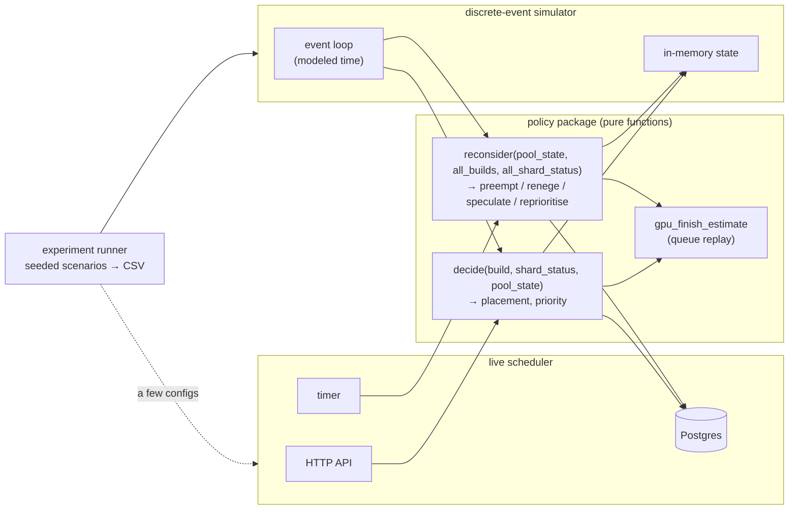
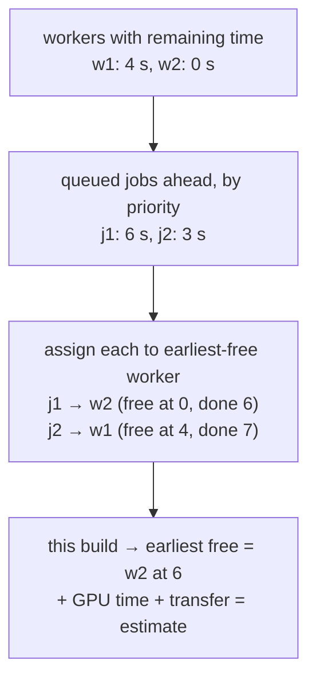
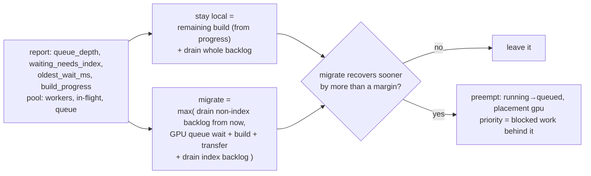
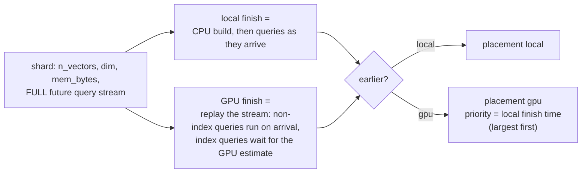
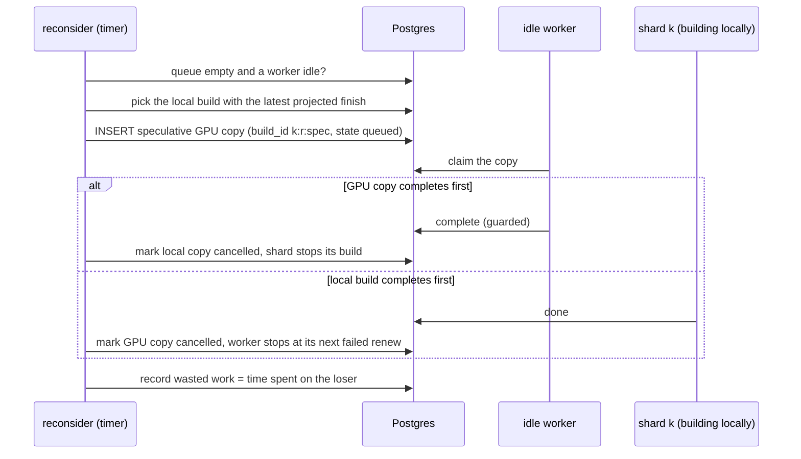

# Phase 3: placement policies and experiments

## Status and scope

**In progress.** Started 2026-10-19. This is the core of the project: five policies behind one interface, compared on identical seeded workloads across the scenarios. Builds are still fake.

The centerpiece is **reactive migration**: a deployable policy that knows only what a real shard reports, and moves a local build to the GPU when the shard's growing query backlog says it should. The **clairvoyant** cost-based policy, which knows every shard's future queries, is kept as an oracle to measure what the unknowable future costs. (Model revision of 2026-10-02; see Phase 1 decisions 28 to 32.)

**Done when** the policy comparison exists for every scenario plus the sweeps in the roadmap, with the simulator validated against a few live runs.

## System diagram

The policy package is pure and is linked into two hosts: the live scheduler and a discrete-event simulator. Both feed it the same inputs; only the clock differs.

## Flows

### Queue replay: the GPU finish estimate

List scheduling over the current queue. Possible only because the scheduler sees every queued job and every live worker.

### Reactive migration: the reconsider step for one locally building shard

Inputs are the shard's latest report and the pool. Nothing about the future.

The backlog is estimated from the report alone: `queue_depth` queries with the scenario's mean duration, split by `waiting_needs_index`. The arrival rate is estimated from successive reports. The margin guards against flapping, and `build_progress` carries the sunk cost: a build at ninety percent has little remaining time to save.

### Clairvoyant cost-based decision (oracle, simulator only)

Priority equals the shard's would-be local finish time, so the worst would-be straggler gets a GPU first (longest-processing-time-first). This is the design the project started with; it is kept because it bounds what any deployable policy can achieve.

### Speculation

## Design decisions

| # | Decision | Alternatives | Why |
| --- | --- | --- | --- |
| 1 | Policies are pure functions of passed-in state; no I/O, no clock, seeded randomness only | Policies query Postgres directly | The simulator can then reuse them byte for byte, and the sweep comparison measures the policy, not two implementations of it. |
| 1a | Deployable policies see only `shard_status` reports; the future query stream is passed only to the clairvoyant oracle, and only in the simulator | One cost-based policy that knows the jobs (the original design) | A real shard cannot declare its future. Separating "what a scheduler can know" from "what the simulator knows" makes the gap measurable. |
| 1b | Preemption of a local build is a first-class `reconsider` action, with the sunk cost read from the shard's reported `build_progress` | Speculation only (never kill a local build) | Freeing the CPU is the only way to help queries that don't need the index while the build is still running. Speculation stays as the alternative for backlogs dominated by `needs_index` queries. |
| 2 | Priority is a number computed by the policy and stored on the row; the claim query orders by it | Separate queues per priority class | One queue, one index, one claim statement. The policy owns the meaning of the number. |
| 3 | `reconsider` runs on a timer in the scheduler and expresses every action as a row change | A long-lived planner that holds the queue in memory | Keeps invariant 1 (all state in Postgres) and makes reconsider restart-safe. |
| 4 | Reneging moves a queued GPU job back to local by a guarded `UPDATE … WHERE state = 'queued'` | Cancel and resubmit | A leased job is never reneged; only queued ones. The guard makes it race-free against a concurrent claim. |
| 5 | A speculative copy is a second `builds` row with its own `build_id` suffix | A flag on the original row | Two rows, two leases, two attempt counters. The original invariants hold unchanged. |
| 6 | Simulator for sweeps, live cluster for validation only | Sweeps on the live cluster | Fake jobs sleep in real time; a 200-round sweep would take days. Disagreement between the two is itself a result to write up. |
| 7 | Estimate error injected as log-normal noise on every estimate the policy sees | Only on build times | The policy never sees truth; the sweep over σ measures its fragility end to end. |
| 8 | **The flapping guard is a margin plus moved-at-most-once** (answers the flapping open question): migrating or reneging must win by `MarginS` (default 2 s, the order of the GPU overhead), and a build whose placement already changed once after submit (`Moved`) is never moved again — a preempted build cannot renege back, a reneged build cannot be preempted. Speculation is additionally one per reconsider tick and never while a copy is in flight | Margin only (a build could still ping-pong when estimates drift past the margin twice); a cooldown timer (needs a clock, breaking purity) | The pair is clock-free and bounds the worst case absolutely: a build loses progress at most once. |
| 9 | **The host computes every number a policy sees and passes it in**: cost-model estimates per build (`Estimates`), the GPU queue wait (`PoolState.QueueWaitS`, `BuildView.QueueWaitS`), the arrival rate and mean query duration on the report (`ShardStatus`). All times are float64 seconds relative to the call, so policies never read a clock | Policies call the cost model and estimator themselves (pure, so allowed) | One choke point implements decision 7: the host noises everything at once. The step 2 queue-replay estimator plugs in by filling `QueueWaitS` without touching any policy, and the simulator feeds modeled time through the same fields. |
| 10 | **One priority currency: seconds of blocked shard work.** At submit the reactive and clairvoyant policies set priority to the build's (would-be) local duration — longest-processing-time-first — and after a preemption it is the backlog plus the abandoned local time, kept current by `reprioritize` past a 1 s churn delta. `static_threshold` uses the vector count, which orders identically within that policy | Priority classes; FIFO within placement | The claim orders by one number (decision 2), so every priority written by one policy must be comparable. Seconds of blocked work is the thing the round actually loses by serving this build later. |

## Implementation notes

### Step 1: the policy interface and the five policies (done 2026-10-19)

| Path | What |
| --- | --- |
| `scheduler/policy/policy.go` | The interface (`Decide`, `Reconsider`), the input types (`Input`, `ReconsiderInput`, `BuildView`, `WorkerView`, `ShardStatus`, `Estimates`), the four action kinds, the shared memory filter, `AlwaysGPU`, and `ByName` (`always_gpu`, `static_threshold[:N]`, `reactive`, `reactive_spec`; the clairvoyant is deliberately absent, decision 1a). |
| `scheduler/policy/threshold.go` | `StaticThreshold`: N or more vectors to the GPU, bigger first; never reconsiders. Default N 200 000. |
| `scheduler/policy/reactive.go` | `Reactive` (stay-vs-migrate from the report alone, preempt past the margin, renege a stuck queued build, reprioritize to the blocked work) and `ReactiveSpec` (plus one speculation per tick onto an idle worker when the queue is empty). |
| `scheduler/policy/clairvoyant.go` | The oracle: constructed with the futures, replays both placements exactly (including the skip rule for not-ready index queries), priority = would-be local finish. |
| `scheduler/api/api.go` | The live host now fills `Input.Est` from the cost model; `QueueWaitS` stays 0 until step 2. `Reconsider` is not yet wired to a timer (step 3). |

`WorkerView` already carries a `Node` field for step 2's per-node transfer term, but the pure types need no schema; whether `workers` gets a `node` column is the owner question flagged below, due before step 2.

## What the published build-time figures change here (2026-10-06)

The Phase 1 doc's "Cost model v0 against published numbers" section collects the data: CPU HNSW builds of 8 minutes for 1M x 128 on 8 vCPUs and 2.6 hours for 10M; GPU builds 10 to 50x faster for the build step; 61 GB of vectors to move for 10M x 1536; 24 GB GPUs that hold 5M x 1536 but not 10M.

- **Transfer is a first-class term in the GPU finish estimate.** At 128 dimensions it was noise; at 1536 it rivals the GPU build itself. The queue-replay estimate must add transfer per build with the measured bandwidth, and the reactive policy's "migrate" branch pays it on top of the queue wait.
- **Two scenarios are added:** `high_dim` (1536 dimensions, so transfer and memory bind) and `production_size` (1 to 10M vectors, 768 to 1536 dimensions; simulator only, since it does not sleep). The sweep table gets a dimension axis (128, 768, 1536).
- **The memory filter is central, not a corner case.** With production sizes some builds fit no worker and the bimodal scenario is the normal one; policies must handle "fits nowhere" as a routine outcome, and the GPU memory estimate's error is a sweep variable alongside time-estimate error.
- **Sunk cost dominates preemption.** A local build is hours; abandoning it at 60% throws away an hour of CPU. The reactive policy's `build_progress` term and the flapping margin matter more than the fake-scale runs suggested; the simulator should report wasted CPU-hours, not just wasted GPU time.
- **The speedup sweep** should cover 10x (end-to-end service figures) to 40x (build-step benchmarks), since which regime the GPU is in changes the threshold policy's optimum.

## What the worker-count question changes here (2026-10-17)

Phase 2 decision 23: how many workers run per card and per machine is a parameter to measure, not an assumption. Two consequences for the policies and the simulator:

- **The transfer term is per node, not per build.** Workers on one machine share its network link and host, so when two builds stream their vectors in at once each gets a share of the bandwidth. The cost model's transfer estimate becomes `bytes / (bandwidth_node / concurrent transfers on that node)`, and the queue-replay estimator (decision 2 of the flows above) needs to know which worker sits on which machine. `workers` therefore needs a `node` column or the pool state a node grouping; the schema question goes to the owner before Phase 3 starts.
- **Builds per card is a third axis.** If Phase 5 confirms that a card can overlap one build's transfer with another's compute (see the Phase 5 doc), the simulator's worker model needs the phases (transfer in, build, transfer out) and a per-card concurrency limit with memory-aware admission, so the GPU finish estimate can account for a second build sharing the card. Until then the simulator keeps one build per worker.
- **The pool is machines × cards, and the sweep varies both.** The simulator's pool model gains a topology, and the roadmap's sweep table gains "workers per node at a fixed card count". With the per-node bandwidth term, the simulator can predict the knee where a second card on one box stops adding throughput (expected to depend on dimension: invisible at 128, binding at 1536), and Phase 5 confirms it on hardware.

## Open questions

- Should `reconsider` be able to pre-empt a leased job (cancel it mid-build to hand the GPU to a worse straggler)? Not in Phase 3. It adds wasted work and the speculation policy already covers the idle-GPU case.
- Where does the shard's local build estimate come from? In Phase 3 it is the same cost model the scheduler uses, corrected by reported `build_progress`. In Phase 4 the shard measures.
- How is the arrival rate estimated from reports? First version: difference in cumulative arrivals between reports over the report interval, smoothed. The report may need a cumulative `arrived` count for this.
- Flapping: decided as decision 8 (margin plus moved-at-most-once).
- The `workers` table and the per-node transfer term (see "What the worker-count question changes here"): does `workers` get a `node` column so the pool state can group workers by machine? Owner's call (schema change), needed before step 2's queue-replay estimator can model shared links. The pure types already carry `WorkerView.Node`.
