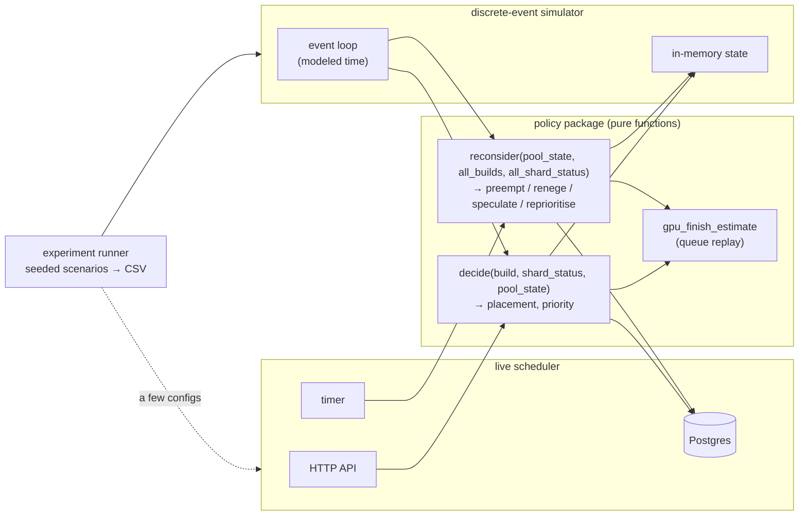
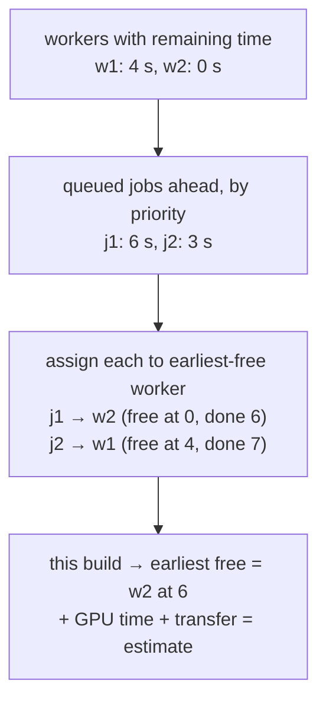
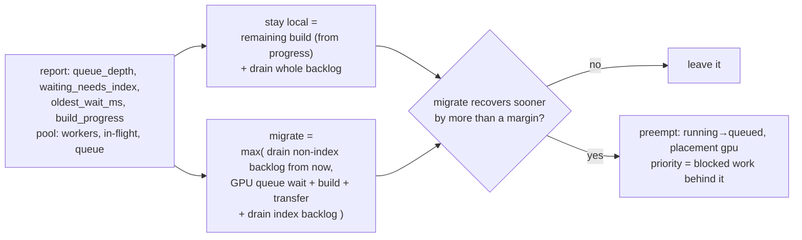
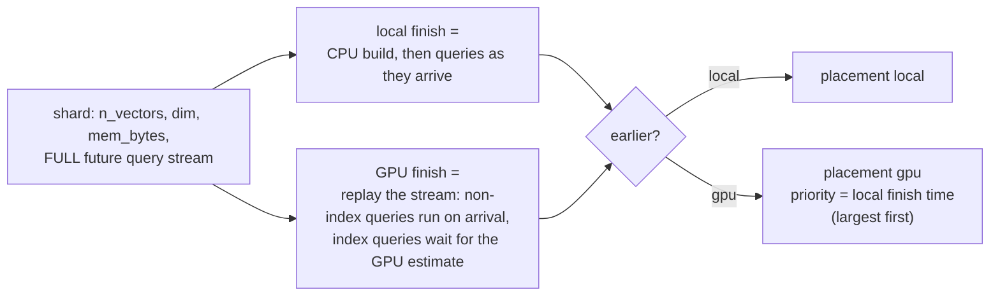
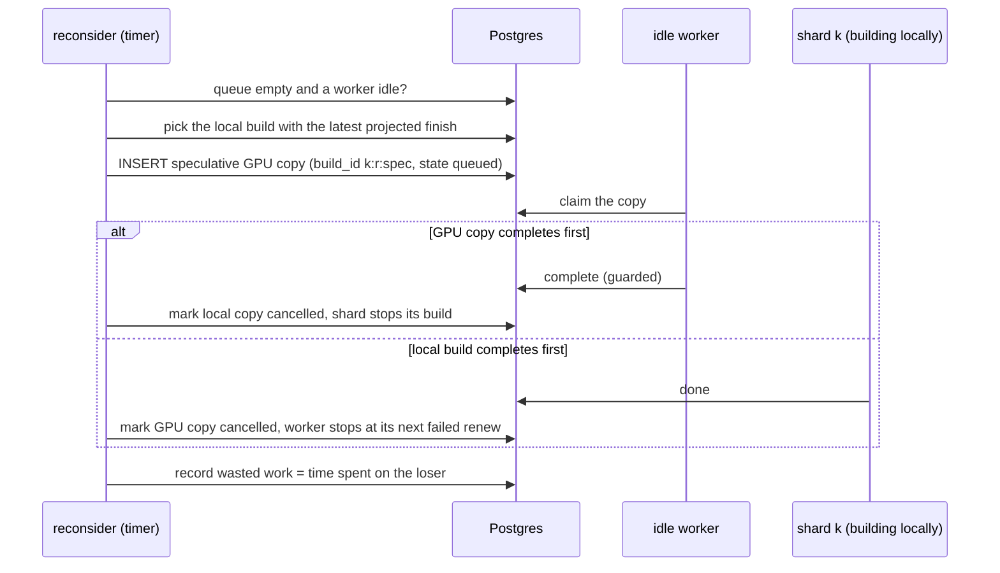

# Phase 3: placement policies and experiments

## Status and scope

**In progress.** This is the core of the project: five policies behind one interface, compared on identical seeded workloads across the scenarios. Builds are still fake.

The centerpiece is **reactive migration**: a deployable policy that knows only what a real shard reports, and moves a local build to the GPU when the shard's growing query backlog says it should. The **clairvoyant** cost-based policy, which knows every shard's future queries, is kept as an oracle to measure what the unknowable future costs. (See Phase 1's model revision, decisions 28 to 32.)

**Done when** the policy comparison exists for every scenario plus the sweeps in the roadmap, with the simulator validated against a few live runs.

## System diagram

The policy package is pure and is linked into two hosts: the live scheduler and a discrete-event simulator. Both feed it the same inputs; only the clock differs.

## Flows

### Queue replay: the GPU finish estimate

List scheduling over the current queue. Possible only because the scheduler sees every queued job and every live worker.

### Reactive migration: the reconsider step for one locally building shard

Inputs are the shard's latest report and the pool. Nothing about the future.

The backlog is estimated from the report alone: `queue_depth` queries with the scenario's mean duration, split by `waiting_needs_index`. The arrival rate is estimated from successive reports. The margin guards against flapping, and `build_progress` carries the sunk cost: a build at ninety percent has little remaining time to save.

### Clairvoyant cost-based decision (oracle, simulator only)

Priority equals the shard's would-be local finish time, so the worst would-be straggler gets a GPU first (longest-processing-time-first). This is the design the project started with; it is kept because it bounds what any deployable policy can achieve.

### Speculation

## Design decisions

| # | Decision | Alternatives | Why |
| --- | --- | --- | --- |
| 1 | Policies are pure functions of passed-in state; no I/O, no clock, seeded randomness only | Policies query Postgres directly | The simulator can then reuse them byte for byte, and the sweep comparison measures the policy, not two implementations of it. |
| 1a | Deployable policies see only `shard_status` reports; the future query stream is passed only to the clairvoyant oracle, and only in the simulator | One cost-based policy that knows the jobs (the original design) | A real shard cannot declare its future. Separating "what a scheduler can know" from "what the simulator knows" makes the gap measurable. |
| 1b | Preemption of a local build is a first-class `reconsider` action, with the sunk cost read from the shard's reported `build_progress` | Speculation only (never kill a local build) | Freeing the CPU is the only way to help queries that don't need the index while the build is still running. Speculation stays as the alternative for backlogs dominated by `needs_index` queries. |
| 2 | Priority is a number computed by the policy and stored on the row; the claim query orders by it | Separate queues per priority class | One queue, one index, one claim statement. The policy owns the meaning of the number. |
| 3 | `reconsider` runs on a timer in the scheduler and expresses every action as a row change | A long-lived planner that holds the queue in memory | Keeps invariant 1 (all state in Postgres) and makes reconsider restart-safe. |
| 4 | Reneging moves a queued GPU job back to local by a guarded `UPDATE … WHERE state = 'queued'` | Cancel and resubmit | A leased job is never reneged; only queued ones. The guard makes it race-free against a concurrent claim. |
| 5 | A speculative copy is a second `builds` row with its own `build_id` suffix | A flag on the original row | Two rows, two leases, two attempt counters. The original invariants hold unchanged. |
| 6 | Simulator for sweeps, live cluster for validation only | Sweeps on the live cluster | Fake jobs sleep in real time; a 200-round sweep would take days. Disagreement between the two is itself a result to write up. |
| 7 | Estimate error injected as log-normal noise on every estimate the policy sees | Only on build times | The policy never sees truth; the sweep over σ measures its fragility end to end. |
| 8 | **The flapping guard is a margin plus moved-at-most-once** (answers the flapping open question): migrating or reneging must win by `MarginS` (default 2 s, the order of the GPU overhead), and a build whose placement already changed once after submit (`Moved`) is never moved again — a preempted build cannot renege back, a reneged build cannot be preempted. Speculation is additionally one per reconsider tick and never while a copy is in flight | Margin only (a build could still ping-pong when estimates drift past the margin twice); a cooldown timer (needs a clock, breaking purity) | The pair is clock-free and bounds the worst case absolutely: a build loses progress at most once. |
| 9 | **The host computes every number a policy sees and passes it in**: cost-model estimates per build (`Estimates`), the GPU queue wait (`PoolState.QueueWaitS`, `BuildView.QueueWaitS`), the arrival rate and mean query duration on the report (`ShardStatus`). All times are float64 seconds relative to the call, so policies never read a clock | Policies call the cost model and estimator themselves (pure, so allowed) | One choke point implements decision 7: the host noises everything at once. The step 2 queue-replay estimator plugs in by filling `QueueWaitS` without touching any policy, and the simulator feeds modeled time through the same fields. |
| 10 | **One priority currency: seconds of blocked shard work.** At submit the reactive policy sets priority to the build's local duration and the clairvoyant to the would-be local *recovery* (the replayed finish) — longest-processing-time-first either way — and after a preemption it is **the backlog behind the build** (the roadmap's words), recomputed identically by `reprioritize` strictly past a 1 s churn delta, so an unchanged backlog means an unchanged priority. `static_threshold` uses the vector count, which orders identically within that policy. *(Corrected in the step 1 triage: first written as "backlog plus the abandoned local time", while the code computed backlog plus* remaining *time — unstable one tick after the preemption, when progress reads 0. Cross-check F3/F4.)* | Priority classes; FIFO within placement; backlog plus abandoned or remaining local time (not recomputable from a queued build's view, and the remaining variant jumps after the preemption) | The claim orders by one number (decision 2), so every priority written by one policy must be comparable, and a priority must be recomputable from the state a queued build actually carries. Seconds of blocked work is the thing the round loses by serving this build later. |
| 11 | **`workers` gets a `node` column** (owner approved), reported in the worker's heartbeat: in Kubernetes `spec.nodeName` via the downward API (the same mechanism as `WORKER_ID`), on Compose the one shared `laptop` node (which is the truth: every Compose worker shares the laptop's link), and `""` = unknown. The estimator gives an unknown-node worker its own private link, because "unknown" must not invent contention between unrelated machines. | Pass the grouping in scheduler config; infer it from worker-ID prefixes | Only the worker knows which machine it landed on, and the per-node transfer term (the worker-count consequences) needs the grouping at estimate time. |
| 12 | **The estimator replays the claim, not textbook list scheduling** (`ReplayQueue`): whenever a worker is free it takes the highest-priority queued job **that fits its memory**, ties by enqueued order — the claim statement's own ORDER BY and filter — so a small idle worker never waits behind a big job it could never take. Transfers share the node's link as a fluid: k concurrent transfers each proceed at 1/k (two 10 s transfers started together both finish at 20 s), the cost model's whole transfer term taken upfront at the claim. A job that fits no live worker estimates **+Inf** — the truth bug 11 hid. Pinned approximations: a busy worker is opaque (`BusyRemainingS` is one lump, so an in-flight build's own transfer does not contend), and the replay freezes the world (no future submits, preemptions or worker deaths). | The roadmap's literal "earliest-free worker" (wrong under heterogeneous memory); full-speed transfers (ignores the sharing decision 11 exists for); serializing transfers per node (too pessimistic) | The estimate should predict what the real claim will do, and the per-node sharing is what step 2 was gated on. |
| 13 | **Submit-time `PoolState.QueueWaitS` joins at the back** (`NewJobWait`): the new build is appended at priority 0 behind every queued job, so the scalar is exact for the FCFS baseline and an upper bound under a policy that would rank it higher. An empty pool keeps 0 (the cold-start rule, G1 — applied by the host, since "no workers yet" is the host's knowledge, not the replay's); a build fitting no live worker gets +Inf. The submit response exposes it as `gpu_queue_wait_ms` (-1 for +Inf; absent on a duplicate, whose answer is the original decision, not a fresh estimate). | The policy's would-be priority (circular: that priority is what Decide is about to compute); the front of the queue (underestimates whenever preempted builds carry real priorities) | One scalar must exist before the decision it feeds, and the bound errs toward "the queue looks slow", which leans a borderline decision local — the direction that never wastes a kill. The simulator calls `ReplayQueue` directly and is not bound by this. |
| 14 | **The reconsider timer is the actuator** (`scheduler/reconsider`, `RECONSIDER_INTERVAL`, default 2 s, 0 disables): each tick settles finished speculation races first, takes one snapshot of workers, non-terminal builds and shard reports, maps it to `ReconsiderInput` (the host computes every number, decision 9), calls the policy's `Reconsider`, and executes the returned actions as guarded single-statement updates — preempts before everything else (G7, so a same-tick speculation's "queue was empty" stays coherent). Zero rows updated means the row moved on (claimed, completed, already moved) between snapshot and write: the action is skipped and the next tick recomputes. Two schedulers ticking concurrently are therefore safe, like two reapers. | Fold it into the reaper's tick (two concerns, one loop); apply a tick's actions in one transaction (unnecessary: each action is independently valid or independently skipped, and a transaction would hold locks across policy-sized work) | The policy stays pure and testable; the actuator stays dumb; staleness is handled by the same zero-rows discipline every other writer already follows. |
| 15 | **The speculative copy is a second `builds` row**, `build_id` = the primary's + `":spec"` (implements decision 5; migration 0006 owner-approved): the claim statement, lease fencing, reaper and the Python worker handle it with **zero changes**. The migration adds `moved` (decision 8's flag, set by preempt and renege, guarded with `NOT moved` so a second move is impossible even across two schedulers) and `speculative`, checks a copy is always GPU-side, replaces the bug-3 `UNIQUE (round_id, shard_id)` with two partial unique indexes (one real build, at most one copy per shard and round), and re-anchors the `shard_status`/`shard_jobs` foreign keys on `builds.build_id` through **stored generated columns** (`shard_id:round_id`) — the database derives the reference itself, and the expression can only ever name the real build, never the copy. One copy ever per build, by primary key: if the GPU could not finish the first copy (cancelled or retry budget), a second buys nothing. The store also refuses to preempt a primary whose copy is in flight (the step 1 probe's rule, now unconditional). | A flag on the original row (reverses decision 5 and hides that a local build is still running); a separate `speculations` table (duplicates claim/lease/reap in Go **and** Python); dummy always-false FK columns (stores a lie to satisfy a constraint) | Decision 5's "two rows, two leases" survives contact with the bug-3 constraint without weakening it: the FK moves to the primary key, which is stronger, and Postgres owns the derivation the way it owns the shard-has-a-build rule. |
| 16 | **Host cancellation is the third lease-ending path.** `ResolveSpeculations` settles races both ways, idempotently: the copy done while the primary still runs → the primary becomes `gpu/done` with **the copy's `finished_at`** (the index existed from that moment; the shard's next report reply says done and it aborts its local build); the primary terminal while the copy is queued or leased → the copy becomes `failed` with a cancel reason, ending a worker's lease from outside. Like the reaper, this is a sanctioned exception to invariant 3's attempt-guarded writes, safe for the invariant's own reason: the worker's every write stays guarded by attempt and `state='leased'`, so its next renew or complete updates zero rows and it stops — exactly a lost lease. Both sides finishing before a tick needs nothing: done is done, built twice. | Let the copy's lease run out (burns the GPU to the end of a build nobody wants); make the worker poll its build's primary (policy knowledge pushed into the worker) | The race must be settled by whoever can see both rows, and only the scheduler can; one guarded statement per direction keeps every interleaving coherent. |
| 17 | **Rounds never see the copies**: round completion (count, all-terminal, `finished_at`), the straggler lag and the queue-wait stats all exclude `speculative` rows, and `SubmitBuild`'s n_shards cap counts real builds only — so a round may close while a losing copy is still being cancelled, and the sweep cancels it afterwards regardless of round state. `gpu_queue_depth` and `builds_leased` DO count copies: they really occupy the queue and the workers. The new counters are `reconsider_actions_total{action,outcome}` and `speculations_resolved_total{winner}` (a local win with `copy_state_at_cancel=leased` is the wasted GPU work the roadmap says to record). | Hold the round open until its copies resolve (a cancelled copy's finish would stretch every round measurement by up to a tick) | The copy is the policy's artifact, not the round's work; the round measures the cluster's recovery, the counters measure the policy's spending. |
| 18 | **The scheduler learns the modeling scale** (`FAKE_TIME_SCALE`, default 1 — the same knob the worker and shardsim already take) and converts every wall-derived fact to modeled seconds before it meets a cost-model duration: a lease's elapsed time (here and in step 2's submit-time estimate), the round's age, a report's oldest wait. The host derives the two report aggregates in SQL: `ArrivalRateQPS` = recorded arrivals / modeled round age, `MeanQueryS` = mean recorded `duration_ms` (shards record modeled durations, decision 60, so the mean needs no conversion). | Scale-free policies (impossible: `build_progress` is scale-free but every duration is not); shards estimating their own arrival rate (pushes derivation into every reporter; the records are already in Postgres at control-plane rates) | Mixing wall timestamps with modeled durations silently misjudges every stay-vs-migrate comparison at scale ≠ 1; only the host knows both clocks. In production the scale is 1 and the conversion vanishes. |
| 19 | **The cold-start rule holds on every tick** (G1 extended): with zero live workers every `QueueWaitS` reads 0, so queued builds hold their place instead of stampeding back to local CPUs the moment the pool blips; a *shrunken* pool (fewer workers, not none) produces genuinely longer replayed waits and reneging reacts to those. A queued build that fits no live worker still reads +Inf, and reneging it to local is exactly how a stuck too-big build escapes the queue — bug 11's cure at the third place placement changes. | Empty pool = +Inf (one heartbeat gap would renege the whole queue, and the cold-start round would undo every submit-time placement) | "No workers yet" and "no workers ever again" are indistinguishable from inside; erring toward holding place matches the submit-time rule, and the shrinking-pool scenario is handled by the case that *is* distinguishable. |
| 20 | **The impossibility escape** (owner approved; amends decision 8, found as the step 3 cross-check's F3 / **bug 13**): a build that already moved once may still **renege when its memory fits no live worker** (`QueueWaitS` +Inf). Decisions 8 and 19 collided — a hurting build preempted onto a big worker that then died was stranded: unclaimable (no lease, no reaper, no budget) and unmovable, bug 11's hang through preempt-then-shrink. Decision 8's at-most-once exists to stop cost-model flapping, and fits-nowhere is not a cost judgment but physics. No loop can form: preemption still strictly requires a never-moved build, so the longest lifetime is submit → preempt → escape-renege → local forever (two moves, terminal). The store's `RenegeToLocal` therefore drops its moved guard (the policy enforces the judgment rule; the escape needs the door open); `PreemptToGPU` keeps its moved guard absolutely. On an *empty* pool the escape stays shut (waits read 0, decision 19's first clause — G5). | Keep decision 8 strict and accept the hang until a big worker returns; fail the stranded build after a grace period (ends the round but loses the shard's index) | A build that *cannot* run where it is queued must leave, whatever its history; the exception is narrow, terminal, and keeps both bug 11 cures honest. |
| 21 | **The discrete-event simulator replays the live system's semantics, not an idealization** (`experiments/sim`): the same policy code (invariant 8), submits mapped like `scheduler/api` (the NewJobWait scalar, cold-start rule), claims mirroring the claim statement (priority DESC, enqueued order via an insert-time seq that survives a preemption like `enqueued_at`, memory filter, idle workers in ascending ID), a reconsider tick every `ReconsiderS` modeled seconds (resolve-then-decide, preempts first, guarded transitions that skip like zero-row UPDATEs), and — the part an idealization would drop — **policies see only reported state**: each shard publishes its load every `PollS` and reacts to placement changes at its own next report, so the live report latency is in the model. Round numbers use the live definitions (decision 30 completion, interpolated-median straggler lag, claimed-only queue waits, copies invisible). Pinned simplifications: submit is instant, reports are unstaggered, a killed worker leaves the pool at once and its lease requeues after `LeaseS`, a cancelled copy frees its worker at the tick, and a 24 h modeled safety cap ends a genuine hang with `Completed=false` (sized for the production preset's ~9.6 h local builds — the 6 h first guess marked every production round incomplete). | Event-driven idealization without report latency (free accuracy loss exactly where the reactive policy lives: in the staleness of what it knows); reuse `shard/sim` with a fake clock (its goroutines and real timers are wall-clock-bound by design) | The simulator's one job is step 7's promise: agree with the live cluster or make the disagreement a finding. Every semantic it shares with the live system is one less false disagreement to chase. |
| 22 | **Per-node link sharing is a simulator flag** (`ShareNodeLinks`): on, transfers share a node's link as a fluid (decision 12's model — what real GPUs on one machine will see, and what the workers-per-node sweep exists to measure); off, a worker occupies itself for its whole GPUTotal without contending, which is what the Phase 1–3 **fake worker actually does** (it sleeps; it cannot contend). Step 7's validation runs compare with sharing OFF, because the live stack being validated against is fake workers. | Always share (the simulator then models contention the live fake stack cannot exhibit, poisoning validation); never share (the sweep that motivated decision 11's node column becomes unmeasurable) | The flag states the fidelity gap instead of hiding it: one bit chooses "model Phase 5 reality" or "model the Phase 3 cluster". |
| 23 | **Estimate error is three seeded log-normal factors per build** (`EstimateSigma`): local, GPU-build and transfer each get `exp(σ·N(0,1))`, drawn once per build from a PCG seeded by the noise seed and the workload seed, applied to every estimate any consumer sees — Decide, Reconsider views, the queue replay's inputs, worker busy-remaining — and **never to execution**. One factor per estimate *kind*, not per build, because a single shared factor would preserve every local-vs-GPU ratio and the sweep would measure nothing. The factors persist across ticks (a misjudged build stays misjudged; re-rolling each tick would average the error away). The clairvoyant is noised like everyone: its edge is the future query stream, not a magically calibrated cost model — the demo sweep shows exactly that, the oracle degrading fastest with σ while reactive_spec stays flat (speculation covers for the bad model, the roadmap's hypothesis). | Noise at the host once per tick (averages out); one factor per build (cancels in comparisons); exempt the oracle (conflates two superpowers and overstates the value of knowing the future) | The sweep asks "how fragile is the cost model": the noise must change decisions, persist like a real systematic misestimate, and spare the ground truth. |
| 24 | **The runner crosses axes into one CSV row per round** (`experiments/cmd/sweep`): scenarios × policies × every roadmap sweep axis (σ, zipf, load, needs_index, dim, speedup, workers, workers-per-node) × seeds, sequential and deterministic (the same invocation is byte-identical). Rows are self-describing — non-overridden axes echo the scenario's own values — so CSVs concatenate safely. Plots are Python + matplotlib (owner approved) in `experiments/analysis`, its own pinned uv project; the percentile is the Go side's `sorted[int(p*(n-1))]`, so a plotted number traces to exact CSV rows. `scripts/sim-sweep-demo.sh` runs a committed, reproducible 1400-round demo (`experiments/results/demo/`, CSVs and PNGs tracked; ad-hoc results above it stay gitignored); the FULL comparison waits for step 7's validation, because results from an unvalidated simulator are decoration. | Parallel runner (noise across rows for free, determinism by bookkeeping — not worth it at 1400 rounds/minute); gonum/plot (clunkier for this); results in Postgres (the control-plane store is not an analytics store) | One row per round is the roadmap's words; byte-identical reruns make a CSV diff a meaningful code-review artifact. |
| 25 | **Two presets complete the roadmap's scenario table**: `high_dim` (the skewed shapes at dim 1536, worker memory set so the top of the size range fits no worker — transfer rivals the GPU build and memory binds) and `production` (zipf 1M–10M × dim 1536, 80 GB workers, 10-minute query horizon, 50 ms queries — hour-long CPU builds that make sunk cost and preemption loss real; **simulator only**, its builds would sleep for hours on the live stack). First observed property of both, worth keeping: at these loads the round's p50 is set by physics (the horizon, or an un-offloadable build every policy must run locally), so policies tie at p50 and differentiate in the straggler lag, the queue waits, threshold's mistakes and the σ sweep — the headline comparisons need the heavier load/skew sweep arms, not just the preset defaults. | Fold them into bimodal/skewed variants (loses the roadmap's named table) | The scenario table is the experiment plan's contract; the "policies tie at p50" observation is exactly what the runner's sweep axes exist to vary. |
| 26 | **The modeled worker memory is 24 GiB everywhere** — the worker's default, the Compose and Kubernetes config, and the presets' "unbounded" constant (`presetBigWorkerMem`), which had drifted apart (8 vs 16 GiB) since Phase 1 without anyone noticing because no preset build needs more than ~200 MB. 24 GiB is the L4/A10G class, the cards the published cuVS/CAGRA index-build benchmarks run on (Milvus 2.4 on AWS: T4 16 GB and A10G 24 GB; NVIDIA's Milvus guidance puts the production floor at 16 GB); the training-class alternative is 40–80 GB (A100/H100), which the `production` preset keeps. The cost model's memory factor (2× the vector bytes) stays: the published *residency* rule for CAGRA is ~1.8× (float16 copy plus graph), but build-time *peak* is several times higher (IVF-PQ ~6×, nn-descent far more) — whether the filter should model peak rather than residency is a Phase 5 measurement, not a constant to guess now. Step 7's hour-long build (12.3M × 128, ~11.5 GiB modeled) is the first build the number decides: it fits a 24 GiB worker and did not fit 8. | Keep 8 (below every current data-center card); 16 (a T4, the oldest card still common); 80 (A100/H100 — makes every preset build offloadable and hides the memory filter) | The number must be the same on both sides of the step 7 comparison, and it should name a real card so Phase 5 can be measured against it. |

## Implementation notes

### Step 1: the policy interface and the five policies

| Path | What |
| --- | --- |
| `scheduler/policy/policy.go` | The interface (`Decide`, `Reconsider`), the input types (`Input`, `ReconsiderInput`, `BuildView`, `WorkerView`, `ShardStatus`, `Estimates`), the four action kinds, the shared memory filter, `AlwaysGPU`, and `ByName` (`always_gpu`, `static_threshold[:N]`, `reactive`, `reactive_spec`; the clairvoyant is deliberately absent, decision 1a). |
| `scheduler/policy/threshold.go` | `StaticThreshold`: N or more vectors to the GPU, bigger first; never reconsiders. Default N 200 000. |
| `scheduler/policy/reactive.go` | `Reactive` (stay-vs-migrate from the report alone, preempt past the margin, renege a stuck queued build, reprioritize to the blocked work) and `ReactiveSpec` (plus one speculation per tick onto an idle worker when the queue is empty). |
| `scheduler/policy/clairvoyant.go` | The oracle: constructed with the futures, replays both placements exactly (including the skip rule for not-ready index queries), priority = would-be local finish. |
| `scheduler/api/api.go` | The live host now fills `Input.Est` from the cost model; `QueueWaitS` stays 0 until step 2. `Reconsider` is not yet wired to a timer (step 3). |

`WorkerView` already carries a `Node` field for step 2's per-node transfer term, but the pure types need no schema; whether `workers` gets a `node` column is the owner question flagged below, due before step 2.

### Cross-check of step 1, the policies

A fresh agent wrote 40 pure subtests (`TestPolicySpec` in `scheduler/crosscheck/policy_test.go`, saved as `test-logs/phase3/step1-crosscheck-policies.log`) from the docs and `go doc` alone, never reading the policy source. 34 passed first time — purity under repetition and permutation, the memory filter at submit for all five, the margin and sunk-cost boundaries by hand, both directions of moved-at-most-once, speculation's no-go cases, three hand-replayed oracle streams including one that flips without the skip rule. 6 failed, and two passing probes carried findings. Triage:

| Finding | Kind | Resolution |
| --- | --- | --- |
| **F1: preemption ignored the memory filter** — a local build fitting no live worker (or facing an empty pool) was preempted into a queue nobody can claim, hanging the round. | Implementation bug | **Bug 11** (`docs/bugs.md`), fixed in its own commit: reconsider never preempts a build that fits no live worker; an empty pool means no preemption, stricter than submit's cold-start rule because a preemption destroys progress. |
| **F3/F4: three versions of the preempt priority** — the roadmap said "the blocked work behind the build", decision 10 said backlog plus abandoned time, the code computed backlog plus *remaining* time; the code's version also jumped one tick after every preemption (a queued shard reports progress 0), so each preempt bred a spurious reprioritize. | Implementation and doc both wrong | Decision 10 corrected in place to the roadmap's rule: priority = the backlog behind the build, recomputed identically everywhere; stable across ticks when the backlog is unchanged. The agent's two tests pinning the old wording updated with it. |
| **F2: the reprioritize delta fired at exactly ±1 s** where the doc says "more than". | Implementation bug | Comparison made strict. |
| **Renege and preempt used different cost models** (probe): renege compared bare build times, so a queued build with 10 runnable non-index queries waiting was reneged into a *worse* recovery (20 s vs 17 s) — which the policy's own preempt rule would immediately want to undo, decision 8 alone stopping the ping-pong. | Spec gap leaning bug | Renege now uses the same recovery arithmetic as preemption with the roles reversed (going local = stay-local with progress 0, which is what a queued shard reports); without a report it degrades to the old build-time comparison. |
| **The original of an in-flight speculative copy was preempted** (probe): the shard would get two GPU rows and lose the CPU progress the copy exists to protect. | Spec gap leaning bug | A build whose speculative copy is in flight is never preempted; pinned in the implementer's tests. |
| **F5: ByName parsed leniently** — `reactive:5`, `always_gpu:` and `static_threshold:` ran silently with defaults, so a typo'd sweep arm would run as the wrong configuration. | Implementation bug | Strict: any argument on a parameterless policy, or an empty threshold, is an error. `""` = always_gpu is now in the documented grammar (the deployed default since Phase 1). |
| **F6: `Name()` lost the threshold** — logs, metrics and CSV rows could not tell the sweep's arms apart, and a logged name did not reproduce the run. | Spec gap | `StaticThreshold.Name()` is now `static_threshold:N`; `ByName(p.Name())` round-trips for every deployable policy. |
| G1–G7: the oracle on an empty pool queues (the same cold-start rule); a local build's migrate branch reads `BuildView.QueueWaitS` ("the wait it would join at"); a shard missing from the futures is an empty stream and a recovery tie goes local; reactive's default threshold is `DefaultThresholdN`; arrivals enter stay-local as growth during the remaining build; speculation judges "queue empty" on the tick's input, so it may coexist with a same-tick preemption of another shard (the host applies preempts first); action order is unspecified, only the set is deterministic. | Spec gaps (documentation) | All pinned in the package's doc comments and here. |

### Step 2: the GPU finish estimator, queue replay

| Path | What |
| --- | --- |
| `db/migrations/0005_workers_node.sql` | `workers.node` (decision 11), default `''` = unknown. |
| `scheduler/policy/estimate.go` | Pure, like the whole package: `ReplayQueue` (the claim mirror with fluid per-node link sharing, decision 12; returns each queued build's start and finish, +Inf for one that fits no worker) and `NewJobWait` (the submit-time scalar, decision 13). |
| `scheduler/store/store.go` | `Heartbeat` carries the node; `GetQueueSnapshot` returns the estimator's raw inputs: live workers, queued GPU builds in claim order, leased builds with seconds since their claim. |
| `scheduler/api/api.go` | `submitBuild` fills `PoolState.QueueWaitS` (snapshot → cost model → `NewJobWait`; a leased build's remaining time is its GPU total minus the time since its claim, floored at 0), logs it, and answers `gpu_queue_wait_ms` (-1 when the build fits no live worker). |
| `worker/kgpu_worker/config.py`, `store.py`, `worker.py` | `WORKER_NODE` (default empty), written by every heartbeat. |
| `deploy/k8s/worker.yaml`, `deploy/compose.yaml` | The downward API's `spec.nodeName`; Compose's one shared `laptop` node. |

`BuildView.QueueWaitS` on reconsider is step 3's wiring: the host will call `ReplayQueue` once per tick and read each queued build's start (and each local build's would-be wait) from it.

### Cross-check of step 2, the estimator

A fresh agent wrote 44 subtests (`TestEstimatorSpec`, 33 pure; `TestEstimatorDB`, 11 against Postgres and the API; saved as `test-logs/phase3/step2-crosscheck-estimator.log`) from the docs and `go doc` alone. 43 passed first time — every fluid-sharing shape by hand (joins, departures, a worker's second claim joining mid-transfer), the claim mirror under mixed memory, a four-worker six-job scenario replayed entirely by hand, the snapshot's claim order agreed with by a real claim, and the per-node term visible end to end through `gpu_queue_wait_ms`. One failed, and seven gaps were pinned. Triage:

| Finding | Kind | Resolution |
| --- | --- | --- |
| **F1: a duplicate submit's response carried `gpu_queue_wait_ms: 0`** where decision 13 says absent — the field was a plain `int64`, which Go always serializes, so "no estimate was made" was indistinguishable from "a worker is free right now". | Implementation bug | The field is now `*int64` with omitempty: nil (omitted) on a duplicate, a real pointer otherwise, so the empty pool's genuine 0 still serializes. Pinned in the implementer's test too. |
| **G1: "at priority 0" vs "behind every queued job"** — the two readings differ if a queued job had negative priority (the new job would go ahead of it). | Spec gap | `NewJobWait`'s doc now says literally: priority 0, Seq after everyone; every shipped policy writes non-negative priorities. |
| **G2: the simultaneous-free tiebreak's direction** was unstated; under mixed memory it changes estimates. | Spec gap | Pinned: ascending worker ID (any one coherent order approximates the real claim's race). |
| **G3: duplicate BuildIDs** in `ReplayQueue`'s input were undefined. | Spec gap | Doc: BuildIDs are the idempotency key and expected unique; duplicates collapse to one entry, value unspecified. |
| **G4: a worker's node changing between heartbeats.** | Spec gap | Doc on `Heartbeat`: the latest heartbeat wins. |
| **G5: a fits-nowhere submit lands local while reporting -1.** | Spec gap | The response doc now says the field describes the GPU path whatever placement was chosen. |
| **G6: the millisecond rounding** was unspecified (observed: truncation). | Spec gap | Doc: whole milliseconds, truncated. |
| **G7: a zero-transfer job** did not count toward the link's k; plausible, undocumented. | Spec gap | Doc on `ReplayQueue`: a job moving no bytes takes no share of the link. |

### Step 3: preemption, reneging and speculation in the reconsider timer

| Path | What |
| --- | --- |
| `db/migrations/0006_speculation.sql` | `builds.moved` and `builds.speculative` (decision 15); the copy-is-GPU check; the bug-3 unique constraint replaced by two partial unique indexes; the `shard_status`/`shard_jobs` FKs re-anchored on `builds.build_id` via stored generated columns. |
| `scheduler/reconsider/reconsider.go` | The timer (decision 14): `Run`/`Tick`, the snapshot→`ReconsiderInput` mapping with the time-scale conversions (decision 18) and the per-tick queue replay (`BuildView.QueueWaitS` from `ReplayQueue` for queued builds, `NewJobWait` for local ones — step 2's second caller), action execution preempts-first, and the resolve sweep each tick. |
| `scheduler/store/store.go` | `PreemptToGPU`/`RenegeToLocal` now set and guard `moved` and refuse a primary with a copy in flight; new `Reprioritize`, `SpeculateCopy`, `ResolveSpeculations` (decision 16), `GetReconsiderSnapshot` (workers, non-terminal builds in claim order, reports with the SQL-derived query aggregates); round completion, straggler lag, queue waits and the n_shards cap exclude copies (decision 17). |
| `scheduler/cmd/scheduler/main.go` | Starts the loop; `RECONSIDER_INTERVAL` and `FAKE_TIME_SCALE` env vars. |
| `scheduler/api/api.go` | `Config.TimeScale`: the submit-time estimate's leased-elapsed conversion (the step 2 code assumed scale 1). |
| `scheduler/metrics/metrics.go` | `reconsider_actions_total{action,outcome}`, `speculations_resolved_total{winner}`. |
| `shard/sim/shard.go`, `shard/sim/timeline.go`, `shard/client/client.go` | The shard aborts its local build when `done` arrives while it is still building (the copy won), with the abort reason told apart from a preemption; the timeline counts copies and never lets one shadow the real build's line; `BuildRow` mirrors `moved`/`speculative`. |
| `deploy/compose.yaml`, `deploy/k8s/scheduler.yaml` | `RECONSIDER_INTERVAL` and `FAKE_TIME_SCALE` for the scheduler (kind's workers run at scale 10, so the scheduler now says 10 too). |

The worker (Python) is untouched: a copy is an ordinary claimable build, and a cancelled copy looks to its worker exactly like a lost lease.

### Cross-check of step 3, the reconsider timer

A fresh agent wrote 44 subtests (`TestReconsiderDB`, 25 on the store guards, migration 0006 and rounds; `TestReconsiderTick`, 17 driving `reconsider.Tick` with the real reactive policies; `TestReconsiderWorker`, 2 with the real Python worker; saved as `test-logs/phase3/step3-crosscheck-reconsider.log`) from the docs, the migrations and `go doc` alone. 42 passed first time, among them: the copy claimed by the roadmap's claim SQL typed in by hand, ninety repetitions of three different races (claim vs renege, resolve vs the copy's complete, resolve vs the shard's local done) each ending in exactly one coherent winner, the policy's own log reasons matching the agent's hand arithmetic to the decimal ("stay local 70.6s, migrate 50.0s"), decision 18's scaling proven by the same lease reading busy at scale 1 and free at scale 10⁵, and the unchanged Python worker building a copy and then being fenced out by a cancel within 115 ms. The two failures were real bugs, and a passing probe carried the round's biggest finding. Triage:

| Finding | Kind | Resolution |
| --- | --- | --- |
| **F1: a preempt in the settle window threw away a won race** — the guard refused a copy "in flight" as `queued`/`leased`, so a copy already *done* but not yet settled let the preempt through; the resolve then found no running primary and the finished index was forgotten, rebuilt a third time. | Implementation bug (a real race window, wider with two schedulers) | **Bug 12** (`docs/bugs.md`), own commit: the guard is now `state <> 'failed'` — only a copy that can no longer win frees the primary to move. |
| **F3: decisions 8 and 19 collided** — a hurting build preempted onto the one big worker was stranded when that worker died: unclaimable by the memory filter, and the designated escape (renege) refused by moved-at-most-once. Bug 11's hang through preempt-then-shrink; the agent's test *passed*, pinning the spec's own conflict. | Design conflict (spec bug) | **Bug 13**, own commit; owner decided **decision 20**, the impossibility escape: a moved build still reneges when it fits no live worker. The agent's two pinning tests updated with the decision. |
| **F2: a GPU-won primary added a fake 0 s sample to the round's queue waits** — the stats selected `placement='gpu' AND started_at IS NOT NULL`, and a resolved primary has both while its `started_at` is its *local* start; every GPU win dragged `build_queue_wait_seconds` down by exactly the amount speculation helps. | Implementation bug | QueueWaits now requires `attempt > 0`, the claim's own counter — the doc's "first claim minus enqueue" made literal. |
| **F4: `SubmitBuild` accepted a non-conventional `build_id`**, creating a build its own shard could never report against (the generated FK derives `shard_id:round_id`). Reachable only by direct store callers — which step 4's simulator adapter will be. | Spec gap leaning bug | `SubmitBuild` now refuses any id that is not `BuildID(shard, round)`; the convention is load-bearing and documented as such. |
| G1: after a GPU win the primary shows `gpu/done` with `attempt=0`, `moved=false`. | Spec gap | Pinned on `SpeculationResolved`: a settlement is neither a move nor a claim; the copy's attempt is the worker's fencing token and is now returned and logged (G4). |
| G2: a race settled at the top of a tick frees its worker for the *same* tick's decisions, including the next speculation. | Spec gap | Pinned in `Tick`: resolve-then-decide is deliberate. |
| G3: the copy's priority and whether it can be reprioritized. | Spec gap | Pinned: set once at creation from the Action (the chosen shard's blocked work); policies skip speculative views on reconsider, so `Reprioritize` is never asked. |
| G4: the resolve log line lacked the copy's attempt — the fencing token of the worker whose work was decided. | Spec gap (observability) | `ResolveSpeculations` returns `CopyAttempt`; the log line carries `copy_attempt` beside the primary's `attempt`. |
| G5: fits-nowhere on an *empty* pool — +Inf or the cold-start 0? | Spec gap | The cold-start clause wins (waits read 0, the build holds); pinned in decision 20's row. |
| G6: `StragglerLag` travels through float seconds, so it carries ns-level rounding. | Spec gap | Pinned on `FinishedRound`: not exactly comparable to row timestamps. |
| G7: a cancelled copy's `finished_at` is the cancel time. | Spec gap | Pinned on `ResolveSpeculations`; rounds ignore it (decision 17). |

### Steps 4–6: the experiment pipeline — simulator, runner, plots

| Path | What |
| --- | --- |
| `experiments/sim/sim.go` | The discrete-event simulator (decision 21): one seeded round against one policy in modeled time, calling the same `Decide`/`Reconsider`/`ReplayQueue`/`NewJobWait` the live scheduler calls, with report-latency, claim order, the reconsider tick's resolve-then-decide and the guarded-transition semantics all mirrored; per-node fluid link sharing behind `ShareNodeLinks` (decision 22); seeded per-build estimate noise (decision 23); `Futures` hands the oracle its streams (decision 1a). ~1400 rounds/minute. |
| `experiments/sim/sim_test.go` | Ten narrated tests, every number hand-computed from the default cost model: local and GPU rounds to the millisecond (including the index query waiting for the shard's next report), FCFS queue waits, link sharing on one node vs two vs off, preemption mid-flight, both speculation outcomes with the wasted worker-seconds, the killed worker's lease requeueing on the reaper's timetable, the empty pool holding (decision 19) with the hang visible as `Completed=false`, byte-identical determinism under noise, and sigma never touching execution. |
| `experiments/cmd/sweep/main.go` | The runner (decision 24): scenarios × policies × sweep axes × seeds, one self-describing CSV row per round, byte-identical reruns. |
| `experiments/analysis/` | The plots (matplotlib, own uv project): `plot_rounds.py` (p50/p99 per policy per scenario) and `plot_sigma.py` (p99 vs estimate error), sharing the Go side's percentile so figures trace to rows. |
| `experiments/workload/presets.go` | `high_dim` and `production` complete the roadmap's scenario table (decision 25). |
| `scripts/sim-sweep-demo.sh`, `experiments/results/demo/` | The committed, reproducible 1400-round demo: three CSVs and both figures. First findings: at preset loads the p50 is physics-bound (ties everywhere; the differentiation is in stragglers, waits and threshold's mistakes), and the σ sweep already shows the oracle degrading fastest while reactive_spec stays flat — speculation covering for the bad cost model, the roadmap's hypothesis. |

The full policy comparison deliberately waits for step 7 (validation on the live cluster): results from an unvalidated simulator are decoration.

### Cross-check of steps 4–6, the simulator and runner

A fresh agent wrote 33 pure subtests (`TestSimSpec`, 27, driving `sim.Run` directly; `TestSweepCSV`, 6, running the sweep binary as a black-box process; saved as `test-logs/phase3/step456-crosscheck-sim.log`) from the docs and `go doc` alone, with the cost-model formulas typed in by hand and a scripted policy that records every input the simulator hands it. 27 passed first time — the report-latency gating at three poll intervals, the claim order to exact finish times, a preempted build keeping its submit-time queue position, both speculation outcomes to the second, determinism across 20 cells run sequentially and concurrently, the runner's byte-identical reruns, and step 2's `ReplayQueue` predicting the simulator's execution *exactly* in the no-busy-worker case while disagreeing by precisely the documented busy-worker-opacity gap otherwise. The failures were one severe bug and three small ones. Triage:

| Finding | Kind | Resolution |
| --- | --- | --- |
| **F1: link sharing stole bandwidth at every rate change and could skip a whole GPU build** — the clock advance computed each worker's share *during* the mutation loop, so a transfer hitting zero removed itself from its node-mates' k for the same interval; the overshoot then slipped past a value-based phase test into "build finished". Every `workers_per_node ≥ 2` arm was wrong (the committed demo, at 1 per node, was untouched). The agent inferred the mechanism from a 0.208 s discrepancy before anyone read the code, and guessed the implementer's blind spot exactly: the original test asserted only `RoundS`, which the surviving build set. | Implementation bug, severe | **Bug 14** (`docs/bugs.md`), own commit: shares snapshotted before any mutation; the phase test is by meaning (remaining ≤ 0 with no build deadline = transfer just ended), bug 12's lesson re-applied. The implementer's test now asserts every shard's finish plus a mid-transfer staggered join by hand. |
| **F2: CSV rows were not self-describing** — `reconsider_s`, `poll_s`, `lease_s` and `noise_seed` all change results and none was a column, so concatenated CSVs (e.g. more noise samples via different noise seeds) could not be told apart. | Spec gap leaning bug | Four new columns (and a `-lease_s` flag); decision 24's "every knob that can change a result is a column" is now literally true. The agent's test updated to count them as configuration. |
| **F3: `Config.MaxModeledS`'s doc said 6 h** while the behaviour (and decision 21) is 24 h — the comment survived the demo-sweep fix. | Documentation bug | Comment corrected. |
| **F4: `BuildsGPU`/`BuildsLocal` counted unfinished builds** on incomplete rounds, against their own "finished" definition. | Implementation bug, minor | Only `done` builds count; the Result doc says an unfinished build counts nowhere. |
| G1: `RoundS`/`ShardFinishS` on an incomplete round describe only what finished (0 if nothing); a consumer ignoring `completed` reads a hang as a fast round. | Spec gap | Pinned on `Result`; the committed plots filter on `completed` (they already did). |
| G2: an overdue worker reads as idle — busy-remaining is estimate-minus-elapsed floored at 0, so a build overrunning its estimate (or noised short) looks free; the live mapping floors identically. | Spec gap (live too) | Pinned on `policy.WorkerView`: erring small is deliberate (an overdue lease frees or reaps soon), but speculation may target a worker still finishing an overrun. |
| G3: same-instant ordering (reports before the tick, first tick at `ReconsiderS`, simultaneous submits in shard order, `ShardFinishS` by shard ID). | Spec gap | Pinned in the package doc. |
| G4: the sim's uniform pool cannot exercise decision 20's mixed-memory escape; only the empty-pool clause is reachable (via the kill). | Spec gap (limitation) | Pinned in the package doc: the mixed-memory escape is covered against real Postgres in `scheduler/reconsider`. |
| G5: `Config`'s zero value has sharing OFF while the runner defaults `-share_links=true`. | Spec gap | Pinned on `Config`: the zero value models the live fake worker (right for step 7); the runner's default models Phase 5 reality (decision 22); validation passes `-share_links=false` explicitly. |
| G6: wasted CPU was not reported, though this doc's own build-time-figures section demands "wasted CPU-hours, not just wasted GPU time". | Spec gap (a real miss) | `Result.WastedCPUS` and a `wasted_cpu_s` column: preemption aborts, locals abandoned after a GPU win, and a finished-but-refused local build all count; hand-asserted in the implementer's tests (a GPU-won speculation wastes exactly 10.5 s of CPU at the default grids). |
| G7: the `zipf` column reads 0 for non-zipf presets. | Spec gap | Pinned in the runner doc: the column echoes the preset's field. |
| G8: the production preset narrows the roadmap's "768–1536 dimensions" to 1536. | Spec gap | Pinned here: deliberate — one `Scenario.Dim` per round; the dimension sweep axis covers 768. |

## What the published build-time figures change here

The Phase 1 doc's "Cost model v0 against published numbers" section collects the data: CPU HNSW builds of 8 minutes for 1M x 128 on 8 vCPUs and 2.6 hours for 10M; GPU builds 10 to 50x faster for the build step; 61 GB of vectors to move for 10M x 1536; 24 GB GPUs that hold 5M x 1536 but not 10M.

- **Transfer is a first-class term in the GPU finish estimate.** At 128 dimensions it was noise; at 1536 it rivals the GPU build itself. The queue-replay estimate must add transfer per build with the measured bandwidth, and the reactive policy's "migrate" branch pays it on top of the queue wait.
- **Two scenarios are added:** `high_dim` (1536 dimensions, so transfer and memory bind) and `production_size` (1 to 10M vectors, 768 to 1536 dimensions; simulator only, since it does not sleep). The sweep table gets a dimension axis (128, 768, 1536).
- **The memory filter is central, not a corner case.** With production sizes some builds fit no worker and the bimodal scenario is the normal one; policies must handle "fits nowhere" as a routine outcome, and the GPU memory estimate's error is a sweep variable alongside time-estimate error.
- **Sunk cost dominates preemption.** A local build is hours; abandoning it at 60% throws away an hour of CPU. The reactive policy's `build_progress` term and the flapping margin matter more than the fake-scale runs suggested; the simulator should report wasted CPU-hours, not just wasted GPU time.
- **The speedup sweep** should cover 10x (end-to-end service figures) to 40x (build-step benchmarks), since which regime the GPU is in changes the threshold policy's optimum.

## What the worker-count question changes here

Phase 2 decision 23: how many workers run per card and per machine is a parameter to measure, not an assumption. Two consequences for the policies and the simulator:

- **The transfer term is per node, not per build.** Workers on one machine share its network link and host, so when two builds stream their vectors in at once each gets a share of the bandwidth. The cost model's transfer estimate becomes `bytes / (bandwidth_node / concurrent transfers on that node)`, and the queue-replay estimator (decision 2 of the flows above) needs to know which worker sits on which machine. `workers` therefore needs a `node` column or the pool state a node grouping; the schema question goes to the owner before Phase 3 starts.
- **Builds per card is a third axis.** If Phase 5 confirms that a card can overlap one build's transfer with another's compute (see the Phase 5 doc), the simulator's worker model needs the phases (transfer in, build, transfer out) and a per-card concurrency limit with memory-aware admission, so the GPU finish estimate can account for a second build sharing the card. Until then the simulator keeps one build per worker.
- **The pool is machines × cards, and the sweep varies both.** The simulator's pool model gains a topology, and the roadmap's sweep table gains "workers per node at a fixed card count". With the per-node bandwidth term, the simulator can predict the knee where a second card on one box stops adding throughput (expected to depend on dimension: invisible at 128, binding at 1536), and Phase 5 confirms it on hardware.

## Open questions

- Should `reconsider` be able to pre-empt a leased job (cancel it mid-build to hand the GPU to a worse straggler)? Not in Phase 3. It adds wasted work and the speculation policy already covers the idle-GPU case.
- Where does the shard's local build estimate come from? In Phase 3 it is the same cost model the scheduler uses, corrected by reported `build_progress`. In Phase 4 the shard measures.
- How is the arrival rate estimated from reports? Decided as decision 18: derived in SQL from the query records the shards already batch into `shard_jobs` (arrivals over the round's modeled age), so the report needs no new field and no per-report differencing.
- Flapping: decided as decision 8 (margin plus moved-at-most-once).
- The `workers` table and the per-node transfer term: decided as decision 11 (owner approved) — `workers.node`, reported by the worker's heartbeat.
