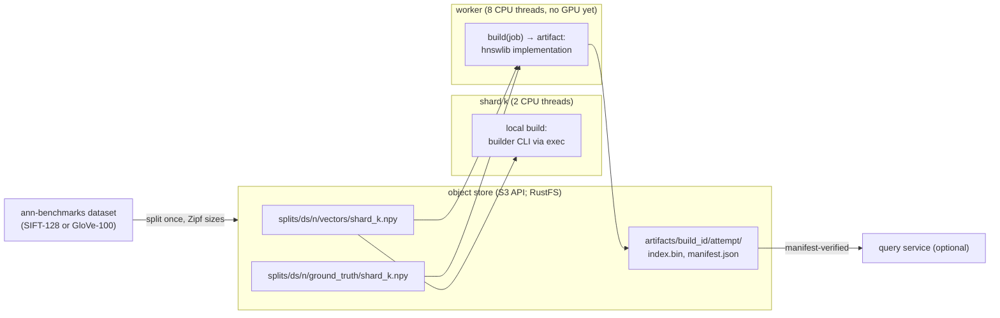
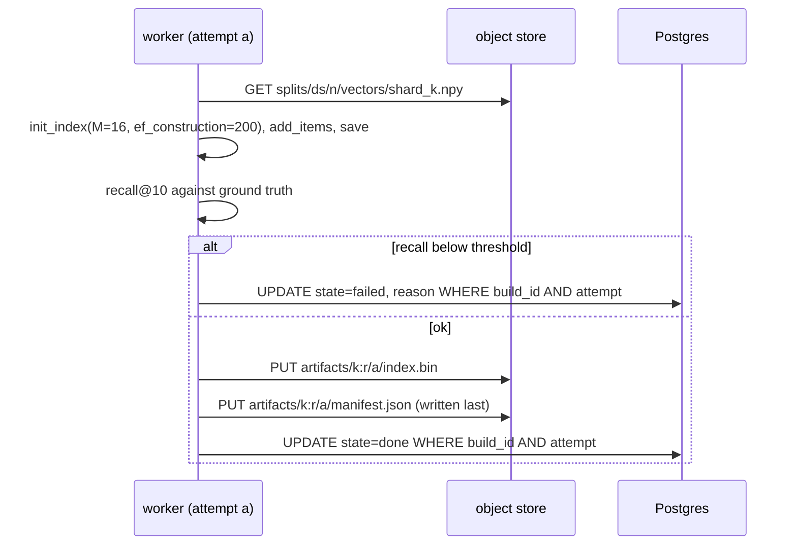
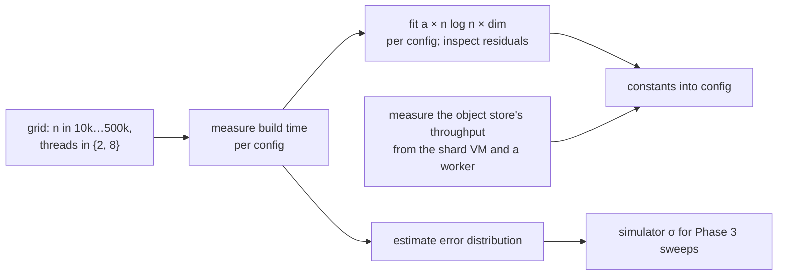

# Phase 4: real CPU builds with hnswlib

## Status and scope

**In progress: step 1 (the data) is done; step 2 (the real build) is being built.** Replace sleeps with real hnswlib builds on real vectors, add the object store, and replace the cost model's constants with measurements.

**Done when** the fitted cost model's error distribution is known, measured on the hardware that stays (the cloud topology without GPUs, below), and the Phase 3 comparison has been rerun on real builds.

## Where things run (restructured during Phase 3 step 7, with the owner)

The software — builder CLI, artifact store, recall gate, fitting code, the comparison rerun — is developed and tested on the laptop with kind, the everyday environment. The measurements are made on **Phase 5's topology without GPUs**: a CPU virtual machine for the shards in the same cloud region, outside the cluster (Phase 2 decision 26), and a small managed cluster with CPU-only workers, MinIO and the scheduler. On one laptop the shards' and the workers' CPUs are the same cores, the "transfer" is a memory copy, and fifty real builds cannot run at once; constants calibrated there would be thrown away in Phase 5. Phase 4 therefore closes by standing the topology up, calibrating there, and committing the manifests, the VM recipe and the teardown script, so Phase 5 only adds the GPU node pool. Roadmap, Phase 4, "Where things run".

## System diagram

The object store — RustFS, decision 13; MinIO when this was drawn — joins as the second stateful service. Vectors flow out to workers; index files and manifests flow back. The scheduler and Postgres are unchanged; only the build implementation and the shard's local build change.



Workers get more threads than a shard, so the tradeoff keeps its shape without a GPU: remote builds are faster but wait in a queue and pay transfer.

## Flows

### Publish order and fencing on the artifact store



A stale attempt writes under its own `attempt` prefix and can never overwrite the winner. A reader that sees a manifest knows the index beside it is complete. Completion in Postgres is recorded only after the manifest exists, so `state = done` implies a readable artifact.

### Calibration



### The build, as the worker and the shard both run it (step 2)

```mermaid
sequenceDiagram
    participant C as caller (worker: Python; shard: Go via exec)
    participant B as python -m kgpu_builder build
    participant S as object store
    C->>B: --build-id k:r --attempt a --dataset ds --n-shards n --shard k --threads t
    B->>S: GET splits/ds/n/vectors/shard_k.npy, queries.npy, ground_truth/shard_k.npy
    loop 10 batches of add_items
        B-->>C: stderr {"progress": 0.1 .. 1.0}
    end
    B->>B: recall@10 over the held-out queries (ef_search 100) against the exact truth
    alt recall below RECALL_MIN
        B-->>C: stdout {"status":"failed","reason":"recall@10 0.84 < 0.90"}; exit 3
    else
        B->>S: PUT artifacts/k:r/a/index.bin
        B->>S: PUT artifacts/k:r/a/manifest.json (last)
        B-->>C: stdout the manifest; exit 0
    end
    Note over C: worker: complete(k:r, a) under the fencing guard / shard: POST /builds/k:r/done
    Note over C: a kill (preempt, lease lost) leaves at most an orphan index.bin under its own attempt — no manifest, so never a completed build
```

## Design decisions

| # | Decision | Alternatives | Why |
| --- | --- | --- | --- |
| 1 | Object store (MinIO) for vectors and artifacts | Blobs in Postgres; shared filesystem | Hundreds of MB per shard. Postgres is a poor file server; a shared filesystem is painful across machines. S3 API means the cloud phase changes a URL. |
| 2 | Artifacts under `build_id/attempt/`, manifest written last, completion recorded after | Overwrite a single path per build | The fencing token extends to the artifact store. Without it a paused worker could overwrite a newer index after waking. |
| 3 | The builder is a CLI invoked by both the Python worker and the Go shard (via exec) | Reimplement the build in Go for the shard | One implementation, one set of parameters, one recall gate. Shard-side build cost is measured on the same code. |
| 4 | Recall gate before publishing | Trust the build | Catches a broken build before it is marked done. Also the secondary metric from the roadmap. |
| 5 | Follow-up jobs become CPU-burning loops, not sleeps | Keep sleeping | They must compete with local builds for the shard's real CPU limit, or the blocking rule is not being tested. |
| 6 | Fit the cost model from measurements and keep the residuals | Assume n log n | The estimate error distribution is an input to Phase 3's σ sweep; assuming the curve would hide the project's main uncertainty. |
| 7 | Develop on the laptop, measure in the cloud: the calibration that enters `docs/speedup.md` is made on Phase 5's topology without GPUs, stood up as Phase 4's closing step | Calibrate on the laptop (the roadmap's original plan); do all of Phase 4 in the cloud | Laptop numbers would be replaced in Phase 5 (shared cores, no network, no concurrency); all-cloud slows every iteration of hardware-independent software. The split makes the "where things run" decision once and rehearses the cloud setup and its cost controls before a GPU is rented. |
| 8 | The shards run on a CPU virtual machine in the same cloud region, outside the cluster | A CPU node pool inside the cluster (reverses Phase 2 decision 26; Kubernetes would restart the "database fleet"); the laptop (the transfer term then measures a home internet connection) | Real cores separate from the workers', a real cloud network to MinIO and the GPU pool, and the Phase 2 shape kept. The laptop is allowed only for a functional end-to-end check, never for a ledger number. |
| 9 | **Two splits side by side, 6 and 50 shards, with the size distribution fixed by the split** (`builder/kgpu_builder/split.py`): the shard of rank r gets a share proportional to 1/r^s of the whole dataset (largest = N/H(n, s), sizes summing to N exactly), ranks assigned to shard ids by a seeded permutation — the same method as the Go generator, not the same permutation (seed 1 lands rank 1 on shard 1 here and on shard 0 there; when the generator gains its sizes-from-the-split mode, the split's assignment wins, cross-check G9) — each shard a contiguous slice of the train set; every shard holds at least one vector (a share that floors to 0 is bumped and the deficit taken from the top ranks — only totals within a few multiples of n are affected, G1); a manifest per split records offset, size, rank and the sha256 of every object. Object layout: `datasets/<ds>/queries.npy` and `manifest.json`; `splits/<ds>/<n>/manifest.json`, `vectors/shard_k.npy`, `ground_truth/shard_k.npy`; later `artifacts/<build_id>/<attempt>/`. | One split, with 50-shard rounds subsampling; sizes still drawn per round from a distribution (the data would have to be re-cut every round) | 6 is the everyday scale and 50 the target; the exponent is a property of how the data was cut, chosen once; the seed keeps governing the query streams and the DDL timing. |
| 10 | **The high-dimension set is a 300k subset of GIST-960** (the first 300k train rows; all 1,000 held-out queries) | The OpenAI 1536-d sets (`dbpedia-openai-*`) — no longer served by ann-benchmarks.com (404 on 2026-10-28); a Hugging Face parquet set (a second data source and a pyarrow dependency); SIFT only | Same source, same HDF5 layout, available now; 960 lies between the 768 and 1536 the roadmap names; the subset keeps the worst case (every shard building at once) near 1.9 GB. |
| 11 | **boto3 is the S3 client** | minio-py (lighter, MinIO's own); a hand-rolled signed-request client | Phase 5 changes an endpoint and keys and nothing else (decision 1); boto3 is the client every S3-compatible store, Google Cloud Storage's interoperability API included, is tested against. |
| 12 | **The Python for Phase 4 lives in one shared package, `builder/` (`kgpu_builder`, its own uv project)**: the data tools now, the hnswlib builder CLI from step 2; the worker takes it as a path dependency then | Inside the worker's project (shard-side tooling in a package named "worker"); a third project per concern | Decision 3 wants one implementation run by the worker and, via exec, the shard; one package is that implementation. |
| 13 | **RustFS replaces MinIO as the object store** (`rustfs/rustfs:1.0.4`, pinned; Compose service `objectstore`, a StatefulSet with a 10 GiB claim on kind, NodePort 30900 mapped to the laptop at the next cluster creation; a throwaway container beside Postgres in `scripts/test-db.sh`). Reverses the product named in decision 1, not its shape: still one S3-API server, vectors in and artifacts out. MinIO stopped publishing community images in 2025, archived its repository in 2026, its Docker Hub repositories were deleted in September 2026 and quay.io now refuses anonymous pulls; its last free release carries an authentication-bypass CVE. | SeaweedFS (mature, also passed the store round-trip test, but its S3 gateway needs a separate credentials file and it took ~15 s to come up); a Chainguard build of the last MinIO (the CVE); a MinIO fork | Both candidates were driven by the same `Store` tests before choosing; RustFS is MinIO-shaped (keys by environment, S3 on 9000, console on 9001) and came up instantly. Owner's choice on 2026-10-28. |
| 14 | **Ground truth is exact and per shard, from the dataset's own held-out queries**: for each shard the top-100 by Euclidean distance over that shard's vectors, by brute force (a chunked matrix product), stored as local indices (`int32 [n_queries, 100]`). The recall gate (decision 4) reads the top-10 of it. | The HDF5's `neighbors` (over the whole dataset, useless per shard); sampling the queries | A query's true neighbours within a shard are what that shard's index is asked for; 10k queries × 1M vectors is seconds with BLAS, so exactness costs nothing. |
| 15 | **`rounds.dataset` names a round's data** (migration 0007, owner approved): the shard simulator sets it (`DATASET=sift-128`); the split is the round's `n_shards`; a build's vectors are `splits/<dataset>/<n_shards>/vectors/shard_<shard_id>.npy`. NULL is a modeled round (the fake builder). The scheduler does not validate the name or the shard count against the committed splits (it has no reason to know them, G4): a wrong one fails at the first build with a reason naming the missing object. | An environment variable on every process (couples a deployment to one dataset; a round could not say which data it used) | A round names its data as a DDL names its table; the worker learns it with the claim and the build row stays what it was. |
| 16 | **The split's sizes reach the Go side as committed JSON** (`experiments/workload/splits/<dataset>-<n>.json`, a copy of the split manifest the builder wrote; `SizeDist{Kind: "split", Split: "sift-128"}` makes the generator take every shard's `NVectors` and the scenario's `Dim` from it; the query streams and DDL offsets are drawn by the same process from the same seed but are **not** the preset's streams, because no size draws are consumed first — cross-check G7). A straggler preset's `Straggler` is dropped by `ApplySplit` (the split's sizes win, G8); a `SizeDist` built by hand with `Kind "split"` and no committed file makes `Generate` panic (a programming error, G9). The copy is verifiable against the store by its sha256s. | The shard simulator reading the manifest from the store (an S3 client in Go: a new dependency for one file); the builder CLI printing it (a process start for a number) | Sizes fixed by the split (decision 9) must be the same in the shard simulator, the scheduler's cost model inputs and the discrete-event simulator, offline and deterministically; a 10 KB file in the repo is the cheapest shared truth. The split's rank assignment wins (cross-check G9). |
| 17 | **The build CLI's contract**: `python -m kgpu_builder build --build-id --attempt --dataset --n-shards --shard --threads [--m 16 --ef-construction 200 --recall-k 10 --ef-search 100]`, `RECALL_MIN` (default 0.9) and the `S3_*` variables from the environment. stdout carries one JSON document, the artifact manifest (or `{"status":"failed","reason"}`); stderr carries progress as JSON lines (`{"progress": p}` after each of ten `add_items` batches, and `{"phase": "build"|"gate"|"publish"}` at each phase); exit 0 built and published, 3 recall below the threshold, 2 usage (one line on stderr: a bad `RECALL_MIN`, threads < 1, a build id with a slash), 1 anything else — and exit 1 still carries one failure document on stdout. The manifest names the installed hnswlib version. With one thread the same vectors give the same index bytes and recall; with several, hnswlib's parallel insertion makes the graph, and the recall slightly, timing-dependent (cross-check G10). Artifacts: `index.bin` then `manifest.json` under `artifacts/<build_id>/<attempt>/` (invariant 7, decision 2); the manifest records build id and attempt, dataset/split/shard, n_vectors, dim, M, ef_construction, threads, index bytes and sha256, recall@k against the exact truth, ef_search, build and gate seconds, the hnswlib version. | Importing the builder in the worker and re-implementing it in Go for the shard (decision 3 rejects it); progress through a file | A process boundary is what both callers can drive and kill; the exit code and one JSON document are the whole interface, so the Go shard needs no Python knowledge beyond "run this, read that". |
| 18 | **The worker's `HnswlibBuilder` runs the CLI as a subprocess** (`BUILDER=hnswlib`; `BUILDER_CMD` defaults to `python -m kgpu_builder`): stderr progress lines feed the worker's progress callback, `cancel` kills the child (`SIGKILL`: the lease is gone, nothing it writes can be completed), exit 3 becomes the existing `fail` path with the gate's reason (decision 41 of Phase 1), exit 0's manifest becomes the `Artifact`. The worker image is built from the repo root with the builder as a path dependency and hnswlib compiled in a build stage. | Import `kgpu_builder` in-process (one implementation, but then the worker's cancellation and the shard's are different mechanisms) | Parity with the shard: the same process, the same kill, the same exit codes on both sides of the placement decision. |
| 19 | **The Go shard runs its local build by exec-ing the same CLI** (`BUILDER_CMD`, default `uv run --project <repo>/builder python -m kgpu_builder`; `SHARD_THREADS`, default 2) in its own process group: stderr progress becomes `build_progress` in the shard's reports, a preempt or a won speculation kills the group, exit 0 is `POST /builds/{id}/done`, exit 3 is the new `POST /builds/{id}/fail` with the reason (a local build could not fail before; the recall gate makes it possible). The modeled sleep remains the behaviour when the round has no dataset. | A Go hnswlib binding (a second implementation, the thing decision 3 forbids) | The roadmap's "the Go shard (via exec)"; killing a process group is the real preempt, with real lost work. |
| 20 | **Queries burn CPU when the round has a dataset** (`QUERY_MODE=burn`, automatic with `DATASET`): a query's modeled duration is spent in a busy loop on the shard's goroutine instead of a sleep, and the shard simulator refuses a time scale other than 1 with a dataset (a real build cannot be sped up). | Keep sleeping (the blocking rule would then be untested, decision 5) | Local builds and queries must compete for the shard's real cores, or the model's central cost is fiction. |
| 21 | **A terminally failed real build is retried on the shard's own CPU once, then its index queries run without the index** (owner's choice; migration 0008 `builds.local_retries`): when the shard learns its build is `failed` (the recall gate refused it locally, or the GPU retry budget ran out) it asks `POST /builds/{id}/retry-local`; `store.RetryLocal` is guarded on `state = 'failed' AND local_retries = 0` and moves the row to local/running at the **next attempt number** (so the retry's artifacts have their own prefix and a stale GPU attempt can never be mistaken for them, invariant 7 — the same reason a first local build publishes under the row's attempt rather than a constant 0, cross-check G3). If the retry fails too, the shard marks the index as never coming, runs its needs-index queries at their modeled duration — the exact-scan fallback a database takes past an unusable index — and the round completes with the failure on record (the completion rule, done or failed per build, is unchanged). `attempt` therefore increments on every claim *and* on the one local retry. Answers the Phase 1 open question; first hit live as bug 18. | Run the index queries at once (no second chance for a flaky gate); fail the round (its time then measures nothing); retry on the GPU again (the budget was the GPU's) | One local retry is what a DBA would do by hand before accepting an unusable index; "then the queries run anyway" is what the optimizer does by itself. |
| 22 | **The worker's memory limit is 2 GiB (request 512 MiB) and the index is streamed to the store from disk**: a real build holds the vectors and the graph (about 1 GiB for SIFT's largest 6-way shard); the Phase 2 limit of 512 MiB, sized for a sleeping builder, killed the container (bug 18). `Store.put_file` uploads in parts and the builder drops the graph before uploading, so the peak is vectors plus graph, not plus the serialised index. | Keep 512 MiB and refuse builds above it (the memory filter is modeled, not measured, until Phase 5); no limit (a runaway build would take the node) | The limit must come from the real build's measured need; 2 GiB fits the laptop's kind nodes with two workers and the GIST subset's largest shard (770 MB). |
| 23 | **A calibration point is a real build of a prefix of the split's largest shard, in its own process** (`python -m kgpu_builder calibrate`): the first `size` vectors of that shard (so every size is a prefix of the same data), built with the parameters a real build uses, gated by an exact top-10 computed for the prefix on 500 held-out queries, one child process per point so its peak memory (`ru_maxrss`) is its own; one CSV row per point (size, dim, threads, build, gate and fetch seconds, recall, index bytes, peak RSS, host), appended as it comes so an interrupted grid keeps what it measured. The default grid is 10k–400k vectors at 2 and 8 threads (the roadmap's shard and worker). | Build whole shards only (five sizes per dataset, no control over the grid); time the live rounds' builds (confounded by contention); an in-process loop (peak memory would be the largest point's for every point) | The fit needs many sizes on one data distribution with one hardware state per point; the process boundary gives exact memory and a clean exit per point, and the CSV-as-you-go survives a laptop sleep. |
| 24 | **The fit is the cost model's own formula, per thread count, fitted in log space, with its error kept as the simulator's sigma** (`fit`): for each thread count, A is the geometric mean of measured/(n·ln(n)·dim) — least squares of the logarithms with a unit slope — because the error that matters is multiplicative, a build twice as long as estimated being the same mistake at every size. (First draft: least squares through the origin in linear space. The cross-check showed that fit dominated by the largest builds, leaving a −0.2 mean log residual that the reported sigma then hid — its G1 — so the method was amended; the linear-space A is still printed for reference.) The residual of a point is measured/fitted; the log residuals are centred by construction, and `sigma`, their population standard deviation, is also their root-mean-square — exactly the log-normal factor the simulator multiplies estimates by (Phase 3 decision 23), so the sweep's sigma axis can be set to a measured value. A free-exponent fit t = c·n^p·dim is reported beside it when at least two distinct sizes exist (n/a otherwise): p > 1 says the curve is steeper than n·ln(n), which one constant cannot capture and which the residual table then shows as a drift. The `COST_*` block the scheduler and worker already read is emitted for a shard/worker thread pair: `COST_A` is the shard's A, `COST_SPEEDUP` the ratio of the two A's (what "GPU speedup" means while the workers are CPUs, roadmap Phase 4), `COST_BANDWIDTH` the median (the true median, averaging the two middles) of the worker points' fetch bytes/s, `COST_GPU_OVERHEAD` the worker points' median fetch + gate seconds unless given — the per-build fixed cost the build time excludes. Several CSVs are fitted together; a missing thread pair omits the block with a note. | Fit a new formula (the simulator, the policies and the estimator all assume this one; changing the shape is a Phase 3 change); fit through a free intercept (a constant offset belongs in the overhead term) | The deliverable is the method and its honesty about the error, not a better curve: the residual spread is an input to the experiments, and the environment block makes a calibrated cluster a config change. |

## Calibration targets from the published figures

The measurements this phase makes have published reference points (Phase 1 doc, "Cost model v0 against published numbers"):

- **CPU build time.** 1M x 128 in 490 s and 10M x 128 in 9,489 s on 8 vCPUs (OpenSearch RFC); our model is 2 to 3x optimistic. The grid should reach at least 1M vectors at 128 dimensions on the worker's thread count, and the fitted constant should be compared with those two points. Whether `n log n` holds across the grid, rather than being assumed, is the residual check already planned.
- **Dimensions.** SIFT-128 and GloVe-100 calibrate the low-dimension regime only. Add at least one high-dimension dataset subset (768 or 1536, e.g. a Cohere or OpenAI embedding set, a few hundred thousand vectors) so the dimension term of the fit is measured, since transfer and memory scale with it and Phase 3's `high_dim` scenario depends on it.
- **Index size.** Oracle's rule, 1.3 x vectors x dims x 4 bytes, and our 640 bytes per 128-dim vector agree within a few percent; measure the actual file sizes from hnswlib and record bytes per vector against dimension and M.
- **Transfer.** Measure MinIO throughput inside the cluster for objects from 100 MB to several GB; at production sizes a single shard's vectors are 6 to 61 GB, so throughput and object-store parallelism decide whether the GPU path pays at all.
- **Thread scaling.** The published figures are 8 vCPUs (RFC), 32 cores (NVIDIA), 64 vCPUs (pgvector, 30x with parallel workers). Fit build time against thread count for both the shard's limit and the worker's, because the local-vs-GPU tradeoff is really "2 threads here vs 8 there vs a GPU".

## Implementation notes

### Step 1: the data

| Path | What |
| --- | --- |
| `builder/` (`kgpu_builder`, its own uv project: numpy, h5py, boto3) | Decision 12. `datasets.py` the catalogue (SIFT-128; GIST-960 with a 300k train limit, decision 10); `download.py` resumable HTTP download checked against the catalogue's size; `split.py` the Zipf split and its manifest (decision 9); `groundtruth.py` exact top-k per shard by a chunked matrix product and `recall_at` for the gate (decision 14); `store.py` the S3 client behind one class (decision 11); `cli.py` `python -m kgpu_builder download|split|groundtruth|upload|verify|all`. |
| `builder/tests/` | Pure: the Zipf sizes by hand (1M across 6: 408,163 at the top, sizes halving by rank, summing exactly), the seeded rank permutation and contiguous offsets, the split's sha256 round trip; the exact top-k against a naive loop with chunking invisible, k clamped to the shard; recall@k by hand. Against a throwaway object store (`TEST_S3_ENDPOINT`, from `scripts/test-db.sh`): bytes, JSON and `.npy` round trips, listing, existence, prefix deletion, idempotent bucket creation. |
| `deploy/compose.yaml` `objectstore`, `deploy/k8s/objectstore.yaml`, `deploy/kind/cluster.yaml` | RustFS 1.0.4 (decision 13): a Compose service on 127.0.0.1:9000; on kind a Secret, a NodePort Service (30900, mapped to the laptop at the next cluster creation) and a StatefulSet with a 10 GiB claim. |
| `scripts/test-db.sh` | Starts a throwaway RustFS beside the throwaway Postgres, exports `TEST_S3_*`, runs the builder's tests after the worker's. |
| `scripts/phase4-data.sh` | The pipeline against the cluster's store for both datasets at 6 and 50 shards (NodePort or a port-forward), ending with the bucket's contents by prefix; saves `test-logs/phase4/step1-data.log`. |

**What the data looks like** (`data/`, gitignored, 2.4 GB of splits plus the two HDF5 files): SIFT-128's 1M vectors split 6 ways give 408,164 / 204,082 / 136,055 / 102,040 / 81,632 / 68,027 vectors — the floors of N/(r·H(6,1)) with the 3 left over on ranks 1–3, as the rule says (the cross-check's F1 caught a first draft that had rounded by hand to the largest fractional parts); ranks are permuted across shard ids by seed 1, rank 1 landing on shard 1. 50 ways the top is 222,… and the bottom 4,4…; the GIST subset's 300k give 122,449 at the top of the 6-way split. Exact top-100 ground truth for 10,000 SIFT queries takes 128 s for the 6-way split and 86 s for the 50-way on the laptop in float64 (91 s and 71 s in the float32 first version, bug 16); GIST's 1,000 queries take 5–8 s.

**On the cluster** (`test-logs/phase4/step1-data.log`): both datasets at both splits uploaded through a port-forward and verified object by object against the manifests' sha256 — 541 MB, 717 MB, 1,158 MB and 1,176 MB at 120–175 MB/s laptop-to-pod through kind's Docker network (two runs: 3.6–8.5 s each). The bucket holds 3.6 GB: the four splits' vectors and ground truth plus the two query sets. That throughput is the first measured number for the cost model's transfer term (assumed 200 MB/s); the calibration proper waits for the cloud topology (decision 7), where the shard VM's path to the store is a real network.

### Cross-check of step 1, the data

A fresh agent wrote 75 black-box checks in five files (`builder/tests/test_xcheck_*.py`; saved as `test-logs/phase4/step1-crosscheck-data.log`) from the docs, `--help` and the docstrings alone: the Zipf rule against an independent fraction-exact computation at nine (N, n, s) cases and the edge cases, the seeded permutation, the manifest's bytes and hashes, the ground truth against a float64 difference-and-norm reference (ties, duplicates, far queries, chunk sizes), the CLI on a synthetic HDF5 (errors, determinism, a tampered bucket), the store against a throwaway RustFS (48 MiB objects, 2,345 keys across S3's 1000-key pages, overwrite, wrong keys), the four real splits on disk against the source HDF5, and a read-only comparison of the cluster's bucket with the laptop (232 objects, identical). 69 passed; the six failures were two implementation problems, one doc error and the same precision limit seen twice. Triage:

| Finding | Kind | Resolution |
| --- | --- | --- |
| **F1: the design doc's example sizes were rounded by hand** (408,163 / 136,054 / 102,041 / 81,633 — the largest-fractional-part rounding), not the rule's floors-plus-remainder (408,164 / 136,055 / 102,040 / 81,632). | Doc error | Doc and the implementer's test corrected to what was built. |
| **F2 / F2b: ground truth was not exact** — float32 cancellation in |q|²+|x|²−2q·x: 4 % correct top-10 at an offset of 1000; 45/1000 GIST rows misordered inside the top-100, one wrong set; SIFT exact (integer distances). | **Bug 16** | float64 throughout; all four splits' ground truth regenerated and re-uploaded; the agent's offset and real-data exactness tests pin it. |
| **F3 / F4: the manifest held no sha256 for the ground-truth objects, so `verify` reported them "intact" with nothing to check** — a flipped byte in a ground-truth object passed. | Implementation bug (the false-success shape of bug 15) | The `groundtruth` command writes each object's sha256 and the k into the manifest; `verify` checks every object the manifest names, flags any shard object without a hash, and reports a missing object as a problem instead of a traceback. |
| G1: the at-least-one-vector rule when N is close to n distorts shares (60 across 50 gives [9, 3, 1, …]) and was documented only in tests.md. | Spec gap | Pinned in `zipf_sizes` and decision 9; irrelevant at real sizes. |
| G2: `recall_at` with k beyond the stored width divided by k (a perfect answer at k = 200 scored 0.5). | Spec gap leaning bug | It raises `ValueError` when k exceeds either width. |
| G3: a file placed under `KGPU_DATA_DIR/ann-benchmarks/` by hand drives the pipeline, undocumented; `all` cannot run on it (download's size check first). | Spec gap | Documented in `--help`. |
| G4: no check that the HDF5 holds the catalogue's train limit or dim (a 500-row "gist" split silently). | Spec gap leaning bug | `split` refuses a file with fewer rows than the limit or a different dim. |
| G5: `groundtruth` before `split`, a network failure, and a missing object in `verify` surfaced as tracebacks. | Spec gap | One-line errors for all three; exit code 1 unchanged. |
| G6: the store leaked botocore exception types to callers. | Spec gap leaning bug | `store.NotFound` from every getter and `size()`. |
| G7: `list`/`delete_prefix` matched plain string prefixes (`splits/sift-128/5` would also take `…/50`; `artifacts/3:1` would take `artifacts/3:17`). | Spec gap leaning bug | Prefixes are directories: a non-empty prefix without a trailing slash gets one. |
| G8: the ground truth's k was not recorded. | Spec gap | `ground_truth_k` in the split manifest. |
| G9: "ranks by a seeded permutation as the Go generator does" is the same method, not the same permutation (seed 1 puts rank 1 on shard 1 in the split, shard 0 in the generator). | Spec gap | Decision 9 says the split's assignment wins when the generator gains its sizes-from-the-split mode. |
| G10: the implementation notes carried a placeholder; the diagram, flows and config docstring still said MinIO and lacked the `<n>/` level. | Doc error | Fixed. |
| G11: `put_npy`'s return value was undocumented. | Spec gap | Documented: the object's size in bytes. |

### Step 2: the real build

| Path | What |
| --- | --- |
| `builder/kgpu_builder/build.py`, `cli.py` (`build`) | The build behind the CLI (decision 17): fetch, ten `add_items` batches with progress on stderr, the recall gate, `index.bin` then `manifest.json` under `artifacts/<build_id>/<attempt>/`; exit 0 / 3 / 1. `builder/tests/test_build.py`: write order, progress and phases, the reloaded index scoring the same recall, the gate refusing with nothing written, the CLI's exit codes and streams. |
| `db/migrations/0007_rounds_dataset.sql`, `scheduler/store` (`CreateRoundWithDataset`, `FailLocal`), `scheduler/api` (`POST /rounds` with `dataset`, `POST /builds/{id}/fail`), `shard/client` | A round names its data (decision 15); a running local build can fail with a reason (decision 19). Tests in `store_test.go` and `api_test.go`. |
| `experiments/workload/splits/*.json`, `splits.go` (`LoadSplit`, `ApplySplit`, size kind `split`) | The committed split manifests and the generator's split mode (decision 16); `splits_test.go`. |
| `worker/kgpu_worker/builder.py` (`HnswlibBuilder`, `GateRefused`), `config.py` (`BUILDER`, `BUILDER_CMD`, `BUILD_THREADS`, `RECALL_MIN`), `store.py` (the claim's `dataset`, `n_shards`), `worker/Dockerfile` (repo-root context, two stages) | The worker side (decision 18). `tests/test_hnswlib_builder.py`: a stub command for the plumbing, the real CLI through a `Worker` on a toy split, the gate refusing. |
| `shard/sim/shard.go` (`runRealBuild`, `localFailed`, `burn`), `shard/cmd/shardsim` (`DATASET`, `BUILDER_CMD`, `SHARD_THREADS`) | The shard side (decisions 19, 20): the CLI in its own process group, progress into the reports, `SIGKILL` on preempt, done or fail by exit code; queries burn the CPU with a dataset; time scale 1 enforced. |
| `deploy/compose.yaml`, `deploy/k8s/worker.yaml`, `scripts/k8s-build-load.sh` | `BUILDER`, `BUILD_THREADS`, `RECALL_MIN` and the store's `S3_*` reach the worker; the image builds from the repo root. |
| `scripts/k8s-check-p4-step2.sh` | A real round per policy on the kind cluster: the laptop's shards build locally with 2 threads, the cluster's workers with 8, all from the store; prints every build's manifest; saves `test-logs/phase4/step2-real-round.log`. |

**First real numbers, on the laptop, 2 threads, from the step 2a trial** (`builder/` against the cluster's store; not calibration, decision 7): SIFT-128's 68,027-vector shard built in 5.1 s (recall@10 0.997, 45 MB index); the 408,164-vector shard in 59.8 s (recall@10 0.988, 270 MB). The cost model's placeholder would have said 13.6 s and 94.5 s: this laptop's cores are 1.6–2.7× faster than the Phase 1 constant, and the real curve is steeper than n·ln n between those two sizes (11.8× the time for 7.0× the n·ln n) — the shape step 4's fit has to capture. Fetch and upload through the port-forward: 0.3 s and 0.4 s for the small shard, 1.2 s and 1.7 s for the large.

**The real round on the cluster** (`test-logs/phase4/step2-real-round.log` and `-reactive.log`; sift-128 at 6 shards, 2 workers at 8 threads in kind, the shards on the laptop at 2 threads, time scale 1, every build from the object store). The first attempt is bug 18. After it:

| Policy | Round | Straggler lag | Where the builds ran | The 408k build (8 threads) | Recall@10 |
| --- | --- | --- | --- | --- | --- |
| always_gpu | 69.6 s | 16.6 s | 6 on the workers | 47.2 s build + 0.7 fetch + 0.7 gate + 0.8 upload | 0.988–0.997 |
| reactive | 75.6 s | 6.5 s | all 6 on the workers: the five small builds were placed local at submit and preempted to the GPU queue at the first tick, before their child process had reported a line ("aborted at 0 %") | 53.3 s | 0.989–0.997 |

Every finished build left `index.bin` and `manifest.json` under its attempt; the preempted local attempts left nothing (killed before the gate). The numbers are a functional check, not calibration (decision 7): the shards, the workers and the store share this laptop, and the two workers' 8-thread builds contend with each other on the Docker VM's ten cores (the straggler took 47 s alone and 53 s with company). Two things the round showed that the model does not: a real build's cost model error (the Phase 1 constant said 94.5 s for the 408k build on one shard-class CPU; 8 threads did it in 47 s, 2 threads in 60 s), and reactive's first-tick preempt-everything throwing away six just-started child processes for a round 6 s longer than always_gpu's — the behaviour the full comparison (Phase 3) called harmless at modeled loads is a measurable cost with real builds, and step 4's calibration is what will let the policy judge it.

### Cross-check of step 2, the real build

A fresh agent wrote 75 checks (Go: `scheduler/crosscheck/p4split_test.go`, `p4localfail_test.go`, `p4shardbuild_test.go`; Python: `builder/tests/test_xcheck_build.py`, `worker/tests/test_xcheck_hnswlib.py`; logs `test-logs/phase4/step2-crosscheck-build.log` and `-py.log`) from the docs, `--help` and the docstrings alone: the CLI's streams, exit codes and manifest on a toy split, the publish order observed live from another thread, a kill mid-build, a second attempt leaving the first untouched, the recall threshold at the exact boundary; the fail endpoint's guards, a 100-round race between fail and done, the completion rule; the shard's child process (progress into `shard_status`, garbage on stderr, exits 0/1/2/3, a SIGTERM-ignoring child with a grandchild killed on preempt, CPU time of burning queries, shardsim refusing a time scale with a dataset); the split mode on every preset. 63 passed first time; the 12 failures were six implementation problems, two minor ones and three strictness questions. Triage:

| Finding | Kind | Resolution |
| --- | --- | --- |
| **F1: `POST /builds/{id}/fail` cut the reason by bytes; a cut inside a multi-byte character made Postgres refuse the write, the shard got a 500 and retried, and the build stayed running.** | **Bug 17** | Both sides cut by characters; whitespace-only reasons refused; the limit documented. |
| **F2: one out-of-range progress value from the child (`{"progress": 7}`) made the shard's report invalid (400) and stuck the shard.** | Implementation bug | The shard clamps progress to [0, 1]. |
| **F3: the worker accepted `RECALL_MIN=abc`, `BUILD_THREADS=-3`, `BUILDER=nope` and an unparsable `BUILDER_CMD`**, two of them as tracebacks instead of the documented exit 2. | Implementation bug | `Config` validates all four at startup with one line each. |
| F4: the manifest said `hnswlib_version: unknown` (hnswlib has no `__version__`). | Implementation bug | `importlib.metadata`. |
| F5: exit 1 could leave stdout empty (a traceback on stderr), so the worker's reason was "builder exited 1: ". | Implementation bug | Every exit 1 carries a failure document; a bad `RECALL_MIN` is a usage error (exit 2, one line). |
| F6: the gate's message printed the threshold to two decimals ("0.5330 < 0.53"). | Minor | Four decimals both sides. |
| F7: exit 3 with empty stdout gave an empty reason. | Minor | A default reason. |
| **G1: a failed build plus a query that needs the index never closed the round** — the Phase 1 open question, now reachable; it then happened live (bug 18). | Design gap | **Decision 21**: one local retry, then the index queries run without the index; `builds.local_retries` (migration 0008, owner approved). |
| G2: exit 0 with an unparsable stdout was *done* on the shard and *failed* on the worker. | Spec gap leaning bug | The shard fails it too ("builder exited 0 without a manifest"); exits 1 and 2 fail on both sides. |
| G3: a local build always ran with `--attempt 0`, which happened to avoid a stale GPU attempt's prefix. | Spec gap | The local build publishes under the row's attempt (0 first, N+1 on the retry); decision 21 says why. |
| G4: the scheduler accepts any dataset name or shard count. | Pinned | Decision 15: it has no reason to know the splits; the first build fails with a readable reason. |
| G5: the CLI accepted `--threads 0` and a build id with a slash (a traceback from the store). | Spec gap leaning bug | Usage errors (exit 2). |
| G6: a whitespace-only fail reason was accepted. | Spec gap | Trimmed, then refused if empty. |
| G7: "the stream draws unchanged" read as "the same streams"; they are not (no size draws are consumed, so the sequence shifts). | Doc error | Decision 16 reworded. |
| G8, G9: `ApplySplit` drops a straggler; a hand-built split kind without a file panics. | Spec gap | Documented on decision 16 and the field. |
| G10: thread-count determinism: one thread reproduces the bytes, four do not. | Spec gap | Decision 17 says so. |
| G11: the API package doc lacked the fail endpoint; `client.Round` had no `Dataset`; the build docstring's signature was wrong; the phase lines were not all listed; the diagram's "save the index" read as a store write. | Doc slips | All fixed. |
| G12: the 500-character limit was undocumented. | Spec gap | Decision 19 and the Phase 1 API table. |

### Step 3: the calibration method, rehearsed on the laptop

| Path | What |
| --- | --- |
| `builder/kgpu_builder/calibrate.py` | `run_grid` / `run_point` (decision 23): one child process per (size, threads, repeat), a prefix of the split's largest shard, the real build parameters, an exact top-10 on 500 queries as the gate, peak RSS; CSV rows as they come. `fit_points` / `residual_table` / `env_overrides` (decision 24): A per thread count through the origin, sigma of the log residuals, the power-law fit beside it, the `COST_*` block. |
| `builder/kgpu_builder/cli.py` (`calibrate`, `calibrate-point`, `fit`) | The commands. |
| `experiments/analysis/plot_calibration.py` | Measured vs fitted per thread count on log-log, residual ratio below. |
| `experiments/results/calibration/laptop-*.csv`, `laptop-calibration.png` | The rehearsal's points (committed as a rehearsal, decision 7) and figure. |
| `builder/tests/test_calibrate.py` | The fit by hand on synthetic points (exact recovery, sigma of injected noise, a steeper curve showing in the exponent), the grid through the CLI on a toy split. |

**The rehearsal** (`test-logs/phase4/step3-calibration.log`, `experiments/results/calibration/`): SIFT-128's 408k shard at 10k–400k vectors and the GIST subset's 122k shard at 10k–120k, each at 2 and 8 threads, two repeats, the store through a port-forward. A laptop with ten cores, so a rehearsal of the method (decision 7), but the shape of the result is the finding:

| Fit | 2 threads | 8 threads |
| --- | --- | --- |
| A, seconds per n·ln(n)·dim, log-space fit (both datasets, 20 points each) | 6.08e-8 | 2.97e-8 |
| the linear-space A the first draft reported, and the mean log residual it hid | 7.46e-8, −0.21 | 3.71e-8, −0.22 |
| measured / fitted, worst to best | 0.69 .. 1.49 | 0.70 .. 1.52 |
| sigma (= RMS) of ln(measured / fitted) | 0.22 | 0.25 |
| power law t = c · n^p · dim | p = 1.27, sigma 0.06 | p = 1.30, sigma 0.05 |
| fetch + gate per point (the measured overhead) | 1.13 s | 1.18 s |

Three things it says. (1) **Phase 1's constant was 2.3× pessimistic for these cores** (1.4e-7 against 6.1e-8 at 2 threads) — the number itself belongs to this laptop, but the method found it in two minutes of builds. (2) **The n·ln(n) shape is wrong by a quarter across the grid**: time grows like n^1.3, so one constant under-predicts the big builds and over-predicts the small ones, and the residual spread (sigma 0.22–0.25) is the estimate error the Phase 3 sweeps' sigma axis was built to absorb — their 0.3 arm was the right order. A power law fits to 5 %. Whether to change the cost model's shape is a Phase 3 decision (the simulator, the policies and the estimator share the formula); it is logged as an open question below, to be decided on the cloud topology's data, which is the one that counts. (3) **Eight threads over two is 2.0×, not 4×**, on a machine whose ten cores are not all equal, which is what the roadmap's "workers get more cores than a shard" tradeoff looks like with real contention; and the recall at the gate's fixed ef_search of 100 falls with size (SIFT 0.998 → 0.984, GIST 0.989 → 0.939), so the gate's search parameter is a size-dependent setting the cloud calibration should set per dataset, not a constant. Fetch from the store ran at 153–213 MB/s (the cross-check corrected a first draft's "170–230"), in line with step 1's uploads; the `COST_*` block for this laptop would be `COST_A=6.08e-08 COST_SPEEDUP=2.050 COST_GPU_OVERHEAD=1.18 COST_BANDWIDTH=1.813e8 KGPU_ESTIMATE_SIGMA=0.245`, and is not applied anywhere.

### Cross-check of step 3, the calibration method

A fresh agent wrote 27 checks (`builder/tests/test_xcheck_calibrate.py`, log `test-logs/phase4/step3-crosscheck-calibration.log`) from the docs, `--help` and the docstrings alone: the fit's arithmetic by hand on constructed points and on the committed rehearsal CSVs, degenerate inputs, the grid's schema, order, prefix and gate on a toy split (with a deliberately wrong stored ground truth and NaN rows past the prefix), an interrupted grid, peak RSS per point, the plot. 19 passed first time; the eight failures were one doc error, five implementation edges and the median; but the most valuable item was a pass with a finding. Triage:

| Finding | Kind | Resolution |
| --- | --- | --- |
| **G1: the sigma hid a bias.** The linear-space least squares is dominated by the largest builds; on the rehearsal the mean log residual was −0.21 / −0.22, so the "sigma 0.22 / 0.25" understated the model's real estimate error (RMS 0.30 / 0.33). | Method flaw | **Decision 24 amended**: A is fitted in log space (the geometric mean of measured/x), so the log residuals are centred and sigma is the RMS; the linear-space A and the bias it would hide are printed for reference. The rehearsal's A moved from 7.46e-8 / 3.71e-8 to 6.08e-8 / 2.97e-8 (the speedup 2.01 → 2.05); the sigmas are unchanged by construction. |
| F1: `COST_BANDWIDTH` was the upper-middle value, not the median (1.841e8 against a true 1.813e8). | Implementation bug | The true median; the notes corrected. |
| F2: a single distinct size produced an invented power-law exponent (a minimum-norm solution of an underdetermined system). | Implementation bug | The power law is n/a (printed as nan) with fewer than two distinct sizes. |
| F3, F4: a non-numeric value and a size-1 point (x = 0) crashed `fit` with tracebacks. | Implementation bug | One-line errors; sizes below 2 refused by `calibrate` and `fit`. |
| F5: evidence 6 said fetch "170–230 MB/s"; the points span 153–213. | Doc error | Corrected. |
| F6: a size beyond the shard was found only when its point ran, with a traceback. | Implementation bug | Every size is checked against the shard before the grid starts; errors are one line. |
| F7: `--out` pointing at a CSV with a foreign header appended point rows under it. | Spec gap leaning bug | Refused unless the header is the point schema. |
| G2: `COST_GPU_OVERHEAD` was a stated 2.0 s on top of a fit without an intercept. | Spec gap | The default is the worker points' median fetch + gate seconds (1.18 s on the rehearsal), the measured per-build fixed cost; `--overhead` overrides. |
| G3: peak RSS units differ by platform. | Pinned | Converted to bytes on every platform; the docstring says so. |
| G4: a rerun into the same CSV restarted `repeat` at 0. | Spec gap leaning bug | Repeats continue per (size, threads). |
| G5: the plot wrote an empty figure for an empty CSV while `fit` refused it. | Spec gap | Both refuse in one line. |
| G6: fitting two datasets together needed a hand-made concatenation. | Spec gap | `fit` takes several CSVs. |
| G7: a missing thread pair left `fit` at exit 0 with a note. | Pinned | Kept: the per-thread fits are the output; the block is optional. |
| G8, G9: run order, the largest-shard rule, `fetch_bytes`, fewer than 500 queries, sub-threshold points recorded, NaN rows past a prefix. | Spec gap | Pinned in the module docstring. |

## Open questions

- **Should the cost model's shape change from n·ln(n) to a power law?** Step 3's rehearsal fits hnswlib's build time as n^1.27–1.30 with 5 % residuals, against 22–25 % for the n·ln(n) constant. The formula is shared by the scheduler's estimates, the policies, the queue-replay estimator and the simulator (Phase 3), so changing it is a Phase 3 decision with a sweep rerun behind it. Decide on the cloud topology's calibration (step 4), which is the data that counts; until then the sigma the rehearsal measured (0.25) is the honest estimate-error setting for the sweeps.
- **The gate's `ef_search` is a size-dependent setting.** At the default 100 the recall at the gate falls with the shard's size (SIFT 0.998 at 10k to 0.984 at 400k; GIST 0.989 to 0.939 at 120k) because a bigger graph needs a wider search for the same recall. The threshold 0.9 still passes; the cloud calibration should record recall against ef_search per dataset and set the gate from it.

- Dataset: SIFT-128 (1M) or GloVe-100? Decide by what fits in laptop memory after the Zipf split with 50 shards.
- Is the optional query service worth building? Only if there is time; it is the thing that would make "swap in a new index without dropping requests" concrete.
