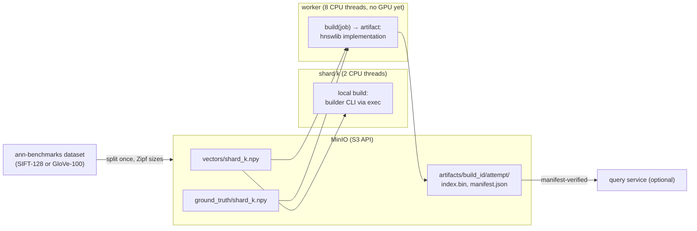
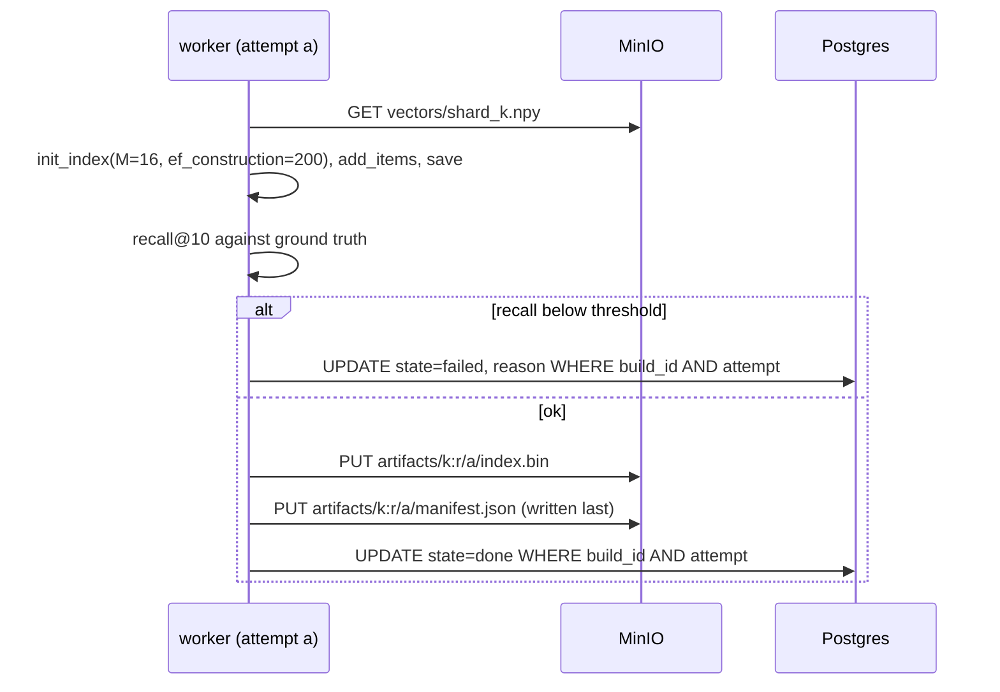
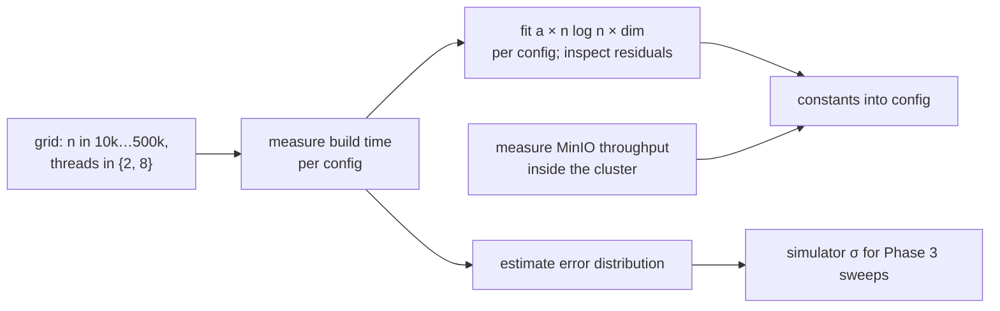

# Phase 4: real CPU builds with hnswlib

## Status and scope

**In progress: step 1, the data, is built.** Replace sleeps with real hnswlib builds on real vectors, add the object store, and replace the cost model's constants with measurements.

**Done when** the fitted cost model's error distribution is known, measured on the hardware that stays (the cloud topology without GPUs, below), and the Phase 3 comparison has been rerun on real builds.

## Where things run (restructured during Phase 3 step 7, with the owner)

The software — builder CLI, artifact store, recall gate, fitting code, the comparison rerun — is developed and tested on the laptop with kind, the everyday environment. The measurements are made on **Phase 5's topology without GPUs**: a CPU virtual machine for the shards in the same cloud region, outside the cluster (Phase 2 decision 26), and a small managed cluster with CPU-only workers, MinIO and the scheduler. On one laptop the shards' and the workers' CPUs are the same cores, the "transfer" is a memory copy, and fifty real builds cannot run at once; constants calibrated there would be thrown away in Phase 5. Phase 4 therefore closes by standing the topology up, calibrating there, and committing the manifests, the VM recipe and the teardown script, so Phase 5 only adds the GPU node pool. Roadmap, Phase 4, "Where things run".

## System diagram

MinIO joins as the second stateful service. Vectors flow out to workers; index files and manifests flow back. The scheduler and Postgres are unchanged; only the build implementation and the shard's local build change.

Workers get more threads than a shard, so the tradeoff keeps its shape without a GPU: remote builds are faster but wait in a queue and pay transfer.

## Flows

### Publish order and fencing on the artifact store

A stale attempt writes under its own `attempt` prefix and can never overwrite the winner. A reader that sees a manifest knows the index beside it is complete. Completion in Postgres is recorded only after the manifest exists, so `state = done` implies a readable artifact.

### Calibration

## Design decisions

| # | Decision | Alternatives | Why |
| --- | --- | --- | --- |
| 1 | Object store (MinIO) for vectors and artifacts | Blobs in Postgres; shared filesystem | Hundreds of MB per shard. Postgres is a poor file server; a shared filesystem is painful across machines. S3 API means the cloud phase changes a URL. |
| 2 | Artifacts under `build_id/attempt/`, manifest written last, completion recorded after | Overwrite a single path per build | The fencing token extends to the artifact store. Without it a paused worker could overwrite a newer index after waking. |
| 3 | The builder is a CLI invoked by both the Python worker and the Go shard (via exec) | Reimplement the build in Go for the shard | One implementation, one set of parameters, one recall gate. Shard-side build cost is measured on the same code. |
| 4 | Recall gate before publishing | Trust the build | Catches a broken build before it is marked done. Also the secondary metric from the roadmap. |
| 5 | Follow-up jobs become CPU-burning loops, not sleeps | Keep sleeping | They must compete with local builds for the shard's real CPU limit, or the blocking rule is not being tested. |
| 6 | Fit the cost model from measurements and keep the residuals | Assume n log n | The estimate error distribution is an input to Phase 3's σ sweep; assuming the curve would hide the project's main uncertainty. |
| 7 | Develop on the laptop, measure in the cloud: the calibration that enters `docs/speedup.md` is made on Phase 5's topology without GPUs, stood up as Phase 4's closing step | Calibrate on the laptop (the roadmap's original plan); do all of Phase 4 in the cloud | Laptop numbers would be replaced in Phase 5 (shared cores, no network, no concurrency); all-cloud slows every iteration of hardware-independent software. The split makes the "where things run" decision once and rehearses the cloud setup and its cost controls before a GPU is rented. |
| 8 | The shards run on a CPU virtual machine in the same cloud region, outside the cluster | A CPU node pool inside the cluster (reverses Phase 2 decision 26; Kubernetes would restart the "database fleet"); the laptop (the transfer term then measures a home internet connection) | Real cores separate from the workers', a real cloud network to MinIO and the GPU pool, and the Phase 2 shape kept. The laptop is allowed only for a functional end-to-end check, never for a ledger number. |
| 9 | **Two splits side by side, 6 and 50 shards, with the size distribution fixed by the split** (`builder/kgpu_builder/split.py`): the shard of rank r gets a share proportional to 1/r^s of the whole dataset (largest = N/H(n, s), sizes summing to N exactly), ranks assigned to shard ids by a seeded permutation as the Go generator does, each shard a contiguous slice of the train set; a manifest per split records offset, size, rank and the sha256 of every object. Object layout: `datasets/<ds>/queries.npy` and `manifest.json`; `splits/<ds>/<n>/manifest.json`, `vectors/shard_k.npy`, `ground_truth/shard_k.npy`; later `artifacts/<build_id>/<attempt>/`. | One split, with 50-shard rounds subsampling; sizes still drawn per round from a distribution (the data would have to be re-cut every round) | 6 is the everyday scale and 50 the target; the exponent is a property of how the data was cut, chosen once; the seed keeps governing the query streams and the DDL timing. |
| 10 | **The high-dimension set is a 300k subset of GIST-960** (the first 300k train rows; all 1,000 held-out queries) | The OpenAI 1536-d sets (`dbpedia-openai-*`) — no longer served by ann-benchmarks.com (404 on 2026-10-28); a Hugging Face parquet set (a second data source and a pyarrow dependency); SIFT only | Same source, same HDF5 layout, available now; 960 lies between the 768 and 1536 the roadmap names; the subset keeps the worst case (every shard building at once) near 1.9 GB. |
| 11 | **boto3 is the S3 client** | minio-py (lighter, MinIO's own); a hand-rolled signed-request client | Phase 5 changes an endpoint and keys and nothing else (decision 1); boto3 is the client every S3-compatible store, Google Cloud Storage's interoperability API included, is tested against. |
| 12 | **The Python for Phase 4 lives in one shared package, `builder/` (`kgpu_builder`, its own uv project)**: the data tools now, the hnswlib builder CLI from step 2; the worker takes it as a path dependency then | Inside the worker's project (shard-side tooling in a package named "worker"); a third project per concern | Decision 3 wants one implementation run by the worker and, via exec, the shard; one package is that implementation. |
| 13 | **RustFS replaces MinIO as the object store** (`rustfs/rustfs:1.0.4`, pinned; Compose service `objectstore`, a StatefulSet with a 10 GiB claim on kind, NodePort 30900 mapped to the laptop at the next cluster creation; a throwaway container beside Postgres in `scripts/test-db.sh`). Reverses the product named in decision 1, not its shape: still one S3-API server, vectors in and artifacts out. MinIO stopped publishing community images in 2025, archived its repository in 2026, its Docker Hub repositories were deleted in September 2026 and quay.io now refuses anonymous pulls; its last free release carries an authentication-bypass CVE. | SeaweedFS (mature, also passed the store round-trip test, but its S3 gateway needs a separate credentials file and it took ~15 s to come up); a Chainguard build of the last MinIO (the CVE); a MinIO fork | Both candidates were driven by the same `Store` tests before choosing; RustFS is MinIO-shaped (keys by environment, S3 on 9000, console on 9001) and came up instantly. Owner's choice on 2026-10-28. |
| 14 | **Ground truth is exact and per shard, from the dataset's own held-out queries**: for each shard the top-100 by Euclidean distance over that shard's vectors, by brute force (a chunked matrix product), stored as local indices (`int32 [n_queries, 100]`). The recall gate (decision 4) reads the top-10 of it. | The HDF5's `neighbors` (over the whole dataset, useless per shard); sampling the queries | A query's true neighbours within a shard are what that shard's index is asked for; 10k queries × 1M vectors is seconds with BLAS, so exactness costs nothing. |

## Calibration targets from the published figures

The measurements this phase makes have published reference points (Phase 1 doc, "Cost model v0 against published numbers"):

- **CPU build time.** 1M x 128 in 490 s and 10M x 128 in 9,489 s on 8 vCPUs (OpenSearch RFC); our model is 2 to 3x optimistic. The grid should reach at least 1M vectors at 128 dimensions on the worker's thread count, and the fitted constant should be compared with those two points. Whether `n log n` holds across the grid, rather than being assumed, is the residual check already planned.
- **Dimensions.** SIFT-128 and GloVe-100 calibrate the low-dimension regime only. Add at least one high-dimension dataset subset (768 or 1536, e.g. a Cohere or OpenAI embedding set, a few hundred thousand vectors) so the dimension term of the fit is measured, since transfer and memory scale with it and Phase 3's `high_dim` scenario depends on it.
- **Index size.** Oracle's rule, 1.3 x vectors x dims x 4 bytes, and our 640 bytes per 128-dim vector agree within a few percent; measure the actual file sizes from hnswlib and record bytes per vector against dimension and M.
- **Transfer.** Measure MinIO throughput inside the cluster for objects from 100 MB to several GB; at production sizes a single shard's vectors are 6 to 61 GB, so throughput and object-store parallelism decide whether the GPU path pays at all.
- **Thread scaling.** The published figures are 8 vCPUs (RFC), 32 cores (NVIDIA), 64 vCPUs (pgvector, 30x with parallel workers). Fit build time against thread count for both the shard's limit and the worker's, because the local-vs-GPU tradeoff is really "2 threads here vs 8 there vs a GPU".

## Implementation notes

### Step 1: the data

| Path | What |
| --- | --- |
| `builder/` (`kgpu_builder`, its own uv project: numpy, h5py, boto3) | Decision 12. `datasets.py` the catalogue (SIFT-128; GIST-960 with a 300k train limit, decision 10); `download.py` resumable HTTP download checked against the catalogue's size; `split.py` the Zipf split and its manifest (decision 9); `groundtruth.py` exact top-k per shard by a chunked matrix product and `recall_at` for the gate (decision 14); `store.py` the S3 client behind one class (decision 11); `cli.py` `python -m kgpu_builder download|split|groundtruth|upload|verify|all`. |
| `builder/tests/` | Pure: the Zipf sizes by hand (1M across 6: 408,163 at the top, sizes halving by rank, summing exactly), the seeded rank permutation and contiguous offsets, the split's sha256 round trip; the exact top-k against a naive loop with chunking invisible, k clamped to the shard; recall@k by hand. Against a throwaway object store (`TEST_S3_ENDPOINT`, from `scripts/test-db.sh`): bytes, JSON and `.npy` round trips, listing, existence, prefix deletion, idempotent bucket creation. |
| `deploy/compose.yaml` `objectstore`, `deploy/k8s/objectstore.yaml`, `deploy/kind/cluster.yaml` | RustFS 1.0.4 (decision 13): a Compose service on 127.0.0.1:9000; on kind a Secret, a NodePort Service (30900, mapped to the laptop at the next cluster creation) and a StatefulSet with a 10 GiB claim. |
| `scripts/test-db.sh` | Starts a throwaway RustFS beside the throwaway Postgres, exports `TEST_S3_*`, runs the builder's tests after the worker's. |
| `scripts/phase4-data.sh` | The pipeline against the cluster's store for both datasets at 6 and 50 shards (NodePort or a port-forward), ending with the bucket's contents by prefix; saves `test-logs/phase4/step1-data.log`. |

**What the data looks like** (`data/`, gitignored, 2.4 GB of splits plus the two HDF5 files): SIFT-128's 1M vectors split 6 ways give 408,163 / 204,082 / 136,054 / 102,041 / 81,633 / 68,027 vectors (ranks permuted across shard ids by seed 1); 50 ways, 222,… down to 4,4…; the GIST subset's 300k give 122,449 at the top of the 6-way split. Exact top-100 ground truth for 10,000 SIFT queries took 91 s for the 6-way split and 71 s for the 50-way on the laptop; GIST's 1,000 queries took 3 s.

**On the cluster** (`test-logs/phase4/step1-data.log`): both datasets at both splits uploaded through a port-forward and verified object by object against the manifests' sha256 — 541 MB, 717 MB, 1,158 MB and 1,176 MB in 3.6, 6.0, 7.0 and 8.2 s, i.e. 120–165 MB/s laptop-to-pod through kind's Docker network. The bucket holds 3.6 GB: the four splits' vectors and ground truth plus the two query sets. That throughput is the first measured number for the cost model's transfer term (assumed 200 MB/s); the calibration proper waits for the cloud topology (decision 7), where the shard VM's path to the store is a real network.

## Open questions

- Dataset: SIFT-128 (1M) or GloVe-100? Decide by what fits in laptop memory after the Zipf split with 50 shards.
- Is the optional query service worth building? Only if there is time; it is the thing that would make "swap in a new index without dropping requests" concrete.
