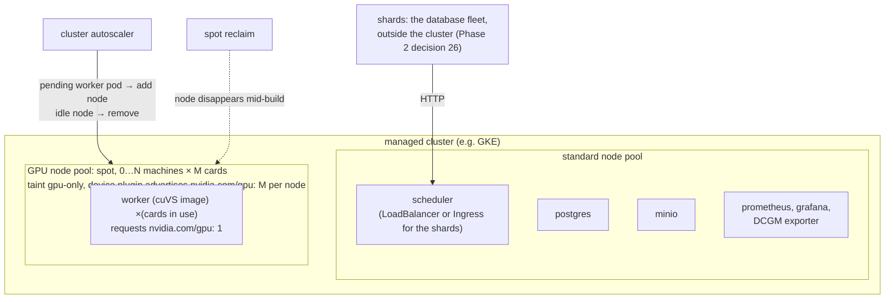
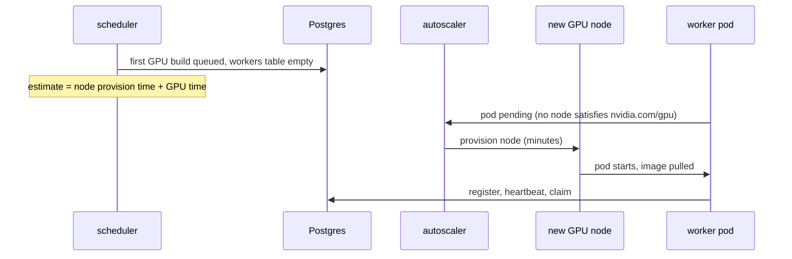
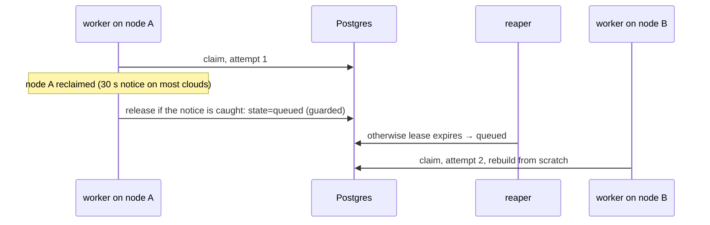

# Phase 5: GPUs and cuVS

## Status and scope

**Planned.** Add a real GPU build implementation, run it for a few hours on a small cloud GPU node pool, and rerun the comparison with a measured GPU cost model.

**Done when** the policy comparison includes real GPU numbers and a spot preemption has been observed and recovered from.

## System diagram

The same manifests as Phase 2, applied to a managed cluster with a GPU node pool that autoscales from zero. The worker image changes; nothing else does.

## Flows

### Cold start

With the pool at zero, the first GPU job waits for a node. That delay is part of the GPU finish estimate, so the cost-based policy sends more work to CPUs while the pool is cold.

### Spot preemption

Recovery goes through the lease path; Kubernetes replaces the pod when a node is available again. What is measured: work lost per preemption, and whether a shorter renew interval would reduce it.

## Design decisions

| # | Decision | Alternatives | Why |
| --- | --- | --- | --- |
| 1 | Separate GPU worker image on a RAPIDS/cuVS base; CPU image unchanged | One image with both | The GPU image is large and needs CUDA. Keeping the CPU image lets the kind cluster stay the everyday environment. |
| 2 | Build CAGRA with cuVS, convert to HNSW, save; verify it loads in hnswlib | Serve CAGRA directly | The query path stays CPU hnswlib, matching the industry pattern (build on GPU, search on CPU). |
| 3 | Memory constraint in placement uses measured peak GPU memory per size | The modeled `mem_bytes` from Phase 1 | Phase 1's model is a placeholder; this phase measures it. |
| 4 | Spot nodes, autoscaling from zero, billing alert first, tear down after each session | On-demand nodes kept up | Cost. Preemption is also a feature here: it is the failure this phase wants to observe. |
| 5 | Cold-start delay added to the GPU finish estimate | Ignore it | It is real, minutes long, and the cost-based policy should visibly prefer CPUs while the pool is cold. |

## What the published figures change here (2026-10-06)

- **GPU memory sizing is a hard constraint.** An L4 has 24 GB; the OpenSearch RFC built 5M x 1536 on a 24 GB A10G, and 10M at that width does not fit. The placement memory constraint added in this phase must use measured peak memory per size and dimension, and the node pool choice (L4 24 GB vs A100/H100 40 to 80 GB) decides which shards can be offloaded at all.
- **Cold start is comparable to the build.** A GPU build of 1 to 10M vectors is 17 s to 4 minutes (RFC); node provisioning is minutes. The cold-start term in the estimate is therefore of the same order as the work, which is why the cost-based policy should visibly prefer CPUs while the pool is cold.
- **A spot preemption costs up to a whole build**, minutes of GPU work, not the seconds the fake builds suggested. Record lost GPU-minutes per preemption; whether checkpointing partial graphs is worth it becomes a real question (noted below).
- **Transfer inside the cluster matters.** 6 to 61 GB per shard means the worker's network path to the object store is part of the GPU cost; place workers and MinIO in the same zone and measure the bandwidth the worker actually gets.
- **Expected GPU numbers to compare against:** 1M x 128 in 17 s and 10M x 128 in 227 s on an A10G; 50M in under 30 minutes on an H100.

## What the worker-count question changes here (2026-10-17)

Phase 2 decisions 22 to 24 put a fake card resource (`kgpu.io/gpu-card`) on two stand-in nodes, one card per worker. This phase is where it becomes real:

- **The only manifest change is the resource name.** The device plugin advertises `nvidia.com/gpu: M` on each GPU node; the worker's limit becomes `nvidia.com/gpu: 1`; the taint, selector, probes and grace period are the Phase 2 ones. A worker beyond the card total stays Pending with the same "Insufficient" message the kind check already asserts.
- **Workers per node is a measurement of this phase.** On a two-card machine, run one worker and then two, at 128 and at 1536 dimensions, and record per-build transfer time and build time. The ratio of two-worker to one-worker throughput is the per-node bandwidth term the Phase 3 cost model needs; the expectation is "almost 2x at 128 dims, well under 2x at 1536". The node pool choice is part of the experiment: one-card and two-card machines of the same card type (e.g. L4) cost about the same per card and differ only in this sharing.
- **Builds per card is a measurement too, and probably a win for small builds.** A build has phases: vectors stream in (the card's compute idle), the graph is built (compute saturated), the result copies out. Two builds sharing a card overlap one's transfer with the other's compute, and a small build (most of a Zipf distribution) cannot fill a modern card by itself, so two at once can approach twice the throughput. The losses: two large builds just interleave and the bigger one, the likely straggler, finishes later; and both graphs must fit in card memory at once, where overflow is a crash. Two ways to get there: the device plugin's time-slicing (each card advertised as N slots; blunt, because Kubernetes cannot see memory or build size) or in-process concurrency in the worker, which admits a second build only when the modeled memory of both fits and ideally only while the first is in a transfer phase. The worker knows every build's memory estimate, which is exactly what the device plugin lacks, so the second is the design to try; each build keeps its own lease and attempt, so the invariants hold. Measure one build per card against two with memory-aware admission, at 128 and 1536 dimensions, reporting throughput and the largest build's finish time, since round time is set by the straggler. The modeling assumption "a worker runs one build at a time" stays the default behind a config flag (owner's question, 2026-10-17).

## Open questions

- Is checkpointing a partially built CAGRA graph feasible, so a spot preemption loses minutes rather than a whole build? Only worth asking if measured preemption loss is large.

- Faiss with cuVS-backed CAGRA as the fallback build path if the direct cuVS API causes trouble.
- Which cloud. GKE is the roadmap's example because its GPU node pools and autoscaler are well documented.
