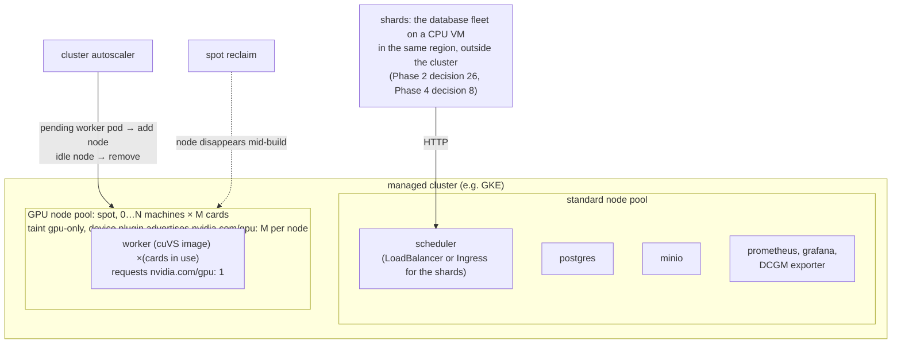
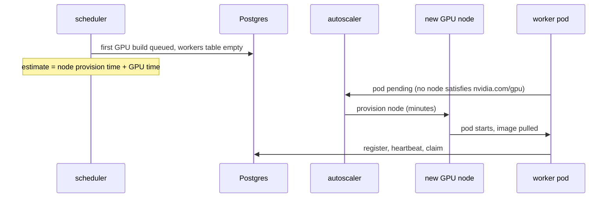
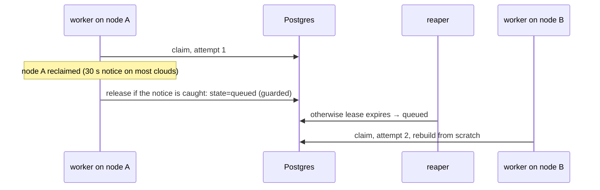

# Phase 5: GPUs and cuVS

## Status and scope

**In progress, GPU-free part first** (the GPU quota is pending; Phase 4 decision 27). Step 1, cost model v1, is done (decisions 6–8 below). Add a real GPU build implementation to the cloud topology Phase 4 leaves behind (a managed cluster with CPU workers, MinIO and the scheduler, plus the shard VM outside it — Phase 4 decisions 7 and 8), run it for a few hours on a GPU node pool added to that cluster, and rerun the comparison with a measured GPU cost model. Scheduler, Postgres, the shard VM and the shard simulator do not change; the worker gets a second builder image behind the same `build(job)` interface.

**Done when** the policy comparison includes real GPU numbers and a spot preemption has been observed and recovered from.

## System diagram

The same manifests as Phase 2, already applied to the managed cluster in Phase 4's closing step; this phase adds the GPU node pool, autoscaling from zero. The worker image changes; nothing else does.

## Flows

### Cold start

With the pool at zero, the first GPU job waits for a node. That delay is part of the GPU finish estimate, so the cost-based policy sends more work to CPUs while the pool is cold.

### Spot preemption

Recovery goes through the lease path; Kubernetes replaces the pod when a node is available again. What is measured: work lost per preemption, and whether a shorter renew interval would reduce it.

## Design decisions

| # | Decision | Alternatives | Why |
| --- | --- | --- | --- |
| 1 | Separate GPU worker image on a RAPIDS/cuVS base; CPU image unchanged | One image with both | The GPU image is large and needs CUDA. Keeping the CPU image lets the kind cluster stay the everyday environment. |
| 2 | Build CAGRA with cuVS, convert to HNSW, save; verify it loads in hnswlib | Serve CAGRA directly | The query path stays CPU hnswlib, matching the industry pattern (build on GPU, search on CPU). |
| 3 | Memory constraint in placement uses measured peak GPU memory per size | The modeled `mem_bytes` from Phase 1 | Phase 1's model is a placeholder; this phase measures it. |
| 4 | Spot nodes, autoscaling from zero, billing alert first, tear down after each session | On-demand nodes kept up | Cost. Preemption is also a feature here: it is the failure this phase wants to observe. |
| 5 | Cold-start delay added to the GPU finish estimate | Ignore it | It is real, minutes long, and the cost-based policy should visibly prefer CPUs while the pool is cold. |
| 6 | **Cost model v1: every term the Phase 4 calibration found is its own, with a constant the calibration measures** (owner's choice, "full refit"): build = A·n^P·ln(n)·(dim + D0); gate = Gate·GateQueries·ln(n)·(dim + D0); save = index bytes / SaveBandwidth; fetch = vector bytes / Bandwidth; upload = index bytes / BandwidthOut; the worker's path = (build + gate)/Speedup + GPUOverhead + save + fetch + upload; the shard's local path = build + gate + save, plus the fetch and the upload when the rig makes the shard use the store (`ShardUsesStore`: this topology does, a database fleet would not). P and D0 come from Phase 4 decision 35 (n^1.2, and a per-vector cost that does not scale with dim — 187 on the VM's x86 cores, 0 on the laptop's), the gate, save and separate upload bandwidth from decision 37. Speedup is no longer the ratio of two A's but the geometric mean, over the worker's calibration points, of the shard model's build time over the worker's measured one (2.12 on the cloud topology), since P and D0 differ between the two fits. The simulator's two buckets stay: `GPUBuild` is what the worker computes (build, gate, overhead, save — the save is disk, counted here so the other bucket stays "the link"), `Transfer` is what crosses the link (fetch + upload) and may share a node's link (Phase 3 decision 24). | Keep n·ln(n) and patch only D0 and the upload rate; defer until GPU timings exist | On the cloud data v1 fits both datasets together with sigma 0.08 at 2 threads against v0's 0.49: every estimate within ±20 % instead of a factor of 1.6. The live rounds replay within 4.4 s (over) instead of 10 s (under). |
| 7 | **`Default()` stays v0 to the digit; `Calibrated()` is the measured block.** v1's formulas with P = 1, D0 = 0, no gate, no save and one bandwidth are v0's, so every Phase 1–3 test, sweep and saved log keeps its numbers; the measured block is a second constructor (`costmodel.Calibrated()`, `Model.calibrated()`), chosen by `COST_MODEL=calibrated` on the scheduler and the worker, `-cost calibrated` on the sweep and the comparer, with the `COST_*` / flag overrides applied on top. The block's bandwidths: the fetch is the worker node's median (1.57e8), the upload the cloud store's measured upload rate (5.0e7, the data step), the save the laptop's extended calibration point (6.6e8) until that point runs in the cloud. | Replace the defaults with the measured numbers (rewrites a hundred pinned tests and every saved log for no new information) | The placeholder and the measurement are both legitimate models; naming which one a run used (the sweep's `cost_model` column) is worth more than pretending there was only ever one. |
| 8 | **The calibration point times the worker's whole path** (`calibrate-point --upload-prefix`, on by default in the grid): after the build and the gate it saves the index to disk and hashes it (the save term) and uploads it to the store under `calibration/scratch/<host>/`, deleting it afterwards (the upload term); it records the gate's query count. The CSV gains `gate_queries, save_s, upload_s, upload_bytes`; a v0 CSV still reads, its v1 columns absent. `fit --v1` fits A, P and D0 in log space with a one-dimensional search on D0, the gate per query, the three bandwidths, and emits the v1 `COST_*` block; `--worker-csv` takes the worker side's CSVs when it is another machine, as on the cloud topology. | Fold save and upload into the overhead (Phase 4 decision 37 showed it cannot scale) | The term the model lacked was exactly the part of the path the point did not time. |
| 9 | **The GPU pool is a second overlay on the Phase 4 one, and two spot L4 pools autoscaling from zero** (`deploy/k8s-gcp-gpu/`, `GPU_POOLS=1 scripts/gcp-up.sh`): `gpu-l4x1` (g2-standard-8, one card) and `gpu-l4x2` (g2-standard-24, two cards) for the workers-per-node measurement, both spot, 0..N nodes so nothing bills between sessions, GKE installing the driver and advertising `nvidia.com/gpu`. The overlay keeps everything of `deploy/k8s-gcp` and changes the worker only: the cuVS image (`kgpu-worker-gpu:p5`), `nvidia.com/gpu: 1` in place of the CPU pool's selector (the card is what places the pod; GKE's accelerator label selects the pool family and its `nvidia.com/gpu=present` taint is tolerated), `BUILDER=cagra`, a real card's memory, more memory for CUDA; and it adds NVIDIA's DCGM exporter as a DaemonSet on the GPU nodes for the Phase 2 dashboard. The cluster's cost configuration becomes `COST_MODEL=calibrated` (v1's block) in both overlays. Written, rendered (`kubectl kustomize`) and cross-checked before the quota exists; applied once it does. | A separate GPU cluster; on-demand GPU nodes kept up; GKE's managed DCGM metrics (billed per sample) | Phase 4 decision 25's promise: Phase 5 adds the GPU pool to the same cluster and nothing else changes. Autoscaling from zero is also the cold start the phase wants to measure (decision 5). |
| 10 | **The cuVS builder converts with `hierarchy="cpu"` and proves the file loads in stock hnswlib before publishing** (amends decision 2 with the detail the docs demand): `cagra.build` on the card, then `hnsw.from_cagra(hnsw.IndexParams(hierarchy="cpu", M=16, ef_construction=200), index)` and `hnsw.save`. The docs say a conversion with the default hierarchy writes a base-layer-only file "not compatible with the original hnswlib", searchable only through cuVS's own wrapper; the `cpu` hierarchy builds the upper layers on the CPU and its file "is compatible with the original hnswlib library". Since the query path is stock hnswlib (decision 2), the builder loads the saved file with hnswlib before the gate — the gate itself then runs through hnswlib, so a file the query path could not read fails the build with a reason, never reaches the store as a manifest. The GPU image is `rapidsai/base:26.10-cuda12-py3.12` (RAPIDS 26.10, CUDA 12, the cuVS wheel included) with the builder and the worker installed on top (`worker/Dockerfile.gpu`); the CPU image is unchanged (decision 1). The builder is selected per job by `--builder cagra` on the CLI and `BUILDER=cagra` on the worker, the same child-process path as hnswlib (Phase 4 decision 18); without cuVS importable the CLI refuses in one line (exit 1), which is what every laptop and kind run sees, and the tests skip. | Serve the base-layer file through cuVS's wrapper (a second query path); Faiss's cuVS-backed CAGRA (the roadmap's fallback, kept) | The file format is the contract between the GPU side and the CPU side; checking it on the worker, with the library that will read it, is cheaper than any later surprise. |
| 11 | **The cold start is a configured provisioning time that an empty pool reports as its queue wait** (decision 5 made concrete; GPU-free step 3): `COLD_START` on the scheduler (a duration, default 0) and `ColdStartS` in the simulator and the sweep (`-cold_start_s`, a sweep axis, echoed as a column). With no live worker, the queue-wait estimate every policy sees at submit and at every reconsider tick is the provisioning time still to come instead of Phase 3's 0 (that rule — "no workers yet must not scare a policy off the queue" — assumed a pool that is only transiently empty; a pool that autoscales from zero is empty by design until asked). The simulator models the pool itself: its workers are not alive until `ColdStartS` after the first GPU build is queued, so a cold round pays the provisioning time once. The reactive policy then keeps a build local while the pool is cold whenever local time beats cold start + GPU path, which is decision 5's intent and the by-hand test's check (10 s: offloaded; 30 s: kept local). What the constant is — node provisioning plus the image pull, minutes — is the first measurement of the GPU session; until then it is 0 everywhere, so nothing changes. The worker Deployment's replicas, not only the autoscaler, make the pool cold between sessions: the GPU overlay is applied with the workers scaled to zero and scaled up at a session's start. | A separate "pool cold" flag on the policies' input (the policies are pure functions of the wait they see; a longer wait is the honest signal); a scheduler-driven scaler (Phase 6's Kueue/KEDA territory) | A term the estimate can carry today, measured when the GPUs come, with the Phase 3 rule kept as the default. |

## Step 1 (GPU-free): cost model v1

| Path | What |
| --- | --- |
| `scheduler/costmodel/costmodel.go` | The model: the terms above, `Default()` (v0) and `Calibrated()`; `LocalTotal` for the shard's whole local path; the two buckets `GPUBuild` and `Transfer`. |
| `worker/kgpu_worker/costmodel.py` | The mirror, `Model.calibrated()`, `COST_MODEL` and the v1 `COST_*` names in `from_env`. |
| `scheduler/cmd/scheduler/main.go` | `COST_MODEL` and the v1 variables into the scheduler's model. |
| `experiments/sim/sim.go`, `scheduler/api/api.go`, `scheduler/reconsider/reconsider.go` | The local path is `LocalTotal` now (the fake shard's sleep, the policies' local estimate, the reconsider timer's). |
| `experiments/cmd/sweep/main.go`, `experiments/cmd/validate/main.go` | `-cost default|calibrated` and the v1 term flags; the sweep's CSV echoes them (`cost_model`, `cost_p`, `cost_d0`, `gate`, `gate_queries`, `save_bandwidth`, `bandwidth_out`, `shard_uses_store`). |
| `builder/kgpu_builder/calibrate.py`, `cli.py` | The extended point (decision 8), `fit_points_v1`, `speedup_v1`, `env_overrides_v1`, `fit --v1 --worker-csv --gate-queries`. |
| `experiments/results/calibration/laptop-v1-sift-128-6.csv` | The laptop's extended points (save 660–740 MB/s, upload 150–215 MB/s to the local store). |
| `experiments/results/calibrated/`, `calibrated-v0/` | The Phase 3 comparison on v1's block (speedup.md evidence 9) and, kept beside it, Phase 4's rerun on v0 with calibrated constants. |

**Results.** The cloud CSVs refitted (`fit --v1`, the shard VM's two datasets against the worker node's): build = 2.30e-9 · n^1.220 · ln(n) · (dim + 187) at 2 threads with sigma 0.079 over both datasets (v0: 0.49), the worker node at 8 threads 1.53e-9 · n^1.198 · ln(n) · (dim + 142) with sigma 0.091; speedup 2.126 with a spread of 0.113 across the grid; gate 1.79e-8 s per query·ln(n)·(dim + D0). The laptop's v1 fit of its own data gives D0 = 0 (Phase 4 decision 35's point: the dimension term is the machine's). The live rounds replayed on the block: 45.9 and 46.4 s against 41.5 live (v0 with calibrated constants: 31.5), every local shard within 0.1–2 s, the straggler 4.4 s over — the over-prediction is the worker's upload at the data step's 50 MB/s, to be measured by the extended point on the next cloud session. The comparison rerun on the block (evidence 9) says what Phase 4's did: with CPU workers no policy moves a round at the median, now with the shard's store round trip making every path longer (bimodal 78 s, hour_build 2716, production 24201 at v1's steeper n^1.22).

### Cross-check of step 1, cost model v1

A fresh agent wrote 15 Go checks (`scheduler/crosscheck/p5s1_costmodel_test.go`), 12 builder checks (`builder/tests/test_xcheck_costmodel_v1.py`) and 8 worker checks (`worker/tests/test_xcheck_costmodel_v1.py`) from decisions 6–8 and the formulas alone: every term by hand, Go against Python on 55 points × 12 terms, `Default()` against a build of the previous commit at every point, the sweep against the committed demo cell by cell, the comparer on the step 4 timelines, the scheduler binary with every `COST_MODEL` spelling, `fit --v1` on the cloud CSVs and on exact synthetic data, the extended point against a throwaway store. Logs `test-logs/phase5/step1-crosscheck.log` (Go). 28 passed first time; 7 failed, two of them real bugs of the step. Triage:

| Finding | Kind | Resolution |
| --- | --- | --- |
| A: `Default()` was not v0 to the digit — `Transfer` truncated fetch and upload to nanoseconds separately where v0 truncated once, a 1–2 ns drift that moved 12 queue-wait cells of the committed demo. Found by building the previous commit beside the working tree. | Bug (against decision 7's promise) | With one bandwidth `Transfer` is computed in v0's single expression; the demo regenerates byte for byte (its new columns aside). |
| B: the comparer lacked seven of the eleven v1 term flags, so a live round run with any v1 override could not be replayed. | Bug | Added, with the same keep-sentinels as the sweep. |
| C: the sweep accepted `-speedup 0`, negative speedups, `NaN` and `Inf` (NaN passes every `< 0` check). | Bug (validation) | Refused; the message names the keep value per flag (0 for P). |
| D: the scheduler accepted `Calibrated`, `CALIBRATED`, `v1`, `v0` for `COST_MODEL`, and `COST_SPEEDUP=0`, `COST_BANDWIDTH=-1`, `COST_P=NaN`; which model ran was unobservable. | Bug | Exactly `default` and `calibrated`; `Model.Validate()` refuses non-positive or non-finite constants at startup (exit 2); the startup line carries `cost_model`. |
| E: the worker silently took v0 for any unknown `COST_MODEL`, so one env block could mean two models. | Spec gap with a hazard | The worker parses the two spellings and the boolean exactly as the scheduler does (Go's `ParseBool` set), validates the v1 fields, and logs `cost_model` at startup. |
| G1: which terms are zero below two vectors. | Pinned | The build and the gate (they are per-graph); fetch, save, upload and the overhead are charged — a one-vector build still moves bytes and starts a process. |
| G2: rounding — per term or per composite. | Pinned | Each Go term is a whole-nanosecond `Duration`; composites may differ from a float sum by a few ns; Python keeps floats; the Go–Python agreement is "within nanosecond rounding". |
| G3, G10: `fit --v1` assumes 500 gate queries on a v0 CSV, and `--gate-queries` defaults to 10000. | Pinned | Documented in the fit's docstring and `--help`: v0 points ran `run_point`'s default of 500; the block's query count is the split's query file (10000 sift-128, 1000 gist). |
| G4: `COST_GPU_OVERHEAD=1.5` is not fitted. | Pinned | Decision 8: the constant the terms do not cover (process start, the manifest), set from the live rounds (decision 37); the GPU calibration refits it. |
| G5: what `KGPU_ESTIMATE_SIGMA` means in v1. | Pinned | The largest of the shard fit's sigma, the worker fit's and the speedup's spread across the grid (0.113 on the cloud): the worst multiplicative error any estimate the scheduler makes carries, which is what the simulator's log-normal factor models. |
| G6, G7: a single-size fit printed P 1.000, D0 0 as if fitted; two unlabelled "threads 8" lines with `--worker-csv`. | Spec gap | A note names the unidentifiable shape; the side is labelled at the end of the line (the line's shape is parsed and kept). |
| G8, G9, G11, G13: the worker's upload and save rates win when both sides carry them; the block omits terms no point measured; an untimed upload records 0; `MemFactor` stays 2. | Pinned | Documented in decisions 7 and 8. |
| G12: the boolean's accepted spellings differed between the sides. | Fixed with E | Both accept Go's `ParseBool` set. |

## What the published figures change here

- **GPU memory sizing is a hard constraint.** An L4 has 24 GB; the OpenSearch RFC built 5M x 1536 on a 24 GB A10G, and 10M at that width does not fit. The placement memory constraint added in this phase must use measured peak memory per size and dimension, and the node pool choice (L4 24 GB vs A100/H100 40 to 80 GB) decides which shards can be offloaded at all.
- **Cold start is comparable to the build.** A GPU build of 1 to 10M vectors is 17 s to 4 minutes (RFC); node provisioning is minutes. The cold-start term in the estimate is therefore of the same order as the work, which is why the cost-based policy should visibly prefer CPUs while the pool is cold.
- **A spot preemption costs up to a whole build**, minutes of GPU work, not the seconds the fake builds suggested. Record lost GPU-minutes per preemption; whether checkpointing partial graphs is worth it becomes a real question (noted below).
- **Transfer inside the cluster matters.** 6 to 61 GB per shard means the worker's network path to the object store is part of the GPU cost; place workers and MinIO in the same zone and measure the bandwidth the worker actually gets.
- **Expected GPU numbers to compare against:** 1M x 128 in 17 s and 10M x 128 in 227 s on an A10G; 50M in under 30 minutes on an H100.

## What the worker-count question changes here

Phase 2 decisions 22 to 24 put a fake card resource (`kgpu.io/gpu-card`) on two stand-in nodes, one card per worker. This phase is where it becomes real:

- **The only manifest change is the resource name.** The device plugin advertises `nvidia.com/gpu: M` on each GPU node; the worker's limit becomes `nvidia.com/gpu: 1`; the taint, selector, probes and grace period are the Phase 2 ones. A worker beyond the card total stays Pending with the same "Insufficient" message the kind check already asserts.
- **Workers per node is a measurement of this phase.** On a two-card machine, run one worker and then two, at 128 and at 1536 dimensions, and record per-build transfer time and build time. The ratio of two-worker to one-worker throughput is the per-node bandwidth term the Phase 3 cost model needs; the expectation is "almost 2x at 128 dims, well under 2x at 1536". The node pool choice is part of the experiment: one-card and two-card machines of the same card type (e.g. L4) cost about the same per card and differ only in this sharing.
- **Builds per card is a measurement too, and probably a win for small builds.** A build has phases: vectors stream in (the card's compute idle), the graph is built (compute saturated), the result copies out. Two builds sharing a card overlap one's transfer with the other's compute, and a small build (most of a Zipf distribution) cannot fill a modern card by itself, so two at once can approach twice the throughput. The losses: two large builds just interleave and the bigger one, the likely straggler, finishes later; and both graphs must fit in card memory at once, where overflow is a crash. Two ways to get there: the device plugin's time-slicing (each card advertised as N slots; blunt, because Kubernetes cannot see memory or build size) or in-process concurrency in the worker, which admits a second build only when the modeled memory of both fits and ideally only while the first is in a transfer phase. The worker knows every build's memory estimate, which is exactly what the device plugin lacks, so the second is the design to try; each build keeps its own lease and attempt, so the invariants hold. Measure one build per card against two with memory-aware admission, at 128 and 1536 dimensions, reporting throughput and the largest build's finish time, since round time is set by the straggler. The modeling assumption "a worker runs one build at a time" stays the default behind a config flag (owner's question).

## Open questions

- Is checkpointing a partially built CAGRA graph feasible, so a spot preemption loses minutes rather than a whole build? Only worth asking if measured preemption loss is large.

- Faiss with cuVS-backed CAGRA as the fallback build path if the direct cuVS API causes trouble.
- Which cloud. GKE is the roadmap's example because its GPU node pools and autoscaler are well documented.
